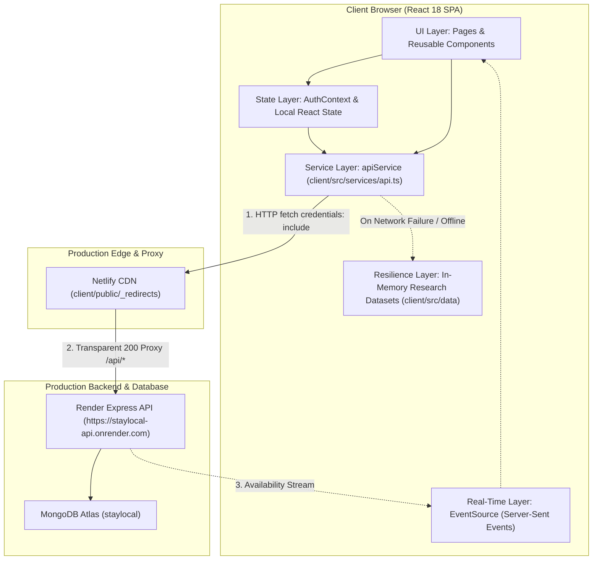
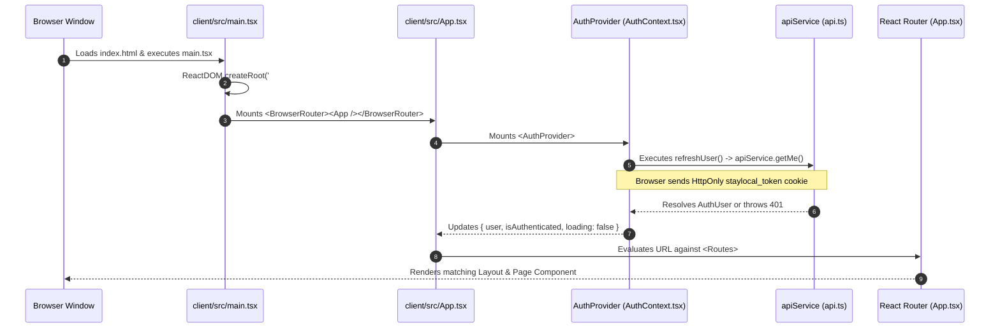

# StayLocal Frontend — Architecture & Codebase Overview

> **Target Audience:** Frontend Engineers, React Learners, and Technical Interview Candidates  
> **Repository Scope:** `client/` (React 18 + Vite + TypeScript + Tailwind CSS)  
> **Role:** Educational Reference & System Blueprint

---

## 1. Executive Summary & Purpose

**StayLocal** is a community-led Himalayan travel and homestay platform designed for the state of Uttarakhand (featuring regions like Munsiyari, Bhimtal, Bageshwar, Pithoragarh, and the Johar Valley).

The frontend application provides three core user experiences:
1. **Tourist Portal:** Explore verified homestays, check real-time bed availability, book time-based stays, discover local artisan treasures, and book local guides.
2. **Host Portal:** Manage homestay listings, review incoming guest requests, lock bed capacity upon confirmation, release dates on rejection, and upload ownership documents for administrative verification.
3. **Platform Administrator Portal:** Review host verification documentation, assign/reassign/unassign preloaded homestays to eligible registered hosts, and inspect complete audit trails.

---

## 2. Technology Stack & Architectural Decision Records (ADRs)

| Technology | Version | Purpose in StayLocal | Why Chosen / Architectural Rationale |
| :--- | :--- | :--- | :--- |
| **React** | `^18.3.1` | UI Library | Component-driven declarative UI, virtual DOM diffing, modern Hooks ecosystem (`useMemo`, `useCallback`, `useContext`). |
| **TypeScript** | `^5.6.3` | Language & Type Safety | End-to-end type safety, domain data modeling ([types/index.ts](file:///c:/Users/HP/Downloads/Major%20Project/client/src/types/index.ts)), compile-time contract enforcement. |
| **Vite** | `^5.4.11` | Build Tool & Dev Server | Ultra-fast Hot Module Replacement (HMR) powered by native ES modules; optimized Rollup production builds. |
| **React Router** | `^6.28.0` | Client-Side Routing | Declarative nested routing, dynamic URL parameters, query string parsing, layout wrapping with `<Outlet />`. |
| **Tailwind CSS** | `^3.4.16` | Utility-First Styling | Bespoke Himalayan color palette (`forest`, `clay`, `mountain`, `sand`), responsive breakpoints, zero runtime CSS overhead. |
| **Lucide React** | `^0.468.0` | Iconography | High-performance tree-shakeable SVG icons representing nature, trekking, security, and accommodation concepts. |
| **Vitest & RTL** | `^2.1.8` / `^14.3.1` | Testing Suite | Lightning-fast test runner using the same Vite transform pipeline, testing user behavior via `@testing-library/react`. |

> [!NOTE]
> **Installed vs. Invoked Dependencies:**  
> `client/package.json` includes `@hookform/resolvers`, `react-hook-form`, `zod`, `clsx`, and `tailwind-merge`. In the current codebase, form inputs are managed using React's native controlled component pattern (`useState`, `onChange`, `onSubmit`), and styling utilizes standard template literals (`${base} ${variantStyles[variant]}`). These libraries remain available in the bundle for future extensions.

---

## 3. High-Level System Architecture Diagram



---

## 4. Directory & Folder Layout

The `client` source code is strictly structured into modular, single-responsibility directories:

```
client/
├── public/
│   ├── _redirects               # Netlify proxy rules: /api/* -> Render backend (200 pass)
│   └── favicon.svg              # Brand icon
├── src/
│   ├── assets/                  # Static assets and images
│   ├── components/              # Modular UI components
│   │   ├── admin/               # Admin guide and treasure governance controls
│   │   ├── auth/                # ProtectedRoute wrapper and role guards
│   │   ├── booking/             # BookingModal, GuideBookingModal, Artisan modals
│   │   ├── common/              # Global Header, Footer, navigation
│   │   ├── destinations/        # DestinationCard, DestinationFilterBar
│   │   ├── experiences/         # ExperienceCard, ExperienceFilterBar
│   │   ├── host/                # ListingFormModal, HostVerificationModal
│   │   ├── stays/               # StayCard, StayFilterBar
│   │   └── ui/                  # Design system primitives: Button, Card, Badge, Input, Select
│   ├── context/
│   │   └── AuthContext.tsx      # Global JWT authentication and user session provider
│   ├── data/                    # Static research datasets (graceful offline fallback)
│   │   ├── accommodations.ts    # 6 Uttarakhand research homestays
│   │   ├── destinations.ts      # 4 curated Himalayan destinations
│   │   ├── experiences.ts       # Cultural and trekking activities
│   │   └── local-treasures.ts   # Indigenous crafts, handlooms, and foods
│   ├── hooks/
│   │   └── useAuth.ts           # Convenience hook to access AuthContext
│   ├── layouts/
│   │   └── RootLayout.tsx       # Persistent shell with Header, Outlet, Footer, Explainer Modal
│   ├── pages/                   # 18 Routed view containers
│   │   ├── HomePage.tsx         # Hero search, curated stays, destination highlights
│   │   ├── DestinationsPage.tsx # Regional destination directory
│   │   ├── DestinationDetailPage.tsx # Deep-dive into single region & altitude
│   │   ├── StaysPage.tsx        # Homestay discovery with multi-parameter filter
│   │   ├── StayDetailPage.tsx   # Property details, gallery, live bed availability & SSE
│   │   ├── ExperiencesPage.tsx  # Cultural trails & workshops
│   │   ├── ExperienceDetailPage.tsx # Experience timeline & booking
│   │   ├── AboutPage.tsx        # Project vision, verification standards, team
│   │   ├── LoginPage.tsx        # Credential submission with redirect handling
│   │   ├── RegisterPage.tsx     # Role-based onboarding (tourist, host, guide)
│   │   ├── ProfilePage.tsx      # Account information, role badges, security
│   │   ├── MyBookingsPage.tsx   # Tourist dashboard (stays & guided tours)
│   │   ├── HostBookingsPage.tsx # Host reservations manager (confirm / reject)
│   │   ├── HostListingsPage.tsx # Host property manager (create / edit / verify)
│   │   ├── GuideDashboardPage.tsx # Local guide profile and excursion management
│   │   ├── AdminVerificationPage.tsx # Admin verification review queue
│   │   ├── AdminHostAssignmentsPage.tsx # Admin property assignment & reassignment
│   │   └── NotFoundPage.tsx     # Custom 404 page with navigation reset
│   ├── services/
│   │   └── api.ts               # Centralized HTTP & SSE service layer (1,342 lines)
│   ├── test/                    # Comprehensive Vitest & RTL test suites (29 tests)
│   ├── types/
│   │   └── index.ts             # Domain models, enums, API request/response types
│   ├── App.tsx                  # Application routing table & provider composition
│   ├── index.css                # Tailwind directives, custom fonts & atmospheric backgrounds
│   └── main.tsx                 # React 18 DOM mount (`createRoot`) & BrowserRouter
├── tailwind.config.js           # Theme configuration, Himalayan colors, fonts
├── tsconfig.json                # Strict TypeScript configuration
└── vite.config.ts               # Vite bundler plugins, dev server, and Vitest setup
```

---

## 5. Application Entry & Initialization Flow

When a user visits StayLocal in their browser, execution proceeds in five sequential phases:



1. **DOM Container Initialization:** [main.tsx](file:///c:/Users/HP/Downloads/Major%20Project/client/src/main.tsx) retrieves the `#root` element from `index.html` and creates a React 18 concurrent root via `ReactDOM.createRoot()`.
2. **Strict Mode & Router Context:** The tree is wrapped in `<React.StrictMode>` for highlighting lifecycle bugs, and `<BrowserRouter>` to synchronize URL history.
3. **Session Rehydration:** `<AuthProvider>` mounts inside [App.tsx](file:///c:/Users/HP/Downloads/Major%20Project/client/src/App.tsx). On mount, an automatic `refreshUser()` call queries `GET /api/auth/me` with `credentials: 'include'`. If the user has a valid HttpOnly cookie (`staylocal_token`), their session is re-established seamlessly without manual login.
4. **Layout & Routing:** `<RootLayout>` renders the persistent atmospheric background, `<Header>`, and `<Footer>`. The active child page is mounted inside `<Outlet />`.
5. **Role-Based Guards:** If a requested route is protected (e.g., `/admin/assignments`), `<ProtectedRoute>` checks `user.role`. If unauthenticated, it redirects to `/login` preserving the target path; if unauthorized, it displays a polite access-restricted notice.

---

## 6. Complete Pages & Routes Inventory

| URL Path | Component | Allowed Roles | Description |
| :--- | :--- | :--- | :--- |
| `/` | `HomePage` | Public | Hero search, featured homestays, cultural discovery trails. |
| `/destinations` | `DestinationsPage` | Public | Regional directory with altitude and climate metadata. |
| `/destinations/:id` | `DestinationDetailPage` | Public | Single destination view with artisan crafts and local guides. |
| `/stays` | `StaysPage` | Public | Filterable homestay catalog with verified/unverified lead badges. |
| `/stays/:id` | `StayDetailPage` | Public | Full property profile, photo gallery, live bed availability widget, SSE stream. |
| `/experiences` | `ExperiencesPage` | Public | Community craft workshops, heritage walks, high-altitude treks. |
| `/experiences/:id` | `ExperienceDetailPage` | Public | Detailed itinerary, packing tips, and booking trigger. |
| `/about` | `AboutPage` | Public | Mission statement, verification methodology, and research origin. |
| `/login` | `LoginPage` | Public | Email and password authentication form. |
| `/register` | `RegisterPage` | Public | Multi-role registration (Tourist, Host, Guide). |
| `/profile` | `ProfilePage` | Any Authenticated | User account details, role badge, quick navigation. |
| `/bookings` | `MyBookingsPage` | `tourist`, `admin` | Traveler dashboard for homestay and guide reservations. |
| `/host/bookings` | `HostBookingsPage` | `host`, `admin` | Host dashboard to confirm or decline guest booking requests. |
| `/host/listings` | `HostListingsPage` | `host`, `admin` | Host listings manager, listing creation modal, document verification upload. |
| `/guide/dashboard` | `GuideDashboardPage` | `guide`, `admin` | Local guide portal for profile verification and tour management. |
| `/admin/verification` | `AdminVerificationPage` | `admin` | Platform verification dashboard to approve/reject host documents. |
| `/admin/assignments` | `AdminHostAssignmentsPage` | `admin` | Homestay host assignment, reassignment, and unassignment portal. |
| `*` | `NotFoundPage` | Public | Custom 404 page with navigation fallback. |

---

## 7. Key Frontend Design Patterns Used

1. **Container / Presentational Pattern:** Complex pages (e.g., `StaysPage`) handle data loading, error states, and URL parameters, passing clean props down to presentational components (`StayCard`, `StayFilterBar`).
2. **Controlled Component Pattern:** Inputs in modals and forms maintain single-source-of-truth state in React, synchronizing DOM input values with state variables.
3. **Compound Layout Pattern:** `RootLayout` defines a universal page frame with header, footer, and shared modals, projecting dynamic page children through React Router's `<Outlet />`.
4. **Guard Pattern (Higher-Order Component Equivalent):** `<ProtectedRoute>` encapsulates authentication checks and role-based permissions, conditionally rendering child views, redirecting to `/login`, or displaying access-denied warnings.
5. **Dictionary / Lookup-Table Styling:** UI primitives like `Button` and `Badge` avoid fragile if-else ladders by indexing into structured class maps (`variantStyles[variant]`).
6. **Graceful Degradation / Offline Fallback:** If the backend API is temporarily offline, `apiService` seamlessly falls back to static research datasets, ensuring the app remains browsable.
7. **Real-Time Reactive Updates (Server-Sent Events):** `StayDetailPage` subscribes to an SSE stream, automatically triggering fresh availability checks when concurrent bookings occur.
