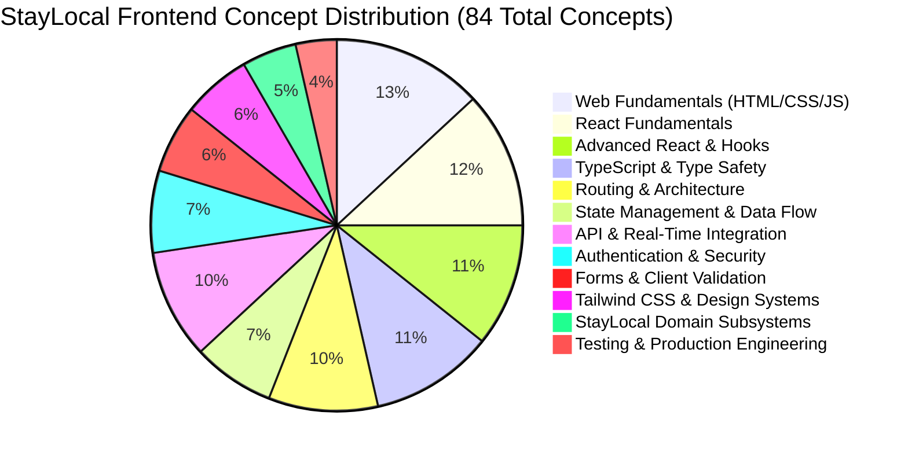
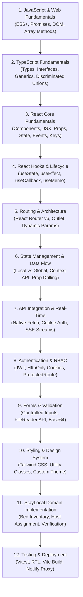

# StayLocal Frontend — Complete Learning Roadmap & Priority System

> **Document Purpose:** Complete syllabus, dependency-based sequence, priority levels, estimated study hours, and mastery checklist for learning the StayLocal frontend.

---

## 1. Concept Inventory & Classification Summary

Across the 12 core knowledge domains analyzed in the StayLocal codebase, **84 distinct engineering concepts** have been extracted and mapped directly to actual project implementations.



---

## 2. Priority Classification Framework

Every concept in this curriculum is grouped into one of three mastery levels:

- **Level 1 — Essential (42 Concepts):** Core principles required to build, explain, fix, and navigate the StayLocal application. Must master these first to discuss the project in an interview.
- **Level 2 — Intermediate (27 Concepts):** Architectural patterns, state synchronization, custom hooks, route guards, and type-safe data modeling needed to deeply comprehend how the subsystems interlock.
- **Level 3 — Advanced (15 Concepts):** Performance optimization, memoization boundaries, ACID-safe UI synchronization, real-time SSE streams, offline fallback degradation, and production deployment configuration.

---

## 3. Dependency-Based Learning Order



---

## 4. Master Syllabus: Detailed Topic Breakdown

| Phase & Module | Concept Name | Priority Level | Estimated Time | Implementation File Reference |
| :--- | :--- | :---: | :---: | :--- |
| **01. JavaScript Fundamentals** | ES6 Modules (`import`/`export`) | Level 1 | 1.0 hr | [main.tsx](file:///c:/Users/HP/Downloads/Major%20Project/client/src/main.tsx) |
| | Arrow Functions & Lexical Scope | Level 1 | 1.0 hr | [Header.tsx](file:///c:/Users/HP/Downloads/Major%20Project/client/src/components/common/Header.tsx) |
| | Object & Array Destructuring | Level 1 | 1.0 hr | [StayCard.tsx](file:///c:/Users/HP/Downloads/Major%20Project/client/src/components/stays/StayCard.tsx) |
| | Rest & Spread Operators | Level 1 | 1.5 hr | [Button.tsx](file:///c:/Users/HP/Downloads/Major%20Project/client/src/components/ui/Button.tsx), [ListingFormModal.tsx](file:///c:/Users/HP/Downloads/Major%20Project/client/src/components/host/ListingFormModal.tsx) |
| | Template Literals & String Interpolation | Level 1 | 0.5 hr | [Button.tsx](file:///c:/Users/HP/Downloads/Major%20Project/client/src/components/ui/Button.tsx) |
| | Optional Chaining (`?.`) & Nullish Coalescing (`??`) | Level 1 | 1.0 hr | [api.ts](file:///c:/Users/HP/Downloads/Major%20Project/client/src/services/api.ts#L84) |
| | Modern Array Methods (`map`, `filter`, `find`, `some`) | Level 1 | 2.0 hr | [StaysPage.tsx](file:///c:/Users/HP/Downloads/Major%20Project/client/src/pages/StaysPage.tsx#L61) |
| | Promises & `async` / `await` | Level 1 | 2.5 hr | [api.ts](file:///c:/Users/HP/Downloads/Major%20Project/client/src/services/api.ts#L104) |
| | `Promise.all` Concurrent Fetching | Level 2 | 1.5 hr | [HomePage.tsx](file:///c:/Users/HP/Downloads/Major%20Project/client/src/pages/HomePage.tsx#L36), [MyBookingsPage.tsx](file:///c:/Users/HP/Downloads/Major%20Project/client/src/pages/MyBookingsPage.tsx#L37) |
| | `FileReader` Web API & Base64 | Level 2 | 2.0 hr | [HostVerificationModal.tsx](file:///c:/Users/HP/Downloads/Major%20Project/client/src/components/host/HostVerificationModal.tsx#L134) |
| | `URLSearchParams` Web API | Level 2 | 1.5 hr | [HomePage.tsx](file:///c:/Users/HP/Downloads/Major%20Project/client/src/pages/HomePage.tsx#L56), [api.ts](file:///c:/Users/HP/Downloads/Major%20Project/client/src/services/api.ts#L132) |
| **02. TypeScript** | Basic Types & Annotations | Level 1 | 1.5 hr | [types/index.ts](file:///c:/Users/HP/Downloads/Major%20Project/client/src/types/index.ts) |
| | Interfaces vs. Type Aliases | Level 1 | 2.0 hr | [types/index.ts](file:///c:/Users/HP/Downloads/Major%20Project/client/src/types/index.ts#L6-L37) |
| | Component Props Typing (`React.FC<Props>`) | Level 1 | 1.5 hr | [Card.tsx](file:///c:/Users/HP/Downloads/Major%20Project/client/src/components/ui/Card.tsx#L9) |
| | Extending Native HTML Attributes | Level 2 | 2.0 hr | [Button.tsx](file:///c:/Users/HP/Downloads/Major%20Project/client/src/components/ui/Button.tsx#L3) |
| | Generics in Hooks & Functions | Level 2 | 2.5 hr | [DestinationDetailPage.tsx](file:///c:/Users/HP/Downloads/Major%20Project/client/src/pages/DestinationDetailPage.tsx#L21) |
| | Union Types & String Literals | Level 1 | 1.5 hr | [types/index.ts](file:///c:/Users/HP/Downloads/Major%20Project/client/src/types/index.ts#L6-L20) |
| | Optional Properties (`property?: type`) | Level 1 | 1.0 hr | [types/index.ts](file:///c:/Users/HP/Downloads/Major%20Project/client/src/types/index.ts#L32) |
| | Type Narrowing (`typeof`, `instanceof Error`) | Level 2 | 1.5 hr | [api.ts](file:///c:/Users/HP/Downloads/Major%20Project/client/src/services/api.ts#L64) |
| | API Response Contract Typing | Level 2 | 2.0 hr | [types/index.ts](file:///c:/Users/HP/Downloads/Major%20Project/client/src/types/index.ts#L180-L240) |
| **03. React Fundamentals** | Function Components & Component Trees | Level 1 | 1.5 hr | [App.tsx](file:///c:/Users/HP/Downloads/Major%20Project/client/src/App.tsx#L25) |
| | JSX / TSX Syntax & Rules | Level 1 | 1.5 hr | [DestinationCard.tsx](file:///c:/Users/HP/Downloads/Major%20Project/client/src/components/destinations/DestinationCard.tsx) |
| | Props & Uni-directional Data Flow | Level 1 | 1.5 hr | [StayCard.tsx](file:///c:/Users/HP/Downloads/Major%20Project/client/src/components/stays/StayCard.tsx#L22) |
| | Component Composition & `children` | Level 1 | 2.0 hr | [Card.tsx](file:///c:/Users/HP/Downloads/Major%20Project/client/src/components/ui/Card.tsx#L9) |
| | State & Immutability (`useState`) | Level 1 | 2.5 hr | [LoginPage.tsx](file:///c:/Users/HP/Downloads/Major%20Project/client/src/pages/LoginPage.tsx#L11) |
| | Event Handling (`onClick`, `onChange`, `onSubmit`) | Level 1 | 1.5 hr | [LoginPage.tsx](file:///c:/Users/HP/Downloads/Major%20Project/client/src/pages/LoginPage.tsx#L18) |
| | Conditional Rendering (Ternary, Short-Circuit, Switch) | Level 1 | 1.5 hr | [Badge.tsx](file:///c:/Users/HP/Downloads/Major%20Project/client/src/components/ui/Badge.tsx#L45) |
| | List Rendering & Stable Keys | Level 1 | 1.5 hr | [Header.tsx](file:///c:/Users/HP/Downloads/Major%20Project/client/src/components/common/Header.tsx#L77) |
| | Controlled Components Pattern | Level 1 | 2.0 hr | [Input.tsx](file:///c:/Users/HP/Downloads/Major%20Project/client/src/components/ui/Input.tsx) |
| | React 18 Root & StrictMode | Level 2 | 1.0 hr | [main.tsx](file:///c:/Users/HP/Downloads/Major%20Project/client/src/main.tsx#L7) |
| **04. Hooks & Advanced React** | `useState` Functional Updates (`prev => ...`) | Level 2 | 2.0 hr | [HostListingsPage.tsx](file:///c:/Users/HP/Downloads/Major%20Project/client/src/pages/HostListingsPage.tsx#L63) |
| | `useEffect` Lifecycle & Dependency Arrays | Level 1 | 2.5 hr | [StaysPage.tsx](file:///c:/Users/HP/Downloads/Major%20Project/client/src/pages/StaysPage.tsx#L57) |
| | `useEffect` Cleanup Functions | Level 2 | 2.0 hr | [StayDetailPage.tsx](file:///c:/Users/HP/Downloads/Major%20Project/client/src/pages/StayDetailPage.tsx#L83) |
| | `useCallback` for Stable Callbacks | Level 2 | 2.0 hr | [MyBookingsPage.tsx](file:///c:/Users/HP/Downloads/Major%20Project/client/src/pages/MyBookingsPage.tsx#L33) |
| | `useMemo` for Expensive Calculations | Level 2 | 2.0 hr | [BookingModal.tsx](file:///c:/Users/HP/Downloads/Major%20Project/client/src/components/booking/BookingModal.tsx#L42) |
| | `useContext` for Shared Context Consumption | Level 1 | 1.5 hr | [useAuth.ts](file:///c:/Users/HP/Downloads/Major%20Project/client/src/hooks/useAuth.ts#L4) |
| | Custom Hooks Pattern (`useAuth`) | Level 2 | 2.0 hr | [useAuth.ts](file:///c:/Users/HP/Downloads/Major%20Project/client/src/hooks/useAuth.ts) |
| | Skeleton Loaders (`animate-pulse`) | Level 2 | 1.5 hr | [DestinationDetailPage.tsx](file:///c:/Users/HP/Downloads/Major%20Project/client/src/pages/DestinationDetailPage.tsx#L45) |
| | Modal Overlay Portals & Escape Handlers | Level 2 | 2.0 hr | [BookingModal.tsx](file:///c:/Users/HP/Downloads/Major%20Project/client/src/components/booking/BookingModal.tsx) |
| **05. Routing & Architecture** | `BrowserRouter`, `<Routes>`, `<Route>` | Level 1 | 2.0 hr | [App.tsx](file:///c:/Users/HP/Downloads/Major%20Project/client/src/App.tsx#L28) |
| | Layout Routes & `<Outlet />` Projection | Level 1 | 1.5 hr | [RootLayout.tsx](file:///c:/Users/HP/Downloads/Major%20Project/client/src/layouts/RootLayout.tsx#L14) |
| | Dynamic Route Parameters (`useParams`) | Level 1 | 1.5 hr | [DestinationDetailPage.tsx](file:///c:/Users/HP/Downloads/Major%20Project/client/src/pages/DestinationDetailPage.tsx#L21) |
| | Query String Synchronization (`useSearchParams`) | Level 2 | 2.0 hr | [StaysPage.tsx](file:///c:/Users/HP/Downloads/Major%20Project/client/src/pages/StaysPage.tsx#L13) |
| | Programmatic Navigation (`useNavigate`) | Level 1 | 1.5 hr | [LoginPage.tsx](file:///c:/Users/HP/Downloads/Major%20Project/client/src/pages/LoginPage.tsx#L30) |
| | History Location & State Passing (`useLocation`) | Level 2 | 2.0 hr | [LoginPage.tsx](file:///c:/Users/HP/Downloads/Major%20Project/client/src/pages/LoginPage.tsx#L16), [ProtectedRoute.tsx](file:///c:/Users/HP/Downloads/Major%20Project/client/src/components/auth/ProtectedRoute.tsx#L30) |
| | Active Route Highlighting (`NavLink`) | Level 1 | 1.0 hr | [Header.tsx](file:///c:/Users/HP/Downloads/Major%20Project/client/src/components/common/Header.tsx#L84) |
| | Catch-All 404 Route (`path="*"`) | Level 1 | 1.0 hr | [App.tsx](file:///c:/Users/HP/Downloads/Major%20Project/client/src/App.tsx#L99) |
| **06. State Management** | Local Component State Scoping | Level 1 | 1.5 hr | [StayCard.tsx](file:///c:/Users/HP/Downloads/Major%20Project/client/src/components/stays/StayCard.tsx#L37) |
| | State Lifting to Parent Container | Level 2 | 2.0 hr | [StaysPage.tsx](file:///c:/Users/HP/Downloads/Major%20Project/client/src/pages/StaysPage.tsx#L94) |
| | Global Context Architecture (`AuthContext`) | Level 2 | 2.5 hr | [AuthContext.tsx](file:///c:/Users/HP/Downloads/Major%20Project/client/src/context/AuthContext.tsx) |
| | Derived State (Avoiding Redundant State) | Level 2 | 1.5 hr | [StaysPage.tsx](file:///c:/Users/HP/Downloads/Major%20Project/client/src/pages/StaysPage.tsx#L61) |
| | Optimistic vs. Pessimistic State Updates | Level 3 | 2.5 hr | [HostBookingsPage.tsx](file:///c:/Users/HP/Downloads/Major%20Project/client/src/pages/HostBookingsPage.tsx#L49) |
| | Fallback State Synchronization | Level 3 | 2.0 hr | [api.ts](file:///c:/Users/HP/Downloads/Major%20Project/client/src/services/api.ts#L62) |
| **07. API Integration** | Native `fetch` Service Architecture | Level 1 | 2.5 hr | [api.ts](file:///c:/Users/HP/Downloads/Major%20Project/client/src/services/api.ts) |
| | RESTful Methods & Endpoints | Level 1 | 2.0 hr | [api.ts](file:///c:/Users/HP/Downloads/Major%20Project/client/src/services/api.ts) |
| | Cookie Auth & `credentials: 'include'` | Level 2 | 2.0 hr | [api.ts](file:///c:/Users/HP/Downloads/Major%20Project/client/src/services/api.ts#L484) |
| | Netlify Rewrite Proxy (`_redirects`) | Level 2 | 1.5 hr | [public/_redirects](file:///c:/Users/HP/Downloads/Major%20Project/client/public/_redirects) |
| | Offline Resilience & Graceful Fallback | Level 3 | 2.5 hr | [api.ts](file:///c:/Users/HP/Downloads/Major%20Project/client/src/services/api.ts#L148) |
| | Server-Sent Events (`EventSource` SSE) | Level 3 | 2.5 hr | [api.ts](file:///c:/Users/HP/Downloads/Major%20Project/client/src/services/api.ts#L456), [StayDetailPage.tsx](file:///c:/Users/HP/Downloads/Major%20Project/client/src/pages/StayDetailPage.tsx#L85) |
| | Structured Error Parsing (`parseApiError`) | Level 2 | 2.0 hr | [api.ts](file:///c:/Users/HP/Downloads/Major%20Project/client/src/services/api.ts#L82) |
| | Loading & Error Banners | Level 1 | 1.5 hr | [ErrorMessage.tsx](file:///c:/Users/HP/Downloads/Major%20Project/client/src/components/ui/ErrorMessage.tsx) |
| **08. Auth & Security** | Login & Registration Workflow | Level 1 | 2.5 hr | [LoginPage.tsx](file:///c:/Users/HP/Downloads/Major%20Project/client/src/pages/LoginPage.tsx), [RegisterPage.tsx](file:///c:/Users/HP/Downloads/Major%20Project/client/src/pages/RegisterPage.tsx) |
| | JWT with HttpOnly Cookies | Level 2 | 2.5 hr | [token.ts](file:///c:/Users/HP/Downloads/Major%20Project/server/src/utils/token.ts), [AuthContext.tsx](file:///c:/Users/HP/Downloads/Major%20Project/client/src/context/AuthContext.tsx) |
| | Role-Based Access Control (RBAC) | Level 2 | 2.0 hr | [ProtectedRoute.tsx](file:///c:/Users/HP/Downloads/Major%20Project/client/src/components/auth/ProtectedRoute.tsx#L33) |
| | Route Guard Pattern (`ProtectedRoute`) | Level 2 | 2.5 hr | [ProtectedRoute.tsx](file:///c:/Users/HP/Downloads/Major%20Project/client/src/components/auth/ProtectedRoute.tsx) |
| | Return-URL Redirection (`from` State) | Level 2 | 2.0 hr | [LoginPage.tsx](file:///c:/Users/HP/Downloads/Major%20Project/client/src/pages/LoginPage.tsx#L16), [ProtectedRoute.tsx](file:///c:/Users/HP/Downloads/Major%20Project/client/src/components/auth/ProtectedRoute.tsx#L30) |
| | Client vs. Server Authorization Defense | Level 3 | 2.0 hr | [ProtectedRoute.tsx](file:///c:/Users/HP/Downloads/Major%20Project/client/src/components/auth/ProtectedRoute.tsx), [auth.ts](file:///c:/Users/HP/Downloads/Major%20Project/server/src/middleware/auth.ts) |
| **09. Forms & Validation** | Multi-Field State Management | Level 2 | 2.0 hr | [ListingFormModal.tsx](file:///c:/Users/HP/Downloads/Major%20Project/client/src/components/host/ListingFormModal.tsx#L54) |
| | Form Submission & Preventing Reload | Level 1 | 1.0 hr | [LoginPage.tsx](file:///c:/Users/HP/Downloads/Major%20Project/client/src/pages/LoginPage.tsx#L18) |
| | Custom Field Validation & Error States | Level 1 | 2.0 hr | [BookingModal.tsx](file:///c:/Users/HP/Downloads/Major%20Project/client/src/components/booking/BookingModal.tsx) |
| | Client-Side File Reading (`FileReader`) | Level 2 | 2.5 hr | [HostVerificationModal.tsx](file:///c:/Users/HP/Downloads/Major%20Project/client/src/components/host/HostVerificationModal.tsx#L113) |
| | File Size & MIME Type Validation | Level 2 | 1.5 hr | [HostVerificationModal.tsx](file:///c:/Users/HP/Downloads/Major%20Project/client/src/components/host/HostVerificationModal.tsx#L119) |
| **10. Styling & Design** | Utility-First CSS Principles | Level 1 | 2.0 hr | [tailwind.config.js](file:///c:/Users/HP/Downloads/Major%20Project/client/tailwind.config.js) |
| | Custom Himalayan Color Theme | Level 1 | 1.5 hr | [tailwind.config.js](file:///c:/Users/HP/Downloads/Major%20Project/client/tailwind.config.js#L9-L68) |
| | Background Meshes & SVG Textures | Level 2 | 1.5 hr | [index.css](file:///c:/Users/HP/Downloads/Major%20Project/client/src/index.css#L34-L50) |
| | Component Dictionary Class Maps | Level 2 | 2.0 hr | [Button.tsx](file:///c:/Users/HP/Downloads/Major%20Project/client/src/components/ui/Button.tsx#L19-L36) |
| | Responsive Layouts & Breakpoints | Level 1 | 2.0 hr | [Header.tsx](file:///c:/Users/HP/Downloads/Major%20Project/client/src/components/common/Header.tsx#L58-L100) |
| **11. StayLocal Subsystems**| Bed-Level Inventory Calculation | Level 3 | 3.0 hr | [BookingModal.tsx](file:///c:/Users/HP/Downloads/Major%20Project/client/src/components/booking/BookingModal.tsx#L66-L150) |
| | Time-Based Policy Management | Level 3 | 2.5 hr | [BookingModal.tsx](file:///c:/Users/HP/Downloads/Major%20Project/client/src/components/booking/BookingModal.tsx#L61-L65) |
| | Host Assignment & Verification Workflow | Level 3 | 3.0 hr | [AdminHostAssignmentsPage.tsx](file:///c:/Users/HP/Downloads/Major%20Project/client/src/pages/AdminHostAssignmentsPage.tsx) |
| | Real-Time Availability SSE Reactivity | Level 3 | 3.0 hr | [StayDetailPage.tsx](file:///c:/Users/HP/Downloads/Major%20Project/client/src/pages/StayDetailPage.tsx#L82-L91) |
| **12. Testing & Production**| Vitest Runner & Assertion APIs | Level 2 | 2.5 hr | [test/booking.test.tsx](file:///c:/Users/HP/Downloads/Major%20Project/client/src/test/booking.test.tsx) |
| | React Testing Library DOM Testing | Level 2 | 3.0 hr | [test/booking.test.tsx](file:///c:/Users/HP/Downloads/Major%20Project/client/src/test/booking.test.tsx#L85-L160) |
| | Vite Production Bundling & Chunking | Level 3 | 2.0 hr | [vite.config.ts](file:///c:/Users/HP/Downloads/Major%20Project/client/vite.config.ts) |

---

## 5. The Top 20 Concepts to Master First

If you have limited time or an upcoming technical interview, focus on these 20 foundational pillars:

1. **Component Composition & Props:** How `Card`, `Button`, and `RootLayout` project content via `children`.
2. **`useState` with Immutability:** Managing controlled form state and updating arrays/objects without mutating previous state.
3. **`useEffect` Lifecycle:** Fetching on mount, reacting to dependency changes, and avoiding infinite re-render loops.
4. **`useCallback` & Reference Equality:** Preventing unnecessary re-creation of fetchers passed to child components.
5. **`useMemo` for Derived Calculations:** Real-time pricing breakdowns and bed capacity checks without storing duplicate state.
6. **Context API (`AuthContext`):** Sharing user identity, role, login/logout functions globally without prop drilling.
7. **Custom Hook (`useAuth`):** Encapsulating `useContext(AuthContext)` with invariant boundary checks.
8. **React Router `<Outlet />` & Layouts:** Establishing persistent application chrome while swapping active route views.
9. **Route Guarding (`ProtectedRoute`):** Enforcing authentication and RBAC before child component mounting.
10. **Query String Synchronization (`useSearchParams`):** Syncing filter criteria between URL query params and component state.
11. **Native `fetch` Architecture:** Encapsulating HTTP requests with credentials, error handling, and parameter encoding.
12. **Cookie-Based Authentication:** Utilizing HttpOnly cookies with `credentials: 'include'` for robust XSS defense.
13. **Graceful Fallback / Offline Resilience:** Falling back to static datasets when network exceptions occur.
14. **Real-Time SSE Streaming:** Subscribing to `EventSource` for instant live availability notifications.
15. **Controlled Forms & Form Events:** Intercepting `onSubmit` with `e.preventDefault()` and managing field validation.
16. **`FileReader` Web API:** Converting uploaded user files to Base64 data URLs for client-side preview and upload.
17. **TypeScript Discriminated Unions:** Modeling state transitions (`'unverified_lead' \| 'verification_pending' \| 'verified'`).
18. **Tailwind Class Lookup Dictionaries:** Building scalable design systems using typed variant-to-class maps.
19. **Skeleton UI Loaders:** Creating polished perceived performance using `animate-pulse` placeholding.
20. **React Testing Library Queries:** Testing user behavior (`getByRole`, `findByText`, `fireEvent.click`) instead of implementation details.

---

## 6. Recommended 4-Week Daily Study Schedule

```
Week 1: Foundations & Architecture
├── Day 1: JavaScript Essentials (ES6+, Destructuring, Spread, Modern Array Methods)
├── Day 2: TypeScript Deep Dive (Interfaces, Generics, Discriminated Unions)
├── Day 3: React Fundamentals (Components, JSX, Props, Controlled Inputs)
├── Day 4: React Router v6 (BrowserRouter, Outlet, Dynamic Params, Query Strings)
└── Day 5: Styling & Tailwind CSS (Custom Theme, Dictionary Pattern, Skeletons)

Week 2: Advanced Hooks & Global State
├── Day 6: useState & useEffect Lifecycle Mastery
├── Day 7: useCallback & useMemo Performance Boundaries
├── Day 8: Context API & Custom Hooks (Building AuthContext & useAuth)
├── Day 9: Protected Routing & RBAC Architecture
└── Day 10: State Lifting & Compound Page Architectures (StaysPage & Filters)

Week 3: Networking, Security & Forms
├── Day 11: HTTP fetch Service Layer & Error Parsing
├── Day 12: Cookie Authentication & Netlify Reverse Proxying
├── Day 13: Offline Resilience & Graceful Fallback Strategies
├── Day 14: Server-Sent Events (SSE) Real-Time Data Synchronization
└── Day 15: Forms, Validation & the FileReader Web API

Week 4: StayLocal Subsystems, Testing & Interview Prep
├── Day 16: Deep Dive: Bed Inventory & Time-Based Booking UI
├── Day 17: Deep Dive: Host Assignment & Verification Audit Portals
├── Day 18: Testing with Vitest & React Testing Library (Component & Integration Tests)
├── Day 19: Vite Build Optimization, Assets, and Netlify Deployment
└── Day 20: Mock Technical Interview Practice (Defending StayLocal Architecture)
```

---

## 7. Interactive Learning Progress Checklist

Use this checklist to track your progress through the curriculum:

- [ ] **Phase 1: Web Development & JavaScript Fundamentals** (`02-javascript-fundamentals.md`)
- [ ] **Phase 2: TypeScript & Type Safety** (`03-typescript.md`)
- [ ] **Phase 3: React Fundamentals** (`04-react-fundamentals.md`)
- [ ] **Phase 4: Advanced React Hooks & Patterns** (`05-react-hooks-and-advanced-concepts.md`)
- [ ] **Phase 5: Routing & Application Architecture** (`06-routing-and-architecture.md`)
- [ ] **Phase 6: State Management & Data Flow** (`07-state-management.md`)
- [ ] **Phase 7: API Integration & Real-Time SSE** (`08-api-integration.md`)
- [ ] **Phase 8: Authentication & Security** (`09-authentication-and-security.md`)
- [ ] **Phase 9: Forms & Client Validation** (`10-forms-and-validation.md`)
- [ ] **Phase 10: Styling, Tailwind CSS & UI Design** (`11-styling-and-ui.md`)
- [ ] **Phase 11: StayLocal Domain Subsystems** (`12-staylocal-frontend-implementation.md`)
- [ ] **Phase 12: Testing, Tooling & Deployment** (`13-testing-and-deployment.md`)
- [ ] **Phase 13: Technical Interview Preparation** (`14-interview-preparation.md`)
