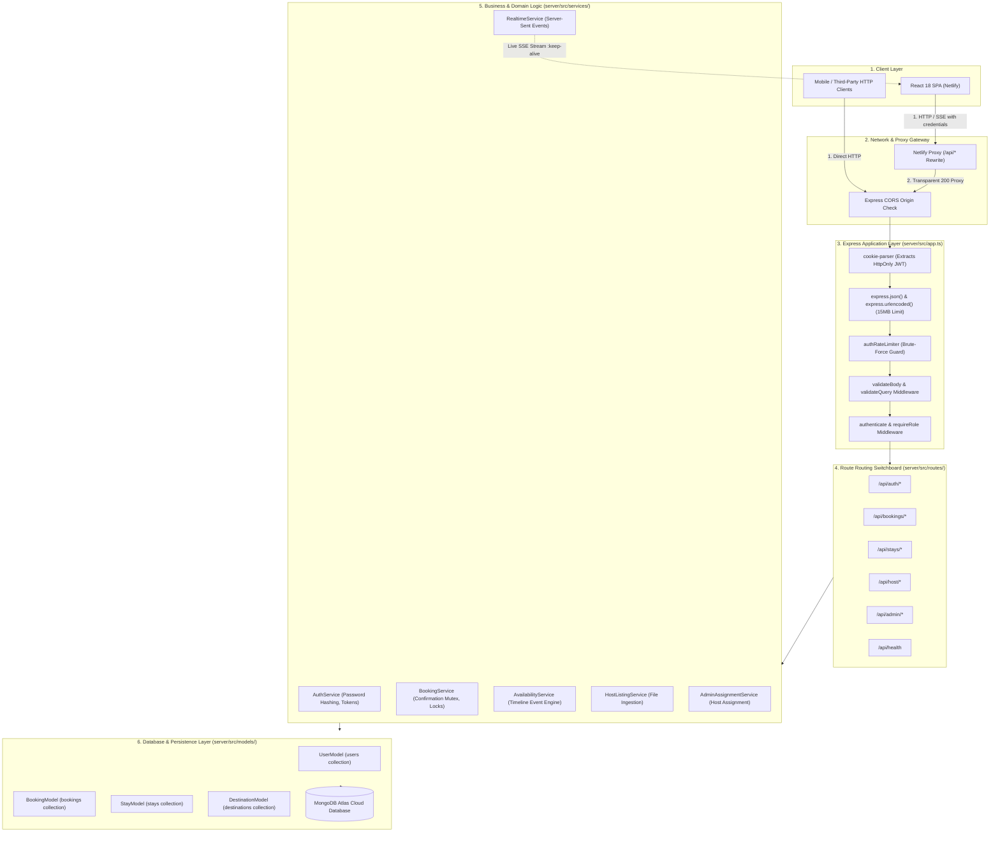
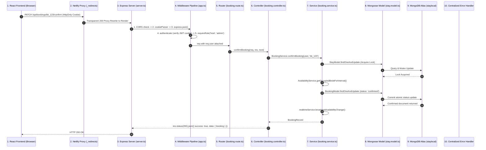

# StayLocal Backend — Architecture, Lifecycle & System Blueprint

> **Target Audience:** Backend Engineers, Full-Stack Developers, and Technical Interview Candidates  
> **Repository Scope:** `server/` (Node.js + Express + TypeScript + Mongoose + MongoDB Atlas)  
> **Role:** Educational Reference & System Architecture Manual

---

## 1. High-Level System Architecture

**StayLocal** is a community-led Himalayan eco-tourism and homestay booking platform. Its backend is designed around a decoupled, layered REST API architecture built with **Node.js**, **Express.js**, **TypeScript**, and **MongoDB Atlas** via **Mongoose**.

The backend serves three primary client personas:
1. **Tourists:** Query destination records, filter verified homestays, calculate bed availability, submit booking requests, and subscribe to real-time inventory updates.
2. **Hosts:** Manage homestay listings, review incoming booking requests, lock bed capacity upon confirmation, release inventory on rejection, and upload property ownership documents.
3. **Administrators:** Review host verification documentation, assign preloaded homestays to registered hosts, inspect audit histories, and manage local artisan treasures.



---

## 2. Foundations: Core Backend Concepts Explained

### 1. What is Backend Development?
**Definition:** Backend development refers to server-side software engineering that handles data storage, business logic processing, authentication, access control, and communication with databases and third-party systems.  
**Analogy:** If a restaurant's dining area (decor, menu card, and waiters) is the frontend, the kitchen (inventory, chefs, recipe rules, and food storage) is the backend.  
**StayLocal Role:** The StayLocal backend guarantees that two travelers cannot double-book the same bed in Munsiyari, validates that passwords meet security requirements, and ensures only administrators can approve host property verifications.

### 2. What is Node.js?
**Definition:** Node.js is an open-source, cross-platform JavaScript runtime environment built on Google Chrome's V8 engine that allows developers to run JavaScript outside the browser, directly on servers.  
**Analogy:** The browser is like an electric car dashboard (optimized for user controls and display), while Node.js takes that same electric motor and puts it into a factory generator (optimized for background power and continuous file/network processing).  
**StayLocal Role:** Executes all server-side JavaScript code in `server/src/server.ts`.

### 3. What is Express.js?
**Definition:** Express.js is a minimal, unopinionated, flexible web application framework for Node.js that provides a robust suite of features for building single-page, multi-page, and hybrid web APIs.  
**Analogy:** If Node.js is raw lumber, nails, and a hammer, Express is the prefabricated framing system that allows you to construct rooms (routes) and doors (middleware) quickly and cleanly.  
**StayLocal Role:** Configured in [server/src/app.ts](file:///c:/Users/HP/Downloads/Major%20Project/server/src/app.ts) via `createApp()`.

### 4. What is TypeScript in Backend Development?
**Definition:** TypeScript is a statically typed superset of JavaScript that compiles to plain JavaScript, providing compile-time type checking, interfaces, and autocompletion.  
**Analogy:** Writing backend JavaScript without TypeScript is like packing a travel bag without checking a checklist: you only discover you forgot your passport when you reach the airport (runtime error). TypeScript checks your bag before you leave home (compile-time error).  
**StayLocal Role:** Configured in [server/tsconfig.json](file:///c:/Users/HP/Downloads/Major%20Project/server/tsconfig.json) with strict null checks, preventing `undefined` errors across all controllers and database models.

### 5. What is an HTTP Server?
**Definition:** An HTTP server is a computer program that listens for incoming network requests over TCP using the Hypertext Transfer Protocol (HTTP), parses request headers and bodies, and returns formatted responses.  
**Analogy:** A receptionist sitting at a building entrance: listening for visitors, checking their badges, directing them to the right office, and handing them visitor slips.  
**StayLocal Role:** Initialized in [server/src/server.ts](file:///c:/Users/HP/Downloads/Major%20Project/server/src/server.ts#L14) via `app.listen(env.PORT, '0.0.0.0', ...)`.

### 6. What is an API (Application Programming Interface)?
**Definition:** An API is a formal contract of endpoints, data structures, and communication protocols that allows two software applications (e.g., a React client and an Express backend) to talk to each other.  
**Analogy:** A power outlet on a wall: the appliance doesn't care how the power station generates electricity, as long as the plug fits the socket and delivers the expected voltage.  
**StayLocal Role:** Defined under `/api/*` in [server/src/routes/index.ts](file:///c:/Users/HP/Downloads/Major%20Project/server/src/routes/index.ts).

### 7. What is REST (Representational State Transfer)?
**Definition:** REST is an architectural style for networked applications that uses standard HTTP methods (GET, POST, PUT, PATCH, DELETE), stateless communication, and resource-oriented URLs (e.g. `/api/stays`, `/api/bookings`).  
**Analogy:** Standard postal mail: every envelope has a standard recipient address, return address, and standard delivery actions (standard mail, registered, parcel).  
**StayLocal Role:** Homestays are resources at `/api/stays`, bookings are created via `POST /api/bookings` and confirmed via `PATCH /api/bookings/:id/confirm`.

### 8. What is Client-Server Architecture?
**Definition:** A computing model that partitions tasks between service providers (servers) and service requesters (clients). The client manages UI presentation, while the server manages persistence and business rules.  
**StayLocal Role:** Netlify hosts the client React SPA; Render hosts the Node.js Express server; MongoDB Atlas hosts the database.

---

## 3. The Complete 10-Stage Request Lifecycle

When a traveler clicks **"Confirm Reservation"** on the React frontend, the request journeys through 10 distinct architectural layers before a response returns:



### Layer-by-Layer File & Function Mapping:

| Stage | Responsibility | StayLocal Implementation File | Function / Artifact |
| :--- | :--- | :--- | :--- |
| **1. Client Trigger** | Traveler/Host clicks button in UI | [client/src/pages/HostBookingsPage.tsx](file:///c:/Users/HP/Downloads/Major%20Project/client/src/pages/HostBookingsPage.tsx#L54) | `apiService.confirmBooking(bookingId)` |
| **2. Reverse Proxy** | Proxies request from frontend domain | [client/public/_redirects](file:///c:/Users/HP/Downloads/Major%20Project/client/public/_redirects#L1) | `/api/* -> Render backend (200!)` |
| **3. HTTP Listener** | Listens on port, receives TCP stream | [server/src/server.ts](file:///c:/Users/HP/Downloads/Major%20Project/server/src/server.ts#L14) | `app.listen(env.PORT)` |
| **4. Middleware** | CORS, parsing, auth, rate limiting | [server/src/app.ts](file:///c:/Users/HP/Downloads/Major%20Project/server/src/app.ts#L16-L35)<br>[server/src/middleware/auth.ts](file:///c:/Users/HP/Downloads/Major%20Project/server/src/middleware/auth.ts#L17) | `cors()`, `cookieParser()`, `authenticate()`, `requireRole()` |
| **5. Routing Switch** | Matches URL path and HTTP verb | [server/src/routes/booking.route.ts](file:///c:/Users/HP/Downloads/Major%20Project/server/src/routes/booking.route.ts#L33) | `bookingRouter.patch('/bookings/:id/confirm', ...)` |
| **6. Controller** | Unpacks HTTP request, calls service | [server/src/controllers/booking.controller.ts](file:///c:/Users/HP/Downloads/Major%20Project/server/src/controllers/booking.controller.ts#L60) | `confirmBooking(req, res, next)` |
| **7. Service** | Mutex locking, capacity checks, events | [server/src/services/booking.service.ts](file:///c:/Users/HP/Downloads/Major%20Project/server/src/services/booking.service.ts#L335) | `BookingService.confirmBooking()` |
| **8. Model** | Schema enforcement, query building | [server/src/models/booking.model.ts](file:///c:/Users/HP/Downloads/Major%20Project/server/src/models/booking.model.ts#L63)<br>[server/src/models/stay.model.ts](file:///c:/Users/HP/Downloads/Major%20Project/server/src/models/stay.model.ts) | `BookingModel.findOneAndUpdate()`, `StayModel.findOneAndUpdate()` |
| **9. Database** | Storage engine, transactions, indexes | Remote MongoDB Atlas Cloud Cluster | `staylocal` database collection writes |
| **10. Response / Error**| Returns JSON payload or error code | [server/src/middleware/errorHandler.ts](file:///c:/Users/HP/Downloads/Major%20Project/server/src/middleware/errorHandler.ts#L7) | `res.status(200).json(...)` or `errorHandler()` |

---

## 4. Directory & Codebase Architecture Map

```
server/
├── src/
│   ├── config/              # Runtime environment & database configuration
│   │   ├── db.ts            # Mongoose connection lifecycle, retries, sanitization
│   │   └── env.ts           # Zod-validated environment schema (PORT, JWT_SECRET, etc.)
│   ├── controllers/         # HTTP request unpackers & response formatters (15 controllers)
│   │   ├── auth.controller.ts
│   │   ├── booking.controller.ts
│   │   ├── host-listing.controller.ts
│   │   ├── admin-assignment.controller.ts
│   │   └── stays.controller.ts
│   ├── data/                # Authoritative Uttarakhand research fallback records
│   │   ├── accommodations.data.ts
│   │   ├── destinations.data.ts
│   │   ├── experiences.data.ts
│   │   └── local-treasures.data.ts
│   ├── middleware/          # Request interception & filtering pipeline
│   │   ├── auth.ts          # authenticate (JWT cookie) & requireRole (RBAC)
│   │   ├── errorHandler.ts  # Centralized operational error & Zod error handler
│   │   ├── notFoundHandler.ts # 404 API route handler
│   │   └── rateLimiter.ts   # express-rate-limit brute force protection
│   ├── models/              # Mongoose schemas, indexes, and document interfaces
│   │   ├── booking.model.ts # Reservation tracking, references, timestamps
│   │   ├── stay.model.ts    # Homestay specifications, rooms, bed capacity, lock
│   │   ├── user.model.ts    # Passwords (bcrypt), roles, profiles
│   │   └── index.ts         # Centralized model registry
│   ├── routes/              # Express Router definitions & URL paths
│   │   ├── auth.route.ts
│   │   ├── booking.route.ts
│   │   ├── stays.route.ts
│   │   └── index.ts         # Aggregated apiRouter
│   ├── scripts/             # Administrative utilities & database maintenance
│   │   ├── create-admin.ts  # Interactive admin account provisioning
│   │   ├── seed.ts          # Idempotent research dataset seeding
│   │   └── reset-host-assignments.ts # ACID-transaction safe host assignment reset
│   ├── services/            # Pure business logic layer (zero HTTP dependencies)
│   │   ├── auth.service.ts
│   │   ├── availability.service.ts # Bed timeline event algorithm
│   │   ├── booking.service.ts      # Concurrency mutex & status state machine
│   │   ├── host-listing.service.ts # Base64 document ingestion
│   │   └── realtime.service.ts     # Server-Sent Events (SSE) broadcasting
│   ├── types/               # TypeScript domain interfaces and API payload types
│   │   └── index.ts
│   ├── utils/               # Error classes, tokens, and helper utilities
│   │   ├── errors.ts        # OOP error hierarchy (AppError, ConflictError, etc.)
│   │   └── token.ts         # JWT signing, verification, and cookie configuration
│   ├── validators/          # Zod request body and query schema validators
│   │   ├── auth.validator.ts
│   │   ├── booking.validator.ts
│   │   └── index.ts
│   ├── app.ts               # Express application assembly (createApp())
│   └── server.ts            # Entry point: DB connection, HTTP listen, graceful shutdown
├── tests/                   # 13 Vitest & Supertest integration suites (175 tests)
├── package.json             # Dependencies, scripts, and build targets
└── tsconfig.json            # Strict TypeScript configuration
```
