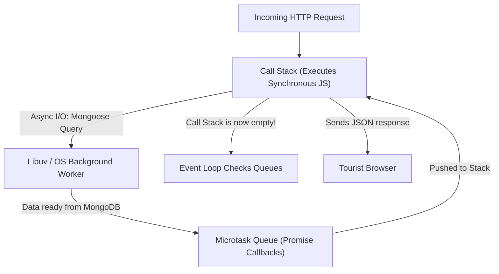

# Module 1: Node.js Runtime Fundamentals in StayLocal

> **Scope:** The Node.js runtime, V8 engine, single-threaded event loop, call stack, microtask queues, non-blocking I/O, CommonJS vs. ESM, and the `process` object in StayLocal.  
> **Target Mastery:** Level 1 (Essential) to Level 2 (Intermediate)

---

## Concept 1: The Node.js Runtime & V8 Engine

### 1. Concept Name
The Node.js JavaScript Runtime Environment

### 2. Simple Definition
Node.js is an environment that lets developers run JavaScript outside a web browser. It takes Google Chrome's V8 execution engine and combines it with low-level C++ system libraries (via Libuv) so JavaScript can interact directly with the operating system, access hard drives, open network ports, and handle database connections.

### 3. Real-World Analogy
Think of the V8 engine as a high-performance sports car engine. Inside Chrome, that engine is installed in a passenger car (restricted to the browser sandbox). Node.js takes that exact same engine and puts it into a tractor with hydraulic arms and heavy towing cables (giving it the power to dig into the local file system and manage database pipelines).

### 4. Why Developers Need It
Before Node.js (2009), developers were forced to use two completely different languages: JavaScript for the browser and PHP, Java, Python, or Ruby for the server. Node.js enables **Universal JavaScript**: the exact same language syntax, data structures, and mental models can be shared between frontend and backend.

### 5. How StayLocal Uses It
StayLocal runs its entire backend on Node.js. In [server/src/server.ts](file:///c:/Users/HP/Downloads/Major%20Project/server/src/server.ts#L7-L21), Node.js executes the `bootstrap()` function, opens network sockets on port `5000`, establishes TLS connections to MongoDB Atlas, and listens for HTTP requests.

### 6. Actual File Location
- **File:** [server/src/server.ts](file:///c:/Users/HP/Downloads/Major%20Project/server/src/server.ts#L14-L21)
- **Function:** `bootstrap()`

### 7. Code Explanation
```typescript
// server/src/server.ts
const server = app.listen(env.PORT, '0.0.0.0', () => {
  console.log('==================================================');
  console.log(`🌲 StayLocal Backend API running in [${env.NODE_ENV}] mode`);
  console.log(`📡 URL: http://localhost:${env.PORT}`);
  console.log(`🩺 Health: http://localhost:${env.PORT}/api/health`);
  console.log(`🌍 CORS Origin: ${env.CORS_ORIGIN}`);
  console.log('==================================================');
});
```
- **Line 1:** `app.listen` calls Node's underlying `net.Server.listen()` method, binding the TCP server to host `'0.0.0.0'` (all network interfaces) and the port resolved from environment variables (`5000`).
- **Lines 2–7:** The callback function executes once the operating system kernel confirms the socket is open and listening.

### 8. Execution Flow
1. Node.js binary starts (`node dist/server.js` or `tsx src/server.ts`).
2. V8 engine compiles the TypeScript/JavaScript into machine code using JIT (Just-In-Time) compilation.
3. Node binds to port 5000.
4. The event loop starts spinning, ready to handle incoming HTTP requests.

### 9. Common Mistakes
- **Treating Node.js as a Language:** Node.js is NOT a programming language; it is a runtime environment that executes the JavaScript language.
- **Using Browser-Only APIs:** Attempting to call `window`, `document`, or `localStorage` inside Node.js code will throw `ReferenceError: window is not defined`.

### 10. Interview Questions
1. *What is the relationship between Node.js, V8, and Libuv?*  
   **Answer:** V8 parses and executes JavaScript code. Libuv is a C-based multi-platform library that provides Node.js with its event loop, non-blocking asynchronous I/O operations (file system, DNS, networking), and background threadpool.
2. *Is Node.js multi-threaded or single-threaded?*  
   **Answer:** JavaScript execution in Node.js is single-threaded (one call stack), but Node's underlying C++ runtime uses a multi-threaded threadpool (via Libuv) to handle heavy tasks like file I/O, cryptography (bcrypt), and DNS resolution in the background.

### 11. Practical Exercise
Open your terminal in the `server` directory and run `node -e "console.log(process.versions)"`. Inspect the output to see the exact versions of Node, V8, and Libuv running on your system.

---

## Concept 2: The Event Loop & Non-Blocking Asynchronous I/O

### 1. Concept Name
The Single-Threaded Event Loop and Non-Blocking I/O

### 2. Simple Definition
Node.js runs your JavaScript code on a single thread. Instead of freezing while waiting for a slow task to finish (like querying MongoDB or reading a file from disk), Node offloads the waiting task to the operating system or a background thread and keeps running other code. When the task finishes, its callback is placed in a queue, and the **Event Loop** picks it up when the call stack is empty.

### 3. Real-World Analogy
Imagine a single waiter in a busy restaurant. In a **blocking (multi-threaded)** model, the waiter takes Order A to the kitchen, stands next to the stove for 20 minutes waiting for the food to cook, serves Customer A, and only then takes Customer B's order.  
In Node's **non-blocking event loop** model, the waiter takes Customer A's order, hands it to the kitchen chef, immediately walks over to Customer B, takes their order, serves drinks, and when the kitchen bell rings (event callback), brings the cooked plate to Customer A. One waiter can effortlessly serve 50 tables.

### 4. Why Developers Need It
Traditional servers (like Apache on PHP or Tomcat on Java) allocated an entire operating system thread per visitor. 5,000 simultaneous visitors required 5,000 threads, which quickly exhausted server RAM (1–2 MB per thread). Node's single-threaded event loop can handle tens of thousands of concurrent connections on a tiny 512MB RAM server like Render's free tier.

### 5. How StayLocal Uses It
When hundreds of travelers search for homestays in Sarmoli simultaneously, `StayModel.find()` is non-blocking. Node sends the query over the network to MongoDB Atlas and immediately processes the next incoming HTTP request rather than sitting idle.

### 6. Actual File Location
- **File:** [server/src/controllers/stays.controller.ts](file:///c:/Users/HP/Downloads/Major%20Project/server/src/controllers/stays.controller.ts#L6-L19)
- **Function:** `getStays()`

### 7. Code Explanation
```typescript
// server/src/controllers/stays.controller.ts
export async function getStays(req: Request, res: Response, next: NextFunction): Promise<void> {
  try {
    const stays = await StaysService.getStays(req.query);
    res.status(200).json({
      success: true,
      data: { stays },
      meta: { total: stays.length },
    });
  } catch (err) {
    next(err);
  }
}
```
- **Line 3:** `await StaysService.getStays(req.query)`: The `await` keyword yields execution back to the Node.js event loop. The call stack is freed up to handle other tourists' requests while MongoDB Atlas compiles the results.
- **Line 4:** When MongoDB Atlas responds, the Promise resolves, placing the continuation on the **Microtask Queue**. The event loop pops it back onto the call stack and sends the HTTP response.

### 8. Execution Flow


### 9. Common Mistakes
- **Blocking the Event Loop with Heavy Synchronous Work:** Running synchronous operations like `fs.readFileSync()` or heavy mathematical loops (`for (let i = 0; i < 1e9; i++)`) inside a route blocks the single thread. While that loop runs, **no other user in the entire world can load StayLocal**. Always use asynchronous APIs (`fs.promises`, `bcrypt.hash`).

### 10. Interview Questions
1. *What are the different phases of the Node.js Event Loop?*  
   **Answer:** Timers (`setTimeout`, `setInterval`) $\rightarrow$ Pending callbacks $\rightarrow$ Idle/Prepare $\rightarrow$ Poll (retrieves new I/O events) $\rightarrow$ Check (`setImmediate`) $\rightarrow$ Close callbacks.
2. *What is the difference between the Microtask Queue and the Macrotask (Callback) Queue?*  
   **Answer:** Microtasks (`process.nextTick`, resolved Promise callbacks `.then()`, `await`) have higher priority than macrotasks (`setTimeout`, `setInterval`, I/O). The event loop drains the entire microtask queue before moving to the next phase of the event loop.

### 11. Practical Exercise
Predict the console output of this code snippet:
```javascript
console.log('1');
setTimeout(() => console.log('2'), 0);
Promise.resolve().then(() => console.log('3'));
process.nextTick(() => console.log('4'));
console.log('5');
```
*Answer:* `1`, `5`, `4` (`process.nextTick` microtask), `3` (Promise microtask), `2` (macrotask timer).

---

## Concept 3: Module Systems — CommonJS vs. ES Modules (ESM)

### 1. Concept Name
JavaScript Module Formats (CommonJS `require` vs. ES Modules `import`)

### 2. Simple Definition
A module system defines how files organize, export, and import functions and variables. Historically, Node.js used **CommonJS** (`module.exports` and `require()`). Modern JavaScript and browsers use **ES Modules** (`export` and `import`).

### 3. Real-World Analogy
CommonJS is like a DVD player: it reads the disc synchronously, tracks it step-by-step at runtime, and loads it when requested. ES Modules are like a streaming app's catalog index: the app analyzes the entire library structure *before* playing any video, allowing it to pre-link and optimize dependencies.

### 4. Why Developers Need It
Node.js originally only supported CommonJS. When the modern `import/export` standard was finalized, the ecosystem underwent a transition. Understanding the difference prevents frustrating errors like `Cannot use import statement outside a module` or `require() of ES Module not supported`.

### 5. How StayLocal Uses It
- **Source Code (`server/src/`):** Written in clean modern ES Module syntax (`import express from 'express'`).
- **Compilation (`server/tsconfig.json`):** Notice line 4: `"module": "CommonJS"`. TypeScript compiles modern `import` statements down to rock-solid CommonJS `require()` calls in `server/dist/` for production stability on Node.js without requiring `"type": "module"` in `server/package.json`.

### 6. Actual File Location
- **File:** [server/tsconfig.json](file:///c:/Users/HP/Downloads/Major%20Project/server/tsconfig.json#L3-L5) and [server/src/app.ts](file:///c:/Users/HP/Downloads/Major%20Project/server/src/app.ts#L1-L3)

### 7. Code Explanation
```typescript
// server/tsconfig.json
{
  "compilerOptions": {
    "target": "ES2022",
    "module": "CommonJS",
    "lib": ["ES2022"],
    "outDir": "./dist",
    "rootDir": "./src",
    "esModuleInterop": true
  }
}
```
- `"module": "CommonJS"` instructs the TypeScript compiler (`tsc`) to transform `import { app } from './app'` into `const app_1 = require("./app")` in `server/dist/server.js`.
- `"esModuleInterop": true` enables default imports from CommonJS modules (like `import express from 'express'`) without compiler errors.

### 8. Execution Flow
1. Developer writes TypeScript with `import/export`.
2. `npm run build` runs `tsc`.
3. TypeScript transpiles files to CommonJS `.js` files in `server/dist/`.
4. Production Node runtime executes `node dist/server.js` using standard CommonJS loading.

### 9. Common Mistakes
- **Mixing `require` and `import` blindly:** Trying to use `import` inside a file without TypeScript or without `"type": "module"` in `package.json` causes immediate node crashes.

### 10. Interview Questions
1. *What are the primary differences between CommonJS and ES Modules?*  
   **Answer:** CommonJS imports are dynamic and synchronous (can be called conditionally inside `if` statements via `require()`); ESM imports are static, asynchronous, and analyzed before execution (enabling tree-shaking).
2. *What does `esModuleInterop` do in tsconfig.json?*  
   **Answer:** It creates compatibility shims so CommonJS packages that export objects via `module.exports` can be imported using standard ES6 default import syntax (`import express from 'express'`).

### 11. Practical Exercise
Inspect `server/dist/server.js` (generated by running `npm run build:server`). Notice how TypeScript converted `import { app } from './app'` into `const app_1 = require("./app")`.

---

## Concept 4: Environment Variables & Zod Runtime Schema Validation

### 1. Concept Name
Type-Safe Environment Configuration (`process.env` + `zod`)

### 2. Simple Definition
Environment variables are values defined outside the application code (in the operating system or `.env` files) that change between environments (development, staging, production), such as database connection strings, secret encryption keys, and port numbers. Schema validation with Zod ensures that if a critical variable is missing or invalid, the server **crashes immediately upon startup** rather than failing mysteriously in production.

### 3. Real-World Analogy
Before a passenger plane takes off, the pilot goes through a pre-flight checklist (fuel level, hydraulic pressure, engine status). If any critical check fails, the plane does not leave the gate. Zod environment validation is the server's pre-flight checklist.

### 4. Why Developers Need It
In naive Node.js apps, developers access `process.env.PORT` directly. If someone forgets to set `MONGODB_URI` on Render, the server might start, wait 20 minutes until a user tries to book a homestay, and only then crash with a null pointer exception. Validating configuration at startup enforces the **Fail-Fast Principle**.

### 5. How StayLocal Uses It
In [server/src/config/env.ts](file:///c:/Users/HP/Downloads/Major%20Project/server/src/config/env.ts), StayLocal reads `.env`, validates variables with a strict Zod schema, validates port ranges ($1$ to $65535$), enforces minimum length ($16$ characters) on `JWT_SECRET`, and exports a strongly typed `env` object.

### 6. Actual File Location
- **File:** [server/src/config/env.ts](file:///c:/Users/HP/Downloads/Major%20Project/server/src/config/env.ts#L10-L41)

### 7. Code Explanation
```typescript
// server/src/config/env.ts
const envSchema = z.object({
  NODE_ENV: z.enum(['development', 'production', 'test']).default('development'),
  PORT: z
    .string()
    .default('5000')
    .transform((val) => parseInt(val, 10))
    .refine((port) => !isNaN(port) && port > 0 && port < 65536, {
      message: 'PORT must be a valid port number between 1 and 65535',
    }),
  CORS_ORIGIN: z.string().default('http://localhost:5173'),
  MONGODB_URI: z.string().optional(),
  JWT_SECRET: z
    .string()
    .default('staylocal-super-secret-jwt-key-for-dev-environment-change-in-prod-32chars!')
    .refine((val) => val.length >= 16, {
      message: 'JWT_SECRET must be at least 16 characters long',
    }),
  JWT_EXPIRES_IN: z.string().default('7d'),
});

const parsed = envSchema.safeParse(process.env);
if (!parsed.success) {
  throw new Error(`Configuration validation failed:\n${issues}`);
}
export const env = parsed.data;
```
- **Lines 14–18:** Takes string `'5000'`, parses it to integer `5000`, and ensures it is within valid TCP port boundaries.
- **Lines 22–27:** Ensures `JWT_SECRET` is at least 16 characters long to prevent brute-force token forgery.
- **Line 31:** `safeParse(process.env)` executes non-throwing validation.
- **Line 33:** If validation fails, prints formatted error messages and halts execution.

### 8. Execution Flow
1. Node process boots up.
2. `dotenv.config()` loads variables from `.env` into `process.env`.
3. `env.ts` parses `process.env` against `envSchema`.
4. If valid, exports typed `env` (where `env.PORT` is guaranteed to be a `number`).
5. All other files import `{ env } from './config/env'` with 100% autocompletion.

### 9. Common Mistakes
- **Committing `.env` files to Git:** Storing `.env` containing production passwords or MongoDB connection strings in GitHub exposes your database to automated scanners within seconds. Always include `.env` in `.gitignore`.

### 10. Interview Questions
1. *What is the Fail-Fast Principle, and why does validating environment variables at startup embody it?*  
   **Answer:** Fail-Fast means detecting and reporting failures as early as possible in the lifecycle. Catching missing environment variables at boot prevents silent runtime failures, data corruption, or crashing mid-transaction during customer traffic.
2. *Why should `process.env` be accessed through a centralized module rather than directly in controllers?*  
   **Answer:** Direct usage of `process.env.VAR` results in string-only types, no runtime validation, duplicate parsing, and risk of typos across files. A centralized module ensures variables are parsed, validated, and strongly typed.

### 11. Practical Exercise
Inspect [server/src/config/env.ts](file:///c:/Users/HP/Downloads/Major%20Project/server/src/config/env.ts#L5-L8). Notice how it attempts to load `.env` from three potential paths (root `.env`, `server/.env`, and local directory) to accommodate both monorepo root execution and direct `cd server` execution.

---

## Concept 5: The `process` Object & Graceful Shutdown

### 1. Concept Name
Process Lifecycle Management and Graceful Shutdown (`SIGTERM`, `SIGINT`)

### 2. Simple Definition
The `process` object is a global Node.js object providing information about and control over the current running Node process. **Graceful shutdown** is the practice of intercepting operating system termination signals (`SIGTERM` when Render redeploys, or `SIGINT` when you press Ctrl+C in terminal) to close database connections and finish active HTTP requests before stopping, rather than abruptly severing active client connections.

### 3. Real-World Analogy
When a store closes at 9:00 PM, a graceful shutdown means locking the front door so no new customers enter, allowing customers already at the checkout registers to finish paying, closing the cash drawers, and only then turning off the lights. An abrupt shutdown is cutting the power grid at 9:00 PM while customers are in the middle of transactions.

### 4. Why Developers Need It
When hosting platforms (like Render, AWS ECS, or Kubernetes) deploy a new version of your server, they send a `SIGTERM` signal. If your app terminates instantly, users in the middle of booking a homestay experience dropped requests, corrupting data. A graceful shutdown ensures zero downtime deployments.

### 5. How StayLocal Uses It
In [server/src/server.ts](file:///c:/Users/HP/Downloads/Major%20Project/server/src/server.ts#L23-L40), StayLocal registers signal listeners on `process.on('SIGTERM')` and `process.on('SIGINT')`. When triggered, it stops accepting new connections, disconnects Mongoose from MongoDB Atlas cleanly, and exits.

### 6. Actual File Location
- **File:** [server/src/server.ts](file:///c:/Users/HP/Downloads/Major%20Project/server/src/server.ts#L23-L40)
- **Function:** `handleShutdown()`

### 7. Code Explanation
```typescript
// server/src/server.ts
const handleShutdown = async (signal: string) => {
  console.log(`\n[Shutdown] Received ${signal}. Closing StayLocal server gracefully...`);
  server.close(async () => {
    console.log('[Shutdown] HTTP server closed.');
    await disconnectDB();
    process.exit(0);
  });

  // Force exit after 10s timeout
  setTimeout(() => {
    console.error('[Shutdown] Forced termination after timeout.');
    process.exit(1);
  }, 10000);
};

process.on('SIGTERM', () => handleShutdown('SIGTERM'));
process.on('SIGINT', () => handleShutdown('SIGINT'));
```
- **Line 3:** `server.close()` stops the HTTP server from accepting new connections while letting ongoing requests complete.
- **Line 5:** `await disconnectDB()` cleanly closes the MongoDB connection pool.
- **Line 6:** `process.exit(0)` exits with success code 0.
- **Lines 10–13:** Defensive 10-second safety timeout: if an ongoing request hangs indefinitely, forces exit so the process doesn't become a zombie.

### 8. Execution Flow
1. Render deploys a new commit.
2. Render sends `SIGTERM` to the old StayLocal container.
3. `handleShutdown('SIGTERM')` catches the signal.
4. HTTP server stops accepting new connections.
5. Inflight booking confirmations complete.
6. Mongoose closes database sockets.
7. Process exits cleanly with code 0.

### 9. Common Mistakes
- **Omitting the timeout:** If a database query hangs during shutdown, a server without a `setTimeout(..., 10000)` fallback will freeze forever, blocking deployments.

### 10. Interview Questions
1. *What is the difference between `process.exit(0)` and `process.exit(1)`?*  
   **Answer:** Exit code 0 indicates success (normal termination). Any non-zero exit code (like 1) indicates an error or abnormal termination, signaling to process managers (like Docker, PM2, or Render) that the container crashed.
2. *What is the difference between `SIGINT` and `SIGTERM`?*  
   **Answer:** `SIGINT` (Signal Interrupt) is sent from the terminal when a user presses `Ctrl+C`. `SIGTERM` (Signal Terminate) is the standard Unix signal sent by operating systems and container orchestrators to request graceful termination.

### 11. Practical Exercise
Inspect [server/src/config/db.ts](file:///c:/Users/HP/Downloads/Major%20Project/server/src/config/db.ts#L91-L96). Notice the `disconnectDB()` implementation:
```typescript
export async function disconnectDB(): Promise<void> {
  if (mongoose.connection.readyState !== 0) {
    await mongoose.disconnect();
  }
}
```
Explain why checking `readyState !== 0` is necessary before calling `disconnect()`.
