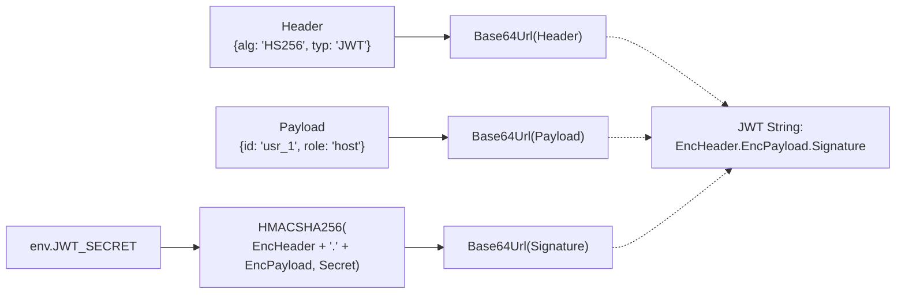

# Module 4: Authentication & Security Architecture in StayLocal

> **Scope:** Full-stack authentication lifecycle, bcrypt password hashing, JWT token mechanics, HttpOnly cookie security, RBAC authorization, and threat mitigation in StayLocal.  
> **Target Mastery:** Level 1 (Essential) to Level 3 (Advanced)

---

## Concept 1: Password Hashing & Bcrypt (`UserSchema.pre('save')`)

### 1. Concept Name
One-Way Cryptographic Password Hashing with Salt Rounds

### 2. Simple Definition
Storing plain-text passwords in a database is a catastrophic security vulnerability. If the database is compromised, every user's password is exposed. Password hashing runs the plain-text password through a one-way mathematical function (Bcrypt) combined with a random string called a **Salt**. The result is a fixed-length scrambled hash. The process cannot be reversed; when the user logs in, the server hashes their input and checks if the hashes match.

### 3. Real-World Analogy
A paper shredder combined with a blender: you drop a secret recipe (password) into the blender with a pinch of unique spices (salt). The resulting smoothie (hash) can never be turned back into a dry sheet of paper. But if you take the same recipe with the same spices, you will always get the exact same smoothie.

### 4. Why Developers Need It
Rainbow tables (precomputed tables of billions of hashed common passwords) allow attackers to reverse simple hashes like MD5 or SHA-256 in milliseconds. Bcrypt incorporates an adaptive cost factor (Salt Rounds) that deliberately slows down calculation, making brute-force attacks computationally infeasible.

### 5. How StayLocal Uses It
In [server/src/models/user.model.ts](file:///c:/Users/HP/Downloads/Major%20Project/server/src/models/user.model.ts#L96-L115), a Mongoose pre-save hook automatically intercepts user saves, checks if the password was modified, generates a salt with 10 rounds, and hashes the password before saving to MongoDB Atlas.

### 6. Actual File Location
- **File:** [server/src/models/user.model.ts](file:///c:/Users/HP/Downloads/Major%20Project/server/src/models/user.model.ts#L96-L115)
- **Hooks & Methods:** `UserSchema.pre('save')` and `UserSchema.methods.comparePassword`

### 7. Code Explanation
```typescript
// server/src/models/user.model.ts
UserSchema.pre<UserDocument>('save', async function (next) {
  if (!this.isModified('password') || !this.password) {
    return next();
  }

  try {
    const salt = await bcrypt.genSalt(10);
    this.password = await bcrypt.hash(this.password, salt);
    next();
  } catch (err) {
    next(err as Error);
  }
});

UserSchema.methods.comparePassword = async function (candidate: string): Promise<boolean> {
  if (!this.password) return false;
  return bcrypt.compare(candidate, this.password);
};
```
- **Line 2:** `this.isModified('password')`: Ensures the password is only re-hashed if it was newly created or changed, preventing double-hashing on profile updates.
- **Line 7:** `bcrypt.genSalt(10)` creates a cryptographically secure 10-round salt ($2^{10} = 1,024$ iterations).
- **Line 8:** Hashes the password and replaces plain text with the hash string.
- **Lines 16–19:** `comparePassword` safely executes constant-time string comparison via `bcrypt.compare`.

### 8. Execution Flow
1. User submits registration with password `"Himalaya@2026"`.
2. Controller calls `user.save()`.
3. Pre-save hook triggers: `bcrypt.hash` generates `$2a$10$wK9g...`.
4. MongoDB receives and stores only the hash string. Plain text is discarded from memory.

### 9. Common Mistakes
- **Re-hashing already hashed passwords:** Forgetting `this.isModified('password')` causes the already-hashed password to be hashed a second time whenever the user updates their bio, permanently locking them out of their account!

### 10. Interview Questions
1. *What is a "Salt" in password hashing, and why is it necessary?*  
   **Answer:** A salt is a unique random string appended to the password before hashing. It ensures that two users with the identical password (`"password123"`) will have completely different hashes in the database, defeating rainbow table attacks.
2. *What is the difference between encryption and hashing?*  
   **Answer:** Encryption is a two-way function intended to be decrypted with a secret key (e.g. AES). Hashing is a one-way mathematical function that can never be decrypted.

### 11. Practical Exercise
Inspect [server/src/models/user.model.ts](file:///c:/Users/HP/Downloads/Major%20Project/server/src/models/user.model.ts#L41). Notice `password: { select: false }`. Explain how this setting prevents accidental leakage of password hashes in normal queries.

---

## Concept 2: JSON Web Tokens (JWT) Architecture

### 1. Concept Name
JSON Web Token (JWT) Stateless Authentication

### 2. Simple Definition
A JSON Web Token (JWT) is a compact, URL-safe string format used to securely transmit identity claims between two parties. It consists of three parts separated by dots (`header.payload.signature`). The server signs the token using a secret key. When the client returns the token, the server verifies the signature to confirm the user's identity without querying a session database on every single request.

### 3. Real-World Analogy
A wax-sealed royal letter: the king writes down your name and permissions ("Knight"), signs it, and presses his signet ring into melted wax. You carry the letter with you. Anyone who recognizes the king's seal knows the letter is authentic and has not been tampered with.

### 4. Why Developers Need It
Traditional sessions require storing a session ID in a server database (like Redis) and querying it on every HTTP request. If you scale to 5 servers, all 5 servers must query that central session database. JWTs are **stateless**: the token itself contains the user ID and role, and any server with the `JWT_SECRET` can verify it independently in microseconds.

### 5. How StayLocal Uses It
In [server/src/utils/token.ts](file:///c:/Users/HP/Downloads/Major%20Project/server/src/utils/token.ts), StayLocal exports `signToken()` and `verifyToken()`. The JWT payload contains `{ id, email, role }` and expires after 7 days (`env.JWT_EXPIRES_IN`).

### 6. Actual File Location
- **File:** [server/src/utils/token.ts](file:///c:/Users/HP/Downloads/Major%20Project/server/src/utils/token.ts#L8-L23)
- **Functions:** `signToken()` and `verifyToken()`

### 7. Code Explanation
```typescript
// server/src/utils/token.ts
export interface TokenPayload {
  id: string;
  email: string;
  role: UserRole;
}

export function signToken(payload: TokenPayload): string {
  return jwt.sign(payload, env.JWT_SECRET, {
    expiresIn: env.JWT_EXPIRES_IN as jwt.SignOptions['expiresIn'],
  });
}

export function verifyToken(token: string): TokenPayload {
  return jwt.verify(token, env.JWT_SECRET) as TokenPayload;
}
```
- **Lines 1–5:** Strictly defines what claims are stored in the token. Notice: **No passwords or sensitive data!**
- **Lines 7–11:** Signs the payload using the HMAC SHA-256 algorithm and `env.JWT_SECRET`.
- **Lines 13–15:** `verifyToken` checks that the signature matches and that the expiration timestamp has not passed. If someone tampered with their role to make themselves `"admin"`, the signature verification fails and throws `JsonWebTokenError`.

### 8. Execution Flow


### 9. Common Mistakes
- **Storing Sensitive Data in the Payload:** JWT payloads are Base64-encoded, **NOT encrypted**. Anyone with the token can decode it at `jwt.io` and read its contents. Never put passwords, social security numbers, or API keys in a JWT payload!

### 10. Interview Questions
1. *Can a user tamper with the payload of a JWT (e.g. change their role from 'tourist' to 'admin') without being detected?*  
   **Answer:** No. Changing even a single character in the payload invalidates the cryptographic signature. When the server validates the token with `jwt.verify()`, it recomputes the signature using `JWT_SECRET`; the mismatch causes verification to fail immediately.
2. *What is the main drawback of stateless JWTs compared to database sessions, and how do you revoke one?*  
   **Answer:** Stateless JWTs cannot be easily revoked before they expire without maintaining a token blacklist. StayLocal solves this by having `authenticate()` verify that the user's account still exists and is in `status: 'active'` in MongoDB on each request.

### 11. Practical Exercise
Open your terminal and run `node -e "console.log(Buffer.from('{\"id\":\"test\",\"role\":\"admin\"}').toString('base64url'))"`. Observe how easily a JWT payload is converted to Base64URL and why it is not private.

---

## Concept 3: HttpOnly Cookies vs. LocalStorage Security

### 1. Concept Name
HttpOnly, Secure, and SameSite Cookie Transport

### 2. Simple Definition
When an API sends a token to a browser, it can either return it in the JSON body (forcing the frontend to store it in `localStorage`) or set it in an **HttpOnly Cookie**. HttpOnly cookies are stored by the browser in a private sandbox inaccessible to JavaScript. The browser automatically attaches the cookie to outgoing requests to that domain.

### 3. Real-World Analogy
- **`localStorage`:** Writing your credit card PIN on a sticky note attached to your computer monitor. Any guest (or malicious browser extension) that looks at your screen can read it.
- **`HttpOnly` Cookie:** Depositing your funds into an armored bank vault with a private delivery chute: your browser automatically delivers payments to the merchant, but you cannot open the chute or extract the physical cash using JavaScript.

### 4. Why Developers Need It
**Cross-Site Scripting (XSS)** is one of the most common web vulnerabilities. If an attacker injects malicious JavaScript via an unescaped comment box or an insecure npm package, `localStorage.getItem('token')` allows them to steal the user's session in one line of code. `HttpOnly` cookies completely neutralize token theft via XSS because `document.cookie` returns empty string for HttpOnly cookies.

### 5. How StayLocal Uses It
In [server/src/utils/token.ts](file:///c:/Users/HP/Downloads/Major%20Project/server/src/utils/token.ts#L24-L46), StayLocal exports `setAuthCookie()` and `clearAuthCookie()`, setting cookies with `httpOnly: true`, `secure: isProduction`, and `sameSite: isProduction ? 'strict' : 'lax'`.

### 6. Actual File Location
- **File:** [server/src/utils/token.ts](file:///c:/Users/HP/Downloads/Major%20Project/server/src/utils/token.ts#L24-L46)

### 7. Code Explanation
```typescript
// server/src/utils/token.ts
export function setAuthCookie(res: Response, token: string): void {
  const isProduction = env.NODE_ENV === 'production';
  const sevenDaysMs = 7 * 24 * 60 * 60 * 1000;

  res.cookie(AUTH_COOKIE_NAME, token, {
    httpOnly: true,
    secure: isProduction,
    sameSite: isProduction ? 'strict' : 'lax',
    maxAge: sevenDaysMs,
    path: '/',
  });
}

export function clearAuthCookie(res: Response): void {
  const isProduction = env.NODE_ENV === 'production';

  res.clearCookie(AUTH_COOKIE_NAME, {
    httpOnly: true,
    secure: isProduction,
    sameSite: isProduction ? 'strict' : 'lax',
    path: '/',
  });
}
```
- **`httpOnly: true`:** Prevents client JavaScript from reading `document.cookie`.
- **`secure: isProduction`:** Mandates encrypted HTTPS connections in production.
- **`sameSite: 'strict'`:** Instructs the browser never to send this cookie on cross-site requests, mitigating Cross-Site Request Forgery (CSRF).
- **`path: '/'`:** Ensures the cookie is valid across all API routes.

### 8. Execution Flow
1. User logs in at `POST /api/auth/login`.
2. Controller calls `setAuthCookie(res, token)`.
3. Server responds with header `Set-Cookie: staylocal_token=...; HttpOnly; Secure; SameSite=Strict`.
4. Browser stores the cookie.
5. On all future requests, browser automatically attaches `Cookie: staylocal_token=...`.
6. On logout, `clearAuthCookie()` sends an expiration header, deleting the cookie.

### 9. Common Mistakes
- **Mismatched Path or Domain on Clear:** If `res.clearCookie()` does not match the exact `path` and `domain` options used when the cookie was set, the browser ignores the deletion and the user remains logged in! StayLocal uses identical option blocks in both functions.

### 10. Interview Questions
1. *What is CSRF (Cross-Site Request Forgery), and how does `SameSite=Strict` defend against it?*  
   **Answer:** CSRF occurs when a malicious website tricks a user's browser into executing an unauthorized action on a site where the user is authenticated (e.g. submitting a payment). `SameSite=Strict` ensures the cookie is only sent when the request originates from the same site, preventing the attacker's site from utilizing the authenticated session.
2. *Why do we need a Netlify reverse proxy if we use HttpOnly cookies?*  
   **Answer:** Modern browsers block third-party cookies on cross-origin requests. By proxying `/api/*` through Netlify, the request appears same-origin to the browser, allowing `SameSite=Strict` cookies to function smoothly.

### 11. Practical Exercise
Inspect [server/src/controllers/auth.controller.ts](file:///c:/Users/HP/Downloads/Major%20Project/server/src/controllers/auth.controller.ts#L21-L26). Notice how `register()` signs a token and sets the auth cookie immediately upon account creation, automatically logging in the user upon registration.

---

## Concept 4: Rate Limiting & Brute-Force Attack Mitigation

### 1. Concept Name
IP-Based Rate Limiting (`express-rate-limit`)

### 2. Simple Definition
Rate limiting restricts how many times a client (identified by their IP address) can call a specific API endpoint within a given time window. If a user or bot exceeds the limit, the server temporarily blocks them with an HTTP 429 Too Many Requests status code.

### 3. Real-World Analogy
An ATM machine: after 3 incorrect PIN entries, the machine locks the card and forces you to wait before trying again. It does not allow an automated machine to try 10,000 PIN combinations per minute.

### 4. Why Developers Need It
Attackers use automated credential-stuffing tools that attempt millions of leaked email/password combinations against login endpoints. Without rate limiting, an attacker can brute-force passwords or overwhelm server CPU resources through Denial of Service (DoS).

### 5. How StayLocal Uses It
In [server/src/middleware/rateLimiter.ts](file:///c:/Users/HP/Downloads/Major%20Project/server/src/middleware/rateLimiter.ts), StayLocal restricts `/api/auth/register` and `/api/auth/login` to **25 requests per 15-minute window** per IP address.

### 6. Actual File Location
- **File:** [server/src/middleware/rateLimiter.ts](file:///c:/Users/HP/Downloads/Major%20Project/server/src/middleware/rateLimiter.ts#L4-L16)
- **Middleware:** `authRateLimiter`

### 7. Code Explanation
```typescript
// server/src/middleware/rateLimiter.ts
export const authRateLimiter = rateLimit({
  windowMs: 15 * 60 * 1000, // 15 minutes window
  max: env.NODE_ENV === 'test' ? 1000 : 25, // 25 attempts in dev/prod, relaxed in test
  standardHeaders: true, // Return standard RateLimit headers (RFC draft)
  legacyHeaders: false,  // Disable X-RateLimit headers
  message: {
    success: false,
    error: {
      code: 'RATE_LIMIT_EXCEEDED',
      message: 'Too many authentication attempts from this IP address. Please try again after 15 minutes.',
    },
  },
});
```
- **Line 5:** `windowMs: 15 * 60 * 1000`: 15-minute tracking window.
- **Line 6:** `max: 25`: Allows 25 attempts, but expands to 1,000 during automated test runs so integration test suites don't fail.
- **Lines 9–15:** Returns standard StayLocal structured error JSON when the limit is breached.

### 8. Execution Flow
1. An attacker scripts a loop calling `POST /api/auth/login`.
2. Requests 1 through 25 are processed normally.
3. Request 26 arrives at minute 14.
4. `authRateLimiter` checks internal IP bucket, detects count exceeds 25.
5. Rejects request with HTTP 429 Too Many Requests without touching the database or running expensive bcrypt operations.

### 9. Common Mistakes
- **Rate limiting behind a reverse proxy without `trust proxy`:** If running behind Nginx or Cloudflare without `app.set('trust proxy', 1)`, Express sees the reverse proxy's internal IP address for all visitors, accidentally blocking *all* global users when one user triggers the limit!

### 10. Interview Questions
1. *Why is bcrypt particularly vulnerable to Denial of Service (DoS) attacks without rate limiting?*  
   **Answer:** Bcrypt is deliberately CPU-intensive. Sending thousands of concurrent password hashing requests exhausts 100% of the server's CPU cores, causing the server to freeze for legitimate users. Rate limiting drops attacks before bcrypt runs.
2. *What HTTP status code and response headers communicate rate limiting to clients?*  
   **Answer:** Status code `429 Too Many Requests`. Standard headers include `RateLimit-Limit`, `RateLimit-Remaining`, and `RateLimit-Reset` (or `Retry-After`).

### 11. Practical Exercise
Inspect [server/src/routes/auth.route.ts](file:///c:/Users/HP/Downloads/Major%20Project/server/src/routes/auth.route.ts#L10-L11). Notice that `authRateLimiter` is attached specifically to `POST /auth/register` and `POST /auth/login`, but NOT to `GET /auth/me`. Explain why.
