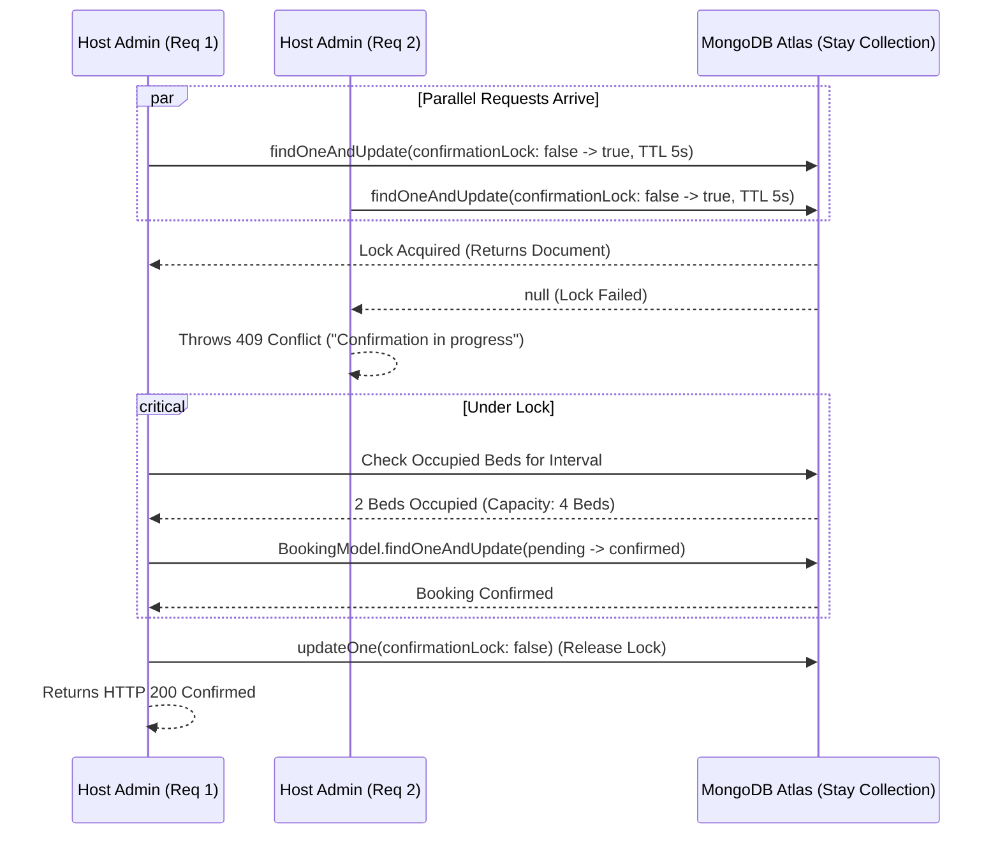

# Module 07: Booking Engine, Inventory Algorithms & Concurrency Control

This module details the core business engine of StayLocal: the real-time availability calculation, bed-level inventory discretization, time-based cleaning buffers, distributed concurrency locking, and atomic state transitions preventing double-bookings in Himalayan eco-homestays.

---

## Architecture Diagram: Booking Concurrency & State Machine

```mermaid
stateDiagram-v2
    [*] --> Pending : Tourist Submits Reservation (POST /api/bookings)
    
    state "Pending State" as Pending {
        note right of Pending
            Beds temporarily held for 30 mins
            expiresAt indexed for automatic cleanup
        end note
    }

    Pending --> Confirmed : Host Confirms (PATCH /api/bookings/:id/confirm)
    Pending --> Rejected : Host Rejects (PATCH /api/bookings/:id/reject)
    Pending --> Cancelled : Tourist Cancels (PATCH /api/bookings/:id/cancel)
    Pending --> Expired : 30 Min Timer Expiry

    state "Confirmation Mutex Pipeline" as ConfirmMutex {
        AcquireLock : StayModel.findOneAndUpdate(confirmationLock=true, TTL=5s)
        CapacityCheck : Interval Bed Evaluation Under Lock
        AtomicTransition : BookingModel.findOneAndUpdate(id, status='pending' -> 'confirmed')
        ReleaseLock : StayModel.updateOne(confirmationLock=false)
    }

    Pending --> ConfirmMutex : Host Action
    ConfirmMutex --> Confirmed : Success (Lock Released)
    ConfirmMutex --> Pending : Lock Conflict / Overbooked (409 Conflict)

    Confirmed --> Cancelled : Host / Admin / Tourist Cancel
    Confirmed --> Completed : Post Check-Out Date

    Cancelled --> [*]
    Rejected --> [*]
    Expired --> [*]
    Completed --> [*]
```

---

## Concept 1: Bed-Level Inventory vs. Room-Level Capacity

### 1. Concept Name
Bed-Level Granular Inventory Modeling vs. Traditional Hotel Room Capacity.

### 2. Simple Definition
Traditional hotel booking systems reserve entire numbered rooms (e.g., Room 101, Room 102). In rural Himalayan homestays, travelers often share traditional dorm rooms, family lofts, or communal attic quarters. **Bed-level inventory modeling** treats the homestay's total capacity as an aggregate pool of discrete beds rather than rigid single-room keys.

### 3. Real-World Analogy
Think of a mountain trekking hut with 8 sturdy wooden cots. Two solo trekkers arrive and take 1 cot each. A couple arrives and needs 2 cots. The hut still has 4 cots available. If you managed this like a luxury city hotel requiring each party to lock an entire room, you would turn away trekkers despite having 4 empty beds available.

### 4. Why Developers Need It
1. **Accurate Capacity Utilization**: Prevents under-utilization of large alpine eco-cottages that host mixed groups or solo backpackers.
2. **Flexible Reservation Requests**: Allows tourists to request anywhere from 1 bed to the entire property capacity.
3. **Resilient Fallbacks**: If a homestay listing hasn't filled out full room-by-room metadata, the system gracefully falls back to total bed counts or estimated capacity formulas without crashing.

### 5. How StayLocal Uses It
StayLocal calculates authoritative total bed capacity in `AvailabilityService.getStayTotalBeds()` inside [server/src/services/availability.service.ts](file:///c:/Users/HP/Downloads/Major%20Project/server/src/services/availability.service.ts). It inspects explicit bed inventory first, falls back to summing individual room bed arrays, then to double-capacity estimates, and finally to safe defaults.

### 6. Actual File Location
- File: [server/src/services/availability.service.ts](file:///c:/Users/HP/Downloads/Major%20Project/server/src/services/availability.service.ts)
- Method: `AvailabilityService.getStayTotalBeds(stay: StayDoc): number`

### 7. Code Explanation
Here is the capacity resolution hierarchy from [server/src/services/availability.service.ts](file:///c:/Users/HP/Downloads/Major%20Project/server/src/services/availability.service.ts#L173-L185):

```typescript
export class AvailabilityService {
  /**
   * Resolves the authoritative total bed capacity for a homestay.
   */
  static getStayTotalBeds(stay: StayDoc): number {
    if (stay.totalBeds && stay.totalBeds > 0) {
      return stay.totalBeds;
    }
    if (stay.rooms && stay.rooms.length > 0) {
      const sumRoomBeds = stay.rooms.reduce((acc, r) => acc + (r.beds || 1), 0);
      if (sumRoomBeds > 0) return sumRoomBeds;
    }
    if (stay.guestCapacity?.roomCount && stay.guestCapacity.roomCount > 0) {
      return stay.guestCapacity.roomCount * 2;
    }
    return stay.guestCapacity?.maxGuests || 4;
  }
}
```

- **Lines 174–176**: First precedence: If the host specified an explicit `totalBeds` counter on the listing, use it directly.
- **Lines 177–180**: Second precedence: If the stay has structured `rooms` subdocuments, use `Array.prototype.reduce()` to tally `r.beds` across every room in the property.
- **Lines 181–183**: Third precedence: If only `roomCount` is known, assume standard mountain twin occupancy (`roomCount * 2`).
- **Line 184**: Safe fallback: Returns `maxGuests` or defaults to 4 beds.

### 8. Execution Flow
1. Tourist requests booking for 3 beds.
2. Booking engine retrieves the `Stay` document from MongoDB Atlas.
3. `getStayTotalBeds(stay)` runs the 4-tier precedence check, returning `totalBeds = 8`.
4. Availability service compares requested beds (3) against currently occupied beds to ensure `occupiedBeds + 3 <= 8`.

### 9. Common Mistakes
- **Assuming 1 guest = 1 room**: Over-constraining availability leads to false "sold out" messages when plenty of space remains.
- **Hardcoding bed capacity in the controller**: Scattering capacity formulas across routes causes discrepancy between the search filter and the checkout confirmation endpoint.

### 10. Interview Questions & Answers
**Q1: Why is an aggregated capacity model preferable to discrete room assignment for rural eco-tourism platforms?**
*Answer:* In rural community-run homestays, room configurations are dynamic; a host might easily convert a family attic space into three individual beds or combine twin beds for a couple. Managing discrete room keys creates unnecessary booking friction and artificial unavailability. An aggregated bed capacity model allows the platform to accept bookings up to maximum capacity while giving the local host operational flexibility on how guests are physically accommodated upon arrival.

**Q2: How do you prevent integer underflow or negative available capacity when calculating inventory?**
*Answer:* Always clamp the calculated available beds using `Math.max(0, totalBeds - occupiedBeds)`. If an administrator temporarily reduces property capacity while existing bookings exist, uncapped subtraction could return negative numbers (e.g. -2 available beds), breaking frontend UI widgets.

### 11. Practical Exercise
Examine [server/src/models/stay.model.ts](file:///c:/Users/HP/Downloads/Major%20Project/server/src/models/stay.model.ts). Search for `totalBeds` and `rooms`. Notice how `rooms` is modeled as an array of subdocuments containing `beds: { type: Number, default: 1 }`.

---

## Concept 2: The Timeline Event Discretization Algorithm for Interval Overlap

### 1. Concept Name
Timeline Event Discretization (Sweep-Line Algorithm) for Peak Concurrent Capacity.

### 2. Simple Definition
When multiple bookings occur with different check-in and check-out dates, calculating whether a homestay is overbooked requires knowing the **maximum number of beds occupied at any single instant** during the requested period. The **sweep-line algorithm** transforms time intervals into discrete positive and negative delta points along a timeline and calculates the running sum to find the peak.

### 3. Real-World Analogy
Imagine a bus with 20 seats running along a mountain highway. Passengers board at various stations (`+2` passengers at Almora) and disembark at others (`-2` passengers at Binsar). To ensure the bus never exceeds 20 passengers, you don't need to check every single second of the journey. You only need to record the counts whenever someone steps on or off the bus and track the peak passenger count.

### 4. Why Developers Need It
Naive approaches attempt to check availability day-by-day in loops (e.g. checking day 1, day 2, day 3). This fails because:
1. Bookings in StayLocal have granular time components (check-in at 12:00 PM, check-out at 10:00 AM).
2. Daily loops cannot account for turnover buffers where a guest checks out in the morning and a new guest checks in in the afternoon.
3. Day loops scale poorly for multi-week reservations. The sweep-line algorithm operates in $O(N \log N)$ time regardless of the reservation duration.

### 5. How StayLocal Uses It
Implemented in `getOccupiedBedsForInterval()` in [server/src/services/availability.service.ts](file:///c:/Users/HP/Downloads/Major%20Project/server/src/services/availability.service.ts). It creates `TimelineEvent` records for every candidate booking, sorts them chronologically, and traverses the events to calculate `peakOccupancy`.

### 6. Actual File Location
- File: [server/src/services/availability.service.ts](file:///c:/Users/HP/Downloads/Major%20Project/server/src/services/availability.service.ts)
- Function: `getOccupiedBedsForInterval(...)`
- Lines: 122–167

### 7. Code Explanation
Here is the timeline sweep algorithm from [server/src/services/availability.service.ts](file:///c:/Users/HP/Downloads/Major%20Project/server/src/services/availability.service.ts#L122-L167):

```typescript
// 1. Define timeline event structure
interface TimelineEvent {
  time: number;
  delta: number;
}

const events: TimelineEvent[] = [];
for (const b of overlapping) {
  const beds = b.bedsRequired || b.guestCount || 1;
  const startTime = new Date(b.checkIn).getTime();
  const endTime = new Date(b.checkOut).getTime() + bufferMs;

  events.push({ time: startTime, delta: beds });     // Arrival (+beds)
  events.push({ time: endTime, delta: -beds });      // Departure + Cleaning (-beds)
}

// 2. Sort chronologically. 
// Tie-breaker: process releases (-delta) before arrivals (+delta)
events.sort((a, b) => {
  if (a.time === b.time) {
    return a.delta - b.delta; // Negative delta comes before positive delta
  }
  return a.time - b.time;
});

let currentOccupancy = 0;
let peakOccupancy = 0;

// 3. Sweep timeline
for (const ev of events) {
  currentOccupancy += ev.delta;
  if (ev.time >= requestedCheckIn.getTime() && ev.time < requestedCheckOut.getTime()) {
    if (currentOccupancy > peakOccupancy) {
      peakOccupancy = currentOccupancy;
    }
  } else if (ev.time < requestedCheckIn.getTime()) {
    if (currentOccupancy > peakOccupancy) {
      peakOccupancy = currentOccupancy;
    }
  }
}

return peakOccupancy;
```

- **Lines 135–136**: For every overlapping booking, two event points are created:
  - At `checkIn`: `delta = +beds`
  - At `checkOut + bufferMs`: `delta = -beds`
- **Lines 141–146 (Tie-Breaker Rule)**: If two events happen at the exact same timestamp (e.g. at 11:00 AM, one guest's cleaning buffer finishes and a new guest checks in), `a.delta - b.delta` sorts negative numbers before positive numbers (`-2` before `+2`). This prevents false peak spikes when one guest leaves right as another arrives.
- **Lines 151–164**: Sweeps through the sorted events. `currentOccupancy` tracks the running total of occupied beds. `peakOccupancy` records the highest water mark encountered during the requested booking window.

### 8. Execution Flow
Suppose Homestay has 4 beds.
- Existing Booking A: May 1 to May 3 (2 beds)
- Existing Booking B: May 2 to May 4 (1 bed)
- New Tourist requests: May 2 to May 5 (2 beds)

1. Events generated:
   - May 1 (00:00): `+2` (Booking A in)
   - May 2 (00:00): `+1` (Booking B in)
   - May 3 (10:00 + buffer): `-2` (Booking A out)
   - May 4 (10:00 + buffer): `-1` (Booking B out)
2. Events sorted by timestamp.
3. Timeline sweep:
   - May 1: `current = 2`, `peak = 2`
   - May 2: `current = 3`, `peak = 3`
   - May 3: `current = 1`, `peak = 3`
   - May 4: `current = 0`, `peak = 3`
4. Peak occupied during requested window = 3 beds.
5. Available beds = $4 - 3 = 1$ bed.
6. Since tourist requested 2 beds, availability service returns `isAvailable: false`.

### 9. Common Mistakes
- **Neglecting identical timestamp tie-breakers**: If guest checkout (`-2`) and guest checkin (`+2`) happen at 11:00 AM, sorting checkin first causes a temporary spike to `current = 4`, falsely rejecting a valid reservation.
- **Ignoring cleaning buffers**: Guests check out at 10:00 AM, but the room is not clean until 11:00 AM. Allowing another guest to check in at 10:30 AM results in guests arriving to unmade beds.

### 10. Interview Questions & Answers
**Q1: What is the computational complexity of the sweep-line algorithm used in StayLocal's availability engine?**
*Answer:* Let $M$ be the number of overlapping candidate bookings. We generate $2M$ events (start and end). Sorting these events takes $O(M \log M)$ time. Sweeping through the sorted array takes $O(M)$ linear time. Thus, the total algorithmic time complexity is $O(M \log M)$, and space complexity is $O(M)$ to store the event records. This is significantly faster and more accurate than discretizing time into arbitrary minute or hour intervals.

**Q2: How does StayLocal prevent database queries from scanning thousands of irrelevant bookings when checking availability?**
*Answer:* StayLocal filters the initial candidate set using MongoDB indexes before running the sweep-line algorithm in Node.js memory. In [server/src/services/availability.service.ts](file:///c:/Users/HP/Downloads/Major%20Project/server/src/services/availability.service.ts#L88-L100), the query filters `{ stayId: stayId.toLowerCase(), checkIn: { $lt: requestedCheckOut }, status: { $in: [...] } }`. This uses the compound index `{ stayId: 1, checkIn: 1, checkOut: 1 }` on `BookingModel` to discard past or distant future bookings directly on the database engine.

### 11. Practical Exercise
Review [server/src/services/availability.service.ts](file:///c:/Users/HP/Downloads/Major%20Project/server/src/services/availability.service.ts#L107-L116). Trace the mathematical overlap formula: `candidate.checkIn < reqOut && checkOutWithBuffer > reqIn`. Prove why any interval outside this boundary cannot possibly collide with the requested window.

---

## Concept 3: Cleaning Buffer Windows and Turnaround Policies

### 1. Concept Name
Cleaning Buffer Windows and Sustainable Mountain Turnaround Policies.

### 2. Simple Definition
A **cleaning buffer window** is an enforced duration of time added immediately after a guest's checkout time during which the beds remain marked as occupied. Even though the prior guest has physically departed, the inventory is locked so that the host can clean, wash Himalayan wool linens, and sanitize the premises.

### 3. Real-World Analogy
In an operating theater or commercial flight, the plane cannot board new passengers the exact second previous passengers step into the jet bridge. The cabin crew requires a mandatory 45-minute turnaround window to sanitize seats, restock galleys, and conduct safety checks.

### 4. Why Developers Need It
1. **Host Reality in Remote Regions**: In Uttarakhand villages, washing linen requires heating mountain spring water or solar heating. Instant turnaround without a buffer causes host burnout and poor guest cleanliness ratings.
2. **Double-Booking Overlaps**: If one tourist books until May 10, 11:00 AM and another books starting May 10, 11:00 AM, zero buffer leaves no room for travel delays.

### 5. How StayLocal Uses It
StayLocal allows each homestay to configure a custom `cleaningBufferMinutes` (defaulting to 60 minutes). In `getOccupiedBedsForInterval()`, every booking's active occupancy window is mathematically extended:
$$\text{Effective CheckOut} = \text{CheckOut Time} + (\text{cleaningBufferMinutes} \times 60 \times 1000)$$

### 6. Actual File Location
- File: [server/src/services/availability.service.ts](file:///c:/Users/HP/Downloads/Major%20Project/server/src/services/availability.service.ts)
- Lines: 71, 111, 133, 190–193

### 7. Code Explanation
Here is how the buffer is applied in [server/src/services/availability.service.ts](file:///c:/Users/HP/Downloads/Major%20Project/server/src/services/availability.service.ts#L71-L115):

```typescript
export async function getOccupiedBedsForInterval(
  stayId: string,
  requestedCheckIn: Date,
  requestedCheckOut: Date,
  cleaningBufferMinutes: number,
  excludeBookingId?: string,
  includePending: boolean = true
): Promise<number> {
  const bufferMs = Math.max(0, cleaningBufferMinutes || 0) * 60 * 1000;
  // ...
  const overlapping = candidates.filter((b) => {
    const checkIn = new Date(b.checkIn).getTime();
    const checkOutWithBuffer = new Date(b.checkOut).getTime() + bufferMs;
    const reqIn = requestedCheckIn.getTime();
    const reqOut = requestedCheckOut.getTime();

    return checkIn < reqOut && checkOutWithBuffer > reqIn;
  });
```

- **Line 71**: Converts `cleaningBufferMinutes` to milliseconds (`bufferMs`), guarding against null or negative inputs with `Math.max(0, ...)`.
- **Line 111 (`checkOutWithBuffer`)**: Extends the candidate checkout time by `bufferMs`.
- **Line 115**: Evaluates overlap against the extended timestamp, ensuring new arrivals cannot overlap the cleaning period.

### 8. Execution Flow
1. Guest 1 checks out on Oct 12 at 10:00 AM UTC.
2. Homestay has `cleaningBufferMinutes: 120` (2 hours).
3. Effective departure for Guest 1 is Oct 12 at 12:00 PM UTC.
4. Guest 2 requests check-in on Oct 12 at 11:00 AM UTC.
5. The overlap check evaluates: `10:00 AM < 11:00 AM` AND `12:00 PM > 11:00 AM` (TRUE).
6. The system marks the beds as occupied and rejects Guest 2's request with an explanation that the turnaround buffer is active.

### 9. Common Mistakes
- **Applying the buffer to check-in instead of check-out**: Extending check-in backwards locks beds before the previous guest has even arrived.
- **Persisting the buffer to the booking record permanently**: The buffer is an operational window, not the guest's booked stay length. If you save `checkOut = checkOut + buffer` in the database, the tourist will be charged extra nights for the host's cleaning time! StayLocal keeps the guest's `checkOut` pure and applies `bufferMs` dynamically in memory during interval math.

### 10. Interview Questions & Answers
**Q1: Why should cleaning buffers be computed dynamically during availability checks rather than stored as altered check-out dates on the booking record?**
*Answer:* Storing the buffer on the booking document corrupts business logic. Financial pricing relies on exact guest nights (`nights * pricePerNight`); inflating check-out dates would overcharge guests. Furthermore, legal invoices, guest itineraries, and SMS confirmations must display the actual departure time agreed upon. Dynamic calculation in `getOccupiedBedsForInterval` enforces operational cleaning protection without distorting financial and customer-facing data.

**Q2: How does StayLocal handle homestays that have zero cleaning buffer?**
*Answer:* `Math.max(0, cleaningBufferMinutes || 0)` guarantees that if a host sets `cleaningBufferMinutes: 0` or leaves it undefined, `bufferMs` resolves safely to `0`. The algorithm then checks raw check-in and check-out timestamps without throwing `NaN` or runtime exceptions.

### 11. Practical Exercise
Check [server/src/models/booking.model.ts](file:///c:/Users/HP/Downloads/Major%20Project/server/src/models/booking.model.ts#L130-L134). Look at `cleaningBufferMinutes: { type: Number, default: 60, min: 0 }`. Notice how the schema enforces that buffer durations cannot be negative.

---

## Concept 4: Distributed Concurrency Control via Document-Level Mutex Locking

### 1. Concept Name
Distributed Concurrency Control using Document Mutex Locks with Time-To-Live (TTL).

### 2. Simple Definition
When two hosts or two guests attempt to confirm bookings for the last remaining bed at the exact same millisecond, a **race condition** occurs. A **mutex (mutual exclusion) lock** is an atomic flag placed on the homestay record that allows only one confirmation process to evaluate and claim beds at a time, rejecting or serializing concurrent attempts.

### 3. Real-World Analogy
Imagine a single fitting room in a clothing store with a deadbolt on the door. Only one person can be inside trying on clothes at any time. If another person tries the door handle while the lock is engaged, they must wait outside until the first person unlocks the door and steps out.

### 4. Why Developers Need It
In Node.js, `async/await` code pauses execution while waiting for database queries (`await BookingModel.find()`). During this pause, another incoming HTTP request can read the exact same inventory before the first request finishes writing its confirmation. This results in **double-booking**, causing severe customer disputes and operational crises for local hosts.

### 5. How StayLocal Uses It
In `BookingService.confirmBooking()` ([server/src/services/booking.service.ts](file:///c:/Users/HP/Downloads/Major%20Project/server/src/services/booking.service.ts#L352-L438)), StayLocal acquires an atomic lock on the `Stay` document using `StayModel.findOneAndUpdate()` with a 5000ms TTL before evaluating capacity.

### 6. Actual File Location
- File: [server/src/services/booking.service.ts](file:///c:/Users/HP/Downloads/Major%20Project/server/src/services/booking.service.ts)
- Method: `BookingService.confirmBooking(...)`
- Lines: 352–438

### 7. Code Explanation
Here is the locking mechanism from [server/src/services/booking.service.ts](file:///c:/Users/HP/Downloads/Major%20Project/server/src/services/booking.service.ts#L352-L380):

```typescript
// Acquire atomic confirmation lock on Stay to serialize simultaneous confirmation evaluations
let lockAcquired = false;
const now = new Date();
try {
  const lockedStay = await StayModel.findOneAndUpdate(
    {
      id: booking.stayId,
      $or: [
        { confirmationLock: false },
        { confirmationLock: { $exists: false } },
        { confirmationLockExpiresAt: { $lt: now } }, // Lock expired (TTL recovery)
      ],
    },
    {
      $set: {
        confirmationLock: true,
        confirmationLockExpiresAt: new Date(Date.now() + 5000), // 5-second lease
      },
    },
    { new: true }
  );

  if (!lockedStay) {
    throw new ConflictError(
      'Concurrent booking confirmation in progress for this homestay. Please try again in a few moments.'
    );
  }
  lockAcquired = true;

  // Perform capacity check under lock...
  // Confirm booking atomically...
} finally {
  // Always release lock
  if (lockAcquired) {
    await StayModel.updateOne(
      { id: booking.stayId },
      { $set: { confirmationLock: false }, $unset: { confirmationLockExpiresAt: 1 } }
    );
  }
}
```

- **Lines 356–372 (`findOneAndUpdate`)**: An atomic MongoDB operation.
  - The query criteria searches for `confirmationLock: false` OR an expired lock (`confirmationLockExpiresAt: { $lt: now }`).
  - If a concurrent process has already locked the stay, the query finds 0 matches and returns `null`.
- **Lines 374–378**: If `lockedStay` is null, StayLocal throws HTTP 409 `ConflictError`, cleanly preventing simultaneous parallel evaluations.
- **Line 368 (`confirmationLockExpiresAt: +5000`)**: Time-To-Live safety guard. If the Node.js server experiences an unhandled exception or power outage mid-confirmation, the lock automatically expires after 5 seconds, preventing the homestay from being permanently locked forever.
- **Lines 430–437 (`finally` block)**: Regardless of whether confirmation succeeds, throws an error, or encounters invalid capacity, the `finally` block guarantees that `confirmationLock: false` is written back to MongoDB Atlas.

### 8. Execution Flow


### 9. Common Mistakes
- **In-memory JavaScript locks**: Using a local JavaScript `Set` or variable for locks fails completely when running multiple backend instances (e.g. Render autoscaling or Kubernetes pods), because separate containers do not share Node.js memory. The lock MUST reside in the shared database (MongoDB or Redis).
- **Locks without TTL expiration**: If a developer writes `confirmationLock: true` without an expiration timestamp and the process crashes on line 380, the listing is locked forever. No one will ever be able to confirm a booking for that homestay again.
- **Releasing locks outside of a `finally` block**: If an exception is thrown during validation, code execution jumps directly to the catch block. If the release call is not in `finally`, the lock remains stuck until TTL expiry.

### 10. Interview Questions & Answers
**Q1: What is the difference between Optimistic Concurrency Control (OCC) and Pessimistic Concurrency Control (PCC)? Which does StayLocal use?**
*Answer:* 
- **Optimistic Concurrency Control (OCC)**: Assumes conflicts are rare. Operations proceed without locks, and at the moment of writing, a version field (`__v`) is checked. If another write occurred, the transaction fails and retries.
- **Pessimistic Concurrency Control (PCC)**: Assumes conflicts are likely. Operations acquire an explicit lock before reading or calculating state, blocking others until released.
StayLocal uses a **hybrid approach**: it uses a short-lived pessimistic mutex lock (`confirmationLock: true`, 5s lease) on the `StayModel` to serialize capacity evaluation, followed by an optimistic atomic conditional transition (`findOneAndUpdate({ id, status: 'pending' })`) on `BookingModel`.

**Q2: Why is MongoDB's `findOneAndUpdate` considered atomic?**
*Answer:* In MongoDB, write operations on a single document are strictly atomic at the storage engine (WiredTiger) level. When multiple concurrent clients send `findOneAndUpdate` for the same document, WiredTiger places an internal document-level write latch. Only one operation can modify the document; subsequent concurrent requests see the updated state immediately, making it impossible for two threads to acquire the lock simultaneously.

### 11. Practical Exercise
Open [server/src/services/booking.service.ts](file:///c:/Users/HP/Downloads/Major%20Project/server/src/services/booking.service.ts#L352-L438). Review lines 352–438. Verify how `lockAcquired` boolean tracks whether the `finally` block should issue the release query.

---

## Concept 5: Atomic State Transitions and Double-Booking Prevention

### 1. Concept Name
Atomic Status Transitions via Conditional Updates (`findOneAndUpdate`).

### 2. Simple Definition
An **atomic state transition** is a database write operation that alters a document's lifecycle state (e.g. from `'pending'` to `'confirmed'`) only if the document currently matches the expected prerequisite state. If another actor has already cancelled, rejected, or confirmed the record, the condition fails and zero records are modified.

### 3. Real-World Analogy
Think of a physical boarding pass scanner at an airport departure gate. When a passenger scans their pass, the turnstile only clicks green if the ticket status in the database is "Unboarded". If a duplicate photocopy of the ticket is scanned 3 seconds later, the scanner detects that the ticket is already marked "Boarded" and sounds an alarm.

### 4. Why Developers Need It
A common anti-pattern among junior backend engineers is the "Read-Then-Write" antipattern:
```typescript
// DANGEROUS ANTI-PATTERN:
const booking = await BookingModel.findOne({ id });
if (booking.status === 'pending') {
  booking.status = 'confirmed';
  await booking.save();
}
```
If two requests execute this block concurrently, both can read `booking.status === 'pending'` simultaneously before either has completed `.save()`. Both proceed, resulting in duplicated confirmation emails, double payment captures, or invalid inventory deductions.

### 5. How StayLocal Uses It
In [server/src/services/booking.service.ts](file:///c:/Users/HP/Downloads/Major%20Project/server/src/services/booking.service.ts#L402-L425), StayLocal executes the confirmation transition using an atomic conditional update:

### 6. Actual File Location
- File: [server/src/services/booking.service.ts](file:///c:/Users/HP/Downloads/Major%20Project/server/src/services/booking.service.ts)
- Method: `BookingService.confirmBooking(...)`
- Lines: 402–425

### 7. Code Explanation
Here is the atomic transition implementation from [server/src/services/booking.service.ts](file:///c:/Users/HP/Downloads/Major%20Project/server/src/services/booking.service.ts#L402-L425):

```typescript
// Atomic conditional status update ensuring no race condition alters state
const confirmedBooking = await BookingModel.findOneAndUpdate(
  {
    id: booking.id,
    status: 'pending', // Precondition: must still be pending
  },
  {
    $set: {
      status: 'confirmed',
      confirmedAt: new Date(),
    },
    $unset: {
      expiresAt: 1, // Remove pending reservation expiry
    },
  },
  { new: true }
);

if (!confirmedBooking) {
  throw new ConflictError(
    'Booking status was modified by another operation. Could not confirm.'
  );
}
```

- **Line 404 (`status: 'pending'`)**: The atomic condition. The update will ONLY apply if `status` is currently `'pending'`.
- **Line 409 (`$set: { status: 'confirmed' }`)**: Atomically mutates the status.
- **Line 413 (`$unset: { expiresAt: 1 }`)**: Cleans up the temporary 30-minute expiration countdown used for pending bookings.
- **Lines 419–423**: If `confirmedBooking` returns `null`, it proves that another concurrent request altered the status (e.g., the tourist cancelled the request right as the host hit confirm). The server halts and throws `ConflictError` (HTTP 409).

### 8. Execution Flow
1. Booking `bk-99` is currently in status `'pending'`.
2. Host clicks "Confirm".
3. Simultaneously, Tourist clicks "Cancel".
4. If Tourist's request reaches MongoDB first:
   - Sets `status = 'cancelled'`.
5. Host's request executes `findOneAndUpdate({ id: 'bk-99', status: 'pending' })`:
   - MongoDB evaluates the query: `status` is now `'cancelled'`, not `'pending'`.
   - Update matches 0 documents.
   - Returns `null`.
6. Host's controller receives `null`, catches the conflict, and returns HTTP 409: `"Booking status was modified by another operation"`.
7. The database integrity is preserved; the booking cannot be both cancelled and confirmed.

### 9. Common Mistakes
- **Checking conditions in memory instead of the database query**: Writing `if (booking.status === 'pending')` in Node.js does not prevent race conditions. The condition must be embedded directly inside the MongoDB update command.
- **Not handling `null` result**: If `findOneAndUpdate` returns `null` because the condition failed, assuming the update succeeded will cause the application to return false success responses to the frontend.

### 10. Interview Questions & Answers
**Q1: How does atomic conditional updating solve the "lost update" problem in distributed systems?**
*Answer:* The lost update problem occurs when two transactions read the same initial state, compute a new state, and overwrite each other's changes without knowing the state changed. Conditional updates (also known as "Compare-And-Swap" or CAS) solve this by including the expected previous state in the update filter (`status: 'pending'`). Because the database evaluates the condition and applies the update in a single atomic step while holding the document write lock, the second transaction fails automatically if the first transaction altered the prerequisite state.

**Q2: What is the purpose of `$unset: { expiresAt: 1 }` when a booking transitions from pending to confirmed?**
*Answer:* In StayLocal, pending reservations are held for 30 minutes to allow the host time to review the request without holding inventory forever. If confirmed, the reservation becomes permanent and should never expire. `$unset: { expiresAt: 1 }` deletes the `expiresAt` field from the document, preventing automated cleanup background jobs or TTL index scans from expiring confirmed reservations.

### 11. Practical Exercise
Inspect [server/src/services/booking.service.ts](file:///c:/Users/HP/Downloads/Major%20Project/server/src/services/booking.service.ts#L258-L278). Review `cancelBooking()`. Notice the strict state validation rules preventing cancelled, rejected, or completed bookings from being re-cancelled.

---

## Summary of Booking Engine & Concurrency Rules

| Architectural Requirement | Implementation File | Mechanism | Failure Mode Prevented |
| :--- | :--- | :--- | :--- |
| **Capacity Resolution** | `availability.service.ts` | 4-tier fallback hierarchy | NaN capacity or app crash on incomplete listings |
| **Interval Overlap** | `availability.service.ts` | Sweep-line event discretization | Inaccurate overlap calculation on multi-day stays |
| **Cleaning Buffer** | `availability.service.ts` | Dynamic checkout extension | Guests arriving before mountain linens are cleaned |
| **Concurrency Mutex** | `booking.service.ts` | `StayModel.findOneAndUpdate(TTL=5s)` | Simultaneous host confirmation race conditions |
| **Atomic Transition** | `booking.service.ts` | `BookingModel.findOneAndUpdate(pending)` | Double-confirmation or confirming cancelled bookings |
| **Real-time Sync** | `booking.service.ts` | `realtimeService.broadcastAvailabilityChange` | Stale inventory displayed on tourist frontend |