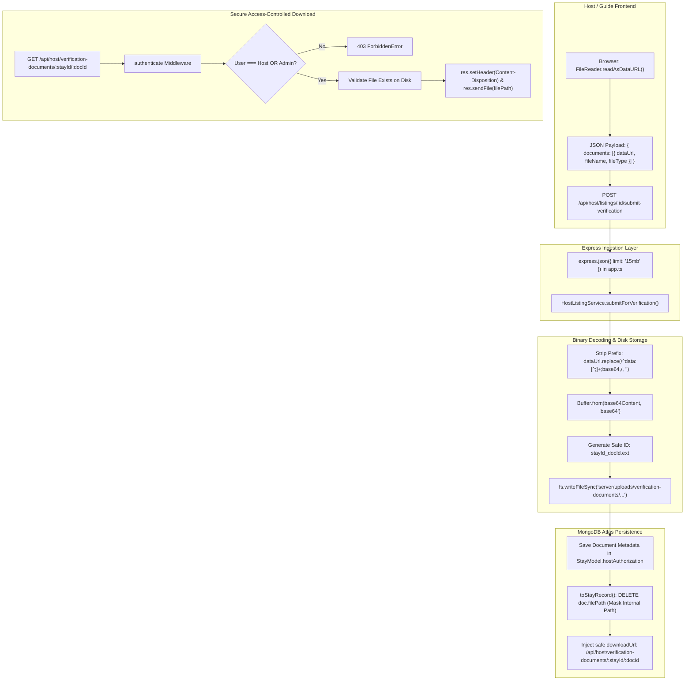

# Module 09: File Uploads & Secure Document Handling

This module explores how StayLocal handles file uploads, verification documents, and private administrative attachments. It examines the architectural choice of Base64 Data URL payloads over multipart streaming, binary buffer transformations, secure disk storage, file path sanitization, and role-based download streaming.

---

## Architecture Diagram: Document Upload & Download Pipeline



---

## Concept 1: Base64 Data URL Payload Processing vs. Multipart/form-data Streaming

### 1. Concept Name
Base64 Data URL Ingestion in JSON Payloads vs. Multipart Streaming (Multer).

### 2. Simple Definition
A **Base64 Data URL** is a text string that encodes binary file data (like a PDF or JPEG image) into ASCII characters using a 64-character alphabet, prefixed with a MIME type header (e.g., `data:application/pdf;base64,JVBERi0...`). This allows complete files to be embedded directly inside standard JSON REST request bodies without requiring specialized multipart form-data parsers.

### 3. Real-World Analogy
Imagine sending a photograph through the postal service.
- **Multipart streaming (Multer)** is like shipping a parcel box with separate compartments: one compartment holds an index card with your text, and another compartment holds the actual glossy photo print.
- **Base64 JSON encoding** is like having an artist convert the photo into a printed grid of alphanumeric color codes on a single piece of letter paper. You slide the letter into a standard envelope; the recipient reads the codes and paints the photo back onto a canvas.

### 4. Why Developers Need It
In modern single-page applications (React + Vite):
1. **Simplified Client APIs**: Frontend services can submit complex nested entities (e.g., a homestay property relationship, legal declaration checkbox, notes, and 3 verification certificates) in a single atomic JSON API call using standard `axios.post()` or `fetch()`, avoiding complicated `FormData.append()` loops.
2. **Eliminates Multer Dependencies**: Multer uses temporary disk streaming that introduces cleanup race conditions, temporary file leaks, and cross-platform path vulnerabilities.
3. **Absence Confirmation**: The StayLocal backend **does NOT use Multer**. File ingestion is handled entirely via Express's JSON parser configured with an expanded limit: `express.json({ limit: '15mb' })`.

### 5. How StayLocal Uses It
In [server/src/app.ts](file:///c:/Users/HP/Downloads/Major%20Project/server/src/app.ts#L48), StayLocal sets `express.json({ limit: '15mb' })`. Hosts submit verification documents (such as land ownership papers, panchayat NOC certificates, or electricity bills) as Base64 strings in the JSON body of `POST /api/host/listings/:id/submit-verification`.

### 6. Actual File Location
- File: [server/src/app.ts](file:///c:/Users/HP/Downloads/Major%20Project/server/src/app.ts) (Line 48)
- File: [server/src/services/host-listing.service.ts](file:///c:/Users/HP/Downloads/Major%20Project/server/src/services/host-listing.service.ts) (Lines 353–370)

### 7. Code Explanation
Here is the configuration in [server/src/app.ts](file:///c:/Users/HP/Downloads/Major%20Project/server/src/app.ts#L48):

```typescript
// Body parsers with generous limit for document/image data URLs
app.use(express.json({ limit: '15mb' }));
app.use(express.urlencoded({ extended: true, limit: '15mb' }));
```

And the decoding in [server/src/services/host-listing.service.ts](file:///c:/Users/HP/Downloads/Major%20Project/server/src/services/host-listing.service.ts#L367-L369):

```typescript
const base64Content = doc.dataUrl.replace(/^data:[^;]+;base64,/, '');
const buffer = Buffer.from(base64Content, 'base64');
fs.writeFileSync(fullDiskPath, buffer);
```

- **`limit: '15mb'`**: Standard Express JSON body limit is 100KB. A 15MB limit accommodates multiple high-resolution photos and PDF deeds while still providing protection against unbounded denial-of-service memory exhaustion.
- **`doc.dataUrl.replace(/^data:[^;]+;base64,/, '')`**: Strips the data URI header prefix (e.g. `data:image/png;base64,`), leaving only raw Base64 characters.
- **`Buffer.from(base64Content, 'base64')`**: Decodes the text string into raw binary bytes in Node.js memory.

### 8. Execution Flow
1. Host selects a 2MB PDF property deed in the frontend.
2. React converts the file to `data:application/pdf;base64,JVBERi0xLjQK...` using `FileReader`.
3. The frontend sends `POST /api/host/listings/:id/submit-verification` with `{ documents: [{ dataUrl, fileName: 'deed.pdf', fileType: 'application/pdf' }] }`.
4. Express's `express.json({ limit: '15mb' })` buffers and parses the JSON request body.
5. `HostListingService` strips the metadata prefix and writes the binary buffer to disk.

### 9. Common Mistakes
- **Exceeding Express default body limits**: Forgetting to set `{ limit: '15mb' }` results in immediate HTTP 413 `PayloadTooLargeError: request entity too large` as soon as a user uploads any file larger than 100KB.
- **Base64 size inflation**: Base64 encoding increases data size by approximately 33%. A 10MB raw file becomes ~13.3MB when Base64-encoded. Setting the limit to 15MB comfortably accommodates 10MB files.

### 10. Interview Questions & Answers
**Q1: What are the trade-offs of accepting file uploads as Base64 JSON strings compared to `multipart/form-data` with Multer?**
*Answer:*
- **Advantages of Base64 JSON**: Simplicity. Client and server communicate over standard JSON payloads; requests can include complex nested JSON alongside the files; zero dependencies on third-party binary streaming libraries like Multer; simpler testing with Postman/Supertest.
- **Disadvantages of Base64 JSON**: 33% payload size inflation due to 6-bit to 8-bit ASCII mapping; higher RAM consumption because the entire file must be buffered into memory before decoding; not suitable for massive multi-gigabyte video files. For StayLocal's use case (2MB to 5MB PDF certificates and photos), Base64 in JSON offers optimal engineering simplicity and reliability.

**Q2: How does `Buffer.from(string, 'base64')` operate in the Node.js runtime?**
*Answer:* `Buffer` is a global Node.js class designed to handle raw binary data outside of the V8 JavaScript heap (allocated in C++ memory). When `Buffer.from(str, 'base64')` is called, the Node.js C++ runtime decodes the 4-byte Base64 ASCII chunks into 3-byte binary octets, returning a contiguous chunk of memory that can be directly written to a file descriptor via `fs.writeFileSync()` or streamed to cloud storage.

### 11. Practical Exercise
Inspect [server/src/app.ts](file:///c:/Users/HP/Downloads/Major%20Project/server/src/app.ts#L48). Verify that `limit: '15mb'` is applied to both `express.json` and `express.urlencoded`.

---

## Concept 2: Safe File Storage and Directory Isolation

### 1. Concept Name
Deterministic Directory Resolution and Safe Disk File Storage.

### 2. Simple Definition
When saving uploaded files to a local server filesystem, the application must guarantee that storage directories exist, ensure paths resolve consistently regardless of whether the app was launched from the project root or a subfolder, and generate collision-free, safe file names that prevent attackers from overwriting system files.

### 3. Real-World Analogy
Imagine a village archive office. When residents bring property deeds, the clerk doesn't let citizens write their own drawer labels or toss documents into the general lobby. The clerk places each deed in a locked cabinet labeled `verification-documents`, inside a folder stamped with the property's official registry number and a unique cryptographic serial code.

### 4. Why Developers Need It
1. **Current Working Directory (`process.cwd()`) Discrepancies**: If a developer starts the server with `npm run dev` from the root directory, `process.cwd()` is `c:/Project/`. If they run `node dist/server.js` from inside `server/`, `process.cwd()` is `c:/Project/server/`. Without dynamic directory resolution, files end up scattered across different folders or crash with `ENOENT`.
2. **Directory Auto-Creation**: If the `uploads/` directory does not exist on a newly deployed container (e.g. fresh Render container), calling `fs.writeFileSync()` immediately crashes the request.
3. **Path Traversal Attacks**: If an attacker submits a file named `../../etc/passwd` or `../../server.ts`, an unsafe implementation would overwrite system files.

### 5. How StayLocal Uses It
In [server/src/services/host-listing.service.ts](file:///c:/Users/HP/Downloads/Major%20Project/server/src/services/host-listing.service.ts#L345-L369), StayLocal dynamically checks `process.cwd()`, ensures directory existence using `fs.mkdirSync(uploadDir, { recursive: true })`, and creates a sanitized filename combining `stayId`, a timestamp, and a cryptographically random hex token.

### 6. Actual File Location
- File: [server/src/services/host-listing.service.ts](file:///c:/Users/HP/Downloads/Major%20Project/server/src/services/host-listing.service.ts)
- Lines: 345–369

### 7. Code Explanation
Here is the storage resolution from [server/src/services/host-listing.service.ts](file:///c:/Users/HP/Downloads/Major%20Project/server/src/services/host-listing.service.ts#L345-L369):

```typescript
// Ensure uploads directory exists
const uploadDir = path.resolve(
  process.cwd(),
  process.cwd().endsWith('server') ? 'uploads/verification-documents' : 'server/uploads/verification-documents'
);
if (!fs.existsSync(uploadDir)) {
  fs.mkdirSync(uploadDir, { recursive: true });
}

// Process incoming documents
for (const doc of incomingDocuments) {
  if (!doc.dataUrl) continue;
  const docId = `doc_${Date.now().toString(36)}_${crypto.randomBytes(4).toString('hex')}`;
  let ext = 'bin';
  if (doc.fileType.includes('pdf')) ext = 'pdf';
  else if (doc.fileType.includes('png')) ext = 'png';
  else if (doc.fileType.includes('jpeg') || doc.fileType.includes('jpg')) ext = 'jpg';

  const safeDiskName = `${stay.id}_${docId}.${ext}`;
  const fullDiskPath = path.join(uploadDir, safeDiskName);

  const base64Content = doc.dataUrl.replace(/^data:[^;]+;base64,/, '');
  const buffer = Buffer.from(base64Content, 'base64');
  fs.writeFileSync(fullDiskPath, buffer);
  // ...
}
```

- **Lines 345–348**: Robust path resolution. Evaluates `process.cwd().endsWith('server')`. Whether running in monorepo development or standalone production container, the path always resolves to `uploads/verification-documents`.
- **Lines 349–351 (`fs.mkdirSync(..., { recursive: true })`)**: Automatically creates the nested directory hierarchy if it doesn't already exist on disk.
- **Line 358 (`crypto.randomBytes(4).toString('hex')`)**: Generates an unpredictable 8-character cryptographic token, guaranteeing zero filename collisions even if two hosts upload documents at the exact same millisecond.
- **Lines 359–362 (MIME Extension Whitelisting)**: Resolves the extension strictly from the verified MIME type (`pdf`, `png`, `jpg`), ignoring whatever extension the user supplied in the filename.
- **Line 364 (`safeDiskName`)**: Synthesizes the final filename (`stay-mun-01_doc_lxyz123_a1b2c3d4.pdf`), isolating files by homestay and document ID.

### 8. Execution Flow
1. Host submits a file named `my_house_deed.pdf`.
2. `uploadDir` resolves to `C:\...\server\uploads\verification-documents`.
3. If the directory does not exist, `fs.mkdirSync` creates it recursively.
4. Unique ID generated: `doc_m1k2l3_9f8e7d6c`.
5. Sanitized filename generated: `stay-mun-01_doc_m1k2l3_9f8e7d6c.pdf`.
6. Bytes written to disk at `fullDiskPath`.
7. `fullDiskPath` is saved in the database record for subsequent authorized retrieval.

### 9. Common Mistakes
- **Using user-supplied filenames directly on disk**: Writing `fs.writeFileSync(path.join(uploadDir, userFilename), buffer)` allows path traversal attacks (e.g. `userFilename = "../../../app.js"`) and creates collisions when two users upload `document.pdf`.
- **Relying on file extensions instead of MIME types**: Trusting `fileName.split('.').pop()` allows users to upload executable files renamed to `.png`.

### 10. Interview Questions & Answers
**Q1: How does StayLocal protect against Path Traversal (Directory Traversal) vulnerabilities during file uploads?**
*Answer:* Path traversal occurs when an attacker uses relative path segments (such as `../`) to manipulate the target destination path on the host filesystem. StayLocal prevents this by completely ignoring the user's original file path. The destination filename is generated programmatically using a strict template: `${stay.id}_${docId}.${ext}`, where `stay.id` is a validated internal database slug, `docId` is a cryptographically generated hex token, and `ext` is derived from a strict MIME type whitelist (`pdf`, `png`, `jpg`).

**Q2: Why is `{ recursive: true }` passed to `fs.mkdirSync()`?**
*Answer:* By default, `fs.mkdirSync('a/b/c')` fails with `ENOENT` if directory `a` or `b` does not already exist. Passing `{ recursive: true }` instructs the operating system to create all necessary parent directories in the tree if they are missing (similar to the Unix `mkdir -p` command), preventing runtime boot crashes on new containers.

### 11. Practical Exercise
Inspect lines 358–365 in [server/src/services/host-listing.service.ts](file:///c:/Users/HP/Downloads/Major%20Project/server/src/services/host-listing.service.ts). Verify how the extension is derived strictly from `doc.fileType` rather than parsing the client's `fileName`.

---

## Concept 3: Data Sanitization and Internal Path Hiding (`toStayRecord`)

### 1. Concept Name
Data Sanitization, Internal Server Path Masking, and Security Redaction.

### 2. Simple Definition
**Internal path hiding** is a security practice where absolute server filesystem paths (e.g., `C:\Users\HP\server\uploads\...` or `/var/www/uploads/...`) are stripped from database records before data is serialized into public API responses. Instead of revealing filesystem structure, the API returns a safe, opaque **download URL**.

### 3. Real-World Analogy
Think of an evidence locker in a police station. When the public requests a case summary, the report says "Fingerprint Evidence: Available at Desk 4 with Permit". The report does NOT tell the public "Physical Evidence is stored on Floor B2, Cabinet 9, Locker 14, Keycode 7741". Revealing internal storage details invites unauthorized tampering.

### 4. Why Developers Need It
1. **Information Disclosure Prevention**: Leaking server file paths reveals the host operating system, username, folder structure, and software directory layout to potential attackers.
2. **Decoupling Storage**: By providing `/api/host/verification-documents/:stayId/:docId`, the frontend never depends on where files physically reside on disk. The backend could move files to AWS S3, Google Cloud Storage, or an encrypted volume without changing the API contract.

### 5. How StayLocal Uses It
StayLocal transforms all outbound homestay records using `toStayRecord()` in [server/src/services/host-listing.service.ts](file:///c:/Users/HP/Downloads/Major%20Project/server/src/services/host-listing.service.ts#L26-L44). It explicitly deletes `filePath` from each document descriptor and generates a standardized, secure `downloadUrl`.

### 6. Actual File Location
- File: [server/src/services/host-listing.service.ts](file:///c:/Users/HP/Downloads/Major%20Project/server/src/services/host-listing.service.ts)
- Function: `toStayRecord(doc: StayDoc | Record<string, unknown>): AccommodationRecord`
- Lines: 26–44

### 7. Code Explanation
Here is the redaction logic from [server/src/services/host-listing.service.ts](file:///c:/Users/HP/Downloads/Major%20Project/server/src/services/host-listing.service.ts#L26-L44):

```typescript
function toStayRecord(doc: StayDoc | Record<string, unknown>): AccommodationRecord {
  const maybe = doc as { toJSON?: () => unknown };
  const raw = typeof maybe.toJSON === 'function' ? maybe.toJSON() : doc;
  const json = JSON.parse(JSON.stringify(raw)) as Record<string, unknown>;
  delete json._id;
  delete json.__v;
  const record = json as unknown as AccommodationRecord;
  if (record.hostAuthorization?.documents) {
    record.hostAuthorization.documents = record.hostAuthorization.documents.map((d: HostVerificationDocument & { filePath?: string }) => {
      const copy = { ...d };
      delete copy.filePath; // Critical: Redact absolute disk path
      if (!copy.downloadUrl && copy.id) {
        copy.downloadUrl = `/api/host/verification-documents/${record.id}/${copy.id}`;
      }
      return copy;
    });
  }
  return record;
}
```

- **Lines 30–31 (`delete json._id; delete json.__v;`)**: Strips MongoDB internal metadata keys.
- **Line 36 (`delete copy.filePath`)**: Critical security step. Removes the raw absolute disk path (e.g. `C:\Users\...\uploads\verification-documents\stay-mun-01_doc_123.pdf`) before the record leaves the service layer.
- **Lines 37–39 (`copy.downloadUrl`)**: Replaces the disk path with an authorized API endpoint: `/api/host/verification-documents/${record.id}/${copy.id}`.

### 8. Execution Flow
1. Database stores document: `{ id: 'doc_1', fileName: 'deed.pdf', filePath: '/var/data/uploads/stay-mun-01_doc_1.pdf' }`.
2. Host queries `/api/host/listings`.
3. `HostListingService.getHostListings()` calls `toStayRecord()`.
4. `toStayRecord()` strips `filePath`.
5. Frontend receives: `{ id: 'doc_1', fileName: 'deed.pdf', downloadUrl: '/api/host/verification-documents/stay-mun-01/doc_1' }`.
6. Client UI renders a clean "View Deed" link pointing to the secure download endpoint.

### 9. Common Mistakes
- **Returning raw Mongoose documents directly**: Calling `res.json(stay)` without filtering or redaction immediately exposes absolute disk paths to anyone who inspects the network tab.
- **Serving uploaded documents via public static folders**: Configuring `app.use(express.static('uploads'))` makes all confidential land deeds, government IDs, and tax documents publicly accessible to anyone on the internet who guesses or scrapes the URL!

### 10. Interview Questions & Answers
**Q1: Why should sensitive user-uploaded verification documents never be served from a public Express static directory (`express.static`)?**
*Answer:* Files served via `express.static('uploads')` are completely unauthenticated. Anyone on the internet with the file URL (or an attacker running automated brute-force attacks against file names) can view and download private government identity proofs, land deeds, and financial certificates without logging in. Serving verification files through an authenticated controller endpoint (`res.sendFile()`) ensures every request passes through authentication and role-based authorization middleware first.

**Q2: What is the security impact of Information Disclosure (CWE-200) when absolute filesystem paths are exposed in API responses?**
*Answer:* Exposing absolute server paths (e.g., `/home/ubuntu/staylocal/server/uploads/...` or `C:\Users\Admin\...`) provides attackers with reconnaissance data: the server operating system, hosting environment, user account names, directory structure, and application install paths. Attackers can use this information to craft targeted Local File Inclusion (LFI) or path traversal exploits.

### 11. Practical Exercise
Review [server/src/services/host-listing.service.ts](file:///c:/Users/HP/Downloads/Major%20Project/server/src/services/host-listing.service.ts#L33-L42). Confirm that `delete copy.filePath` is executed across every item in `record.hostAuthorization.documents`.

---

## Concept 4: Role-Based Document Access Control and Secure File Streaming

### 1. Concept Name
Role-Based Document Access Authorization and Binary File Streaming (`res.sendFile`).

### 2. Simple Definition
**Secure file streaming** is the process of transmitting a binary file from the server's disk to a client's web browser only after rigorously verifying that the requesting user possesses the necessary identity and role permissions to view the file.

### 3. Real-World Analogy
Think of requesting a certified copy of a birth certificate from a municipal registry. You cannot simply walk in and point at a file cabinet. You must show your government ID. The clerk verifies that you are either the individual named on the certificate, their legal guardian, or an authorized court official. Only then does the clerk photocopy the record and hand it to you.

### 4. Why Developers Need It
In StayLocal, hosts upload sensitive documents: personal identity documents, property deeds, and electricity utility bills.
- A random tourist or competing host must NEVER be able to view another host's verification papers.
- Only the **specific host who owns the listing** and platform **administrators** are authorized to download these files.
- The stream must include proper HTTP headers (`Content-Type`, `Content-Disposition`) so the browser displays the PDF inline or prompts for download with the original human-readable filename.

### 5. How StayLocal Uses It
StayLocal exposes `GET /api/host/verification-documents/:id/:documentId` in [server/src/routes/host-listing.route.ts](file:///c:/Users/HP/Downloads/Major%20Project/server/src/routes/host-listing.route.ts#L29). The request passes through `authenticate`, then `HostListingService.getDocumentForDownload()` checks host ownership or admin privileges, and finally `downloadVerificationDocument` in [server/src/controllers/host-listing.controller.ts](file:///c:/Users/HP/Downloads/Major%20Project/server/src/controllers/host-listing.controller.ts#L119-L137) streams the file using `res.sendFile()`.

### 6. Actual File Location
- File: [server/src/services/host-listing.service.ts](file:///c:/Users/HP/Downloads/Major%20Project/server/src/services/host-listing.service.ts) (Lines 424–449)
- File: [server/src/controllers/host-listing.controller.ts](file:///c:/Users/HP/Downloads/Major%20Project/server/src/controllers/host-listing.controller.ts) (Lines 119–137)

### 7. Code Explanation
Here is the authorization check in [server/src/services/host-listing.service.ts](file:///c:/Users/HP/Downloads/Major%20Project/server/src/services/host-listing.service.ts#L424-L449):

```typescript
static async getDocumentForDownload(
  user: AuthUser,
  stayId: string,
  documentId: string
): Promise<{ filePath: string; fileName: string; fileType: string }> {
  const stay = await StayModel.findOne({ id: stayId.toLowerCase() });
  if (!stay) {
    throw new NotFoundError(`Homestay listing '${stayId}' was not found.`);
  }

  // Security: Only the assigned host or admin can access verification files
  if (user.role !== 'admin' && stay.hostId !== user.id) {
    throw new ForbiddenError('You are not authorized to access this private verification document.');
  }

  const doc = stay.hostAuthorization?.documents?.find((d) => d.id === documentId);
  if (!doc || !doc.filePath || !fs.existsSync(doc.filePath)) {
    throw new NotFoundError(`Verification document '${documentId}' not found.`);
  }

  return {
    filePath: doc.filePath,
    fileName: doc.fileName,
    fileType: doc.fileType,
  };
}
```

And the controller streaming response in [server/src/controllers/host-listing.controller.ts](file:///c:/Users/HP/Downloads/Major%20Project/server/src/controllers/host-listing.controller.ts#L119-L137):

```typescript
export async function downloadVerificationDocument(
  req: Request,
  res: Response,
  next: NextFunction
): Promise<void> {
  try {
    if (!req.user) throw new UnauthorizedError();
    const stayId = req.params.id as string;
    const documentId = req.params.documentId as string;

    const doc = await HostListingService.getDocumentForDownload(req.user, stayId, documentId);

    res.setHeader('Content-Type', doc.fileType);
    res.setHeader('Content-Disposition', `inline; filename="${encodeURIComponent(doc.fileName)}"`);
    res.sendFile(doc.filePath);
  } catch (err) {
    next(err);
  }
}
```

- **Lines 435–437**: Core authorization policy: `if (user.role !== 'admin' && stay.hostId !== user.id) throw new ForbiddenError(...)`. Non-owners receive HTTP 403 Forbidden.
- **Line 440 (`fs.existsSync(doc.filePath)`)**: Verifies that the file actually exists on the physical storage device before attempting to read it, avoiding unhandled file descriptor exceptions.
- **Line 131 (`res.setHeader('Content-Type', doc.fileType)`)**: Tells the browser whether the stream is an image (`image/png`) or document (`application/pdf`).
- **Line 132 (`res.setHeader('Content-Disposition', ...)`)**: Sets `inline` so PDFs open cleanly in the browser tab, using `encodeURIComponent()` to safely preserve the original filename without header injection vulnerabilities.
- **Line 133 (`res.sendFile(doc.filePath)`)**: Native Express method that streams the file chunk-by-chunk using Node.js read streams.

### 8. Execution Flow
1. Admin opens `/admin/verifications` and clicks "Inspect Property Deed".
2. Browser sends `GET /api/host/verification-documents/stay-mun-01/doc_abc123`.
3. `authenticate` middleware verifies the admin's JWT cookie and sets `req.user`.
4. `getDocumentForDownload` checks: `user.role === 'admin'` (Permission Granted).
5. File existence on disk is confirmed.
6. Controller sets `Content-Type: application/pdf` and calls `res.sendFile(fullDiskPath)`.
7. Express streams the PDF bytes directly to the browser window.

### 9. Common Mistakes
- **Forgetting `encodeURIComponent` on filenames in headers**: If a host uploads a file named `my deed; filename="hack.exe".pdf`, unencoded interpolation allows HTTP header injection attacks.
- **Reading the entire file with `fs.readFileSync()` into a variable before sending**: `fs.readFileSync()` buffers the entire file into Node.js heap memory. Using `res.sendFile()` uses internal OS file streaming (`sendfile` system call), using virtually zero Node.js RAM.

### 10. Interview Questions & Answers
**Q1: How does Express's `res.sendFile()` achieve high-performance file streaming compared to `fs.readFileSync()`?**
*Answer:* `fs.readFileSync()` loads the entire file from disk into Node.js V8 memory as a Buffer object, which consumes RAM and blocks the thread during file I/O. In contrast, `res.sendFile()` uses Node.js readable streams backed by the operating system's native kernel `sendfile` system call (zero-copy transfer). Data is piped directly from disk cache to the network socket in small chunks without unnecessary user-space buffer allocations.

**Q2: What is an Insecure Direct Object Reference (IDOR) in document download endpoints, and how does StayLocal prevent it?**
*Answer:* IDOR (OWASP Top 10) occurs when an application exposes a direct reference to an internal object (e.g. `/api/documents/12345`) without validating that the authenticated user owns or has permission to view that object. An attacker can change `12345` to `12346` to download another user's private documents. StayLocal prevents IDOR in `getDocumentForDownload` by strictly querying the parent listing and asserting that `user.role === 'admin' || stay.hostId === user.id`.

### 11. Practical Exercise
Review lines 424–449 of [server/src/services/host-listing.service.ts](file:///c:/Users/HP/Downloads/Major%20Project/server/src/services/host-listing.service.ts). Test the logic: What would happen if a user with role `'tourist'` attempted to call this endpoint? (They would immediately be rejected with HTTP 403 Forbidden).

---

## Summary of File & Data Handling Rules

| Step | Technical Requirement | StayLocal Implementation | Security / Architectural Goal |
| :--- | :--- | :--- | :--- |
| **Payload Intake** | Expanded JSON parsing | `express.json({ limit: '15mb' })` | Accepts Base64 without Multer dependencies |
| **Binary Decoding** | Regex header strip | `Buffer.from(base64, 'base64')` | Converts ASCII data URLs into raw binary buffers |
| **Filename Safety** | Cryptographic random tokens | `${stayId}_${docId}.${ext}` | Prevents directory traversal and overwrites |
| **Path Masking** | Service layer transformation | `delete copy.filePath` in `toStayRecord` | Hides server filesystem layout from public APIs |
| **Access Control** | Dual-permission check | Host owner or Admin role | Eliminates Insecure Direct Object References (IDOR) |
| **Delivery** | Streamed response | `res.sendFile()` with headers | Zero-copy kernel streaming without memory overhead |