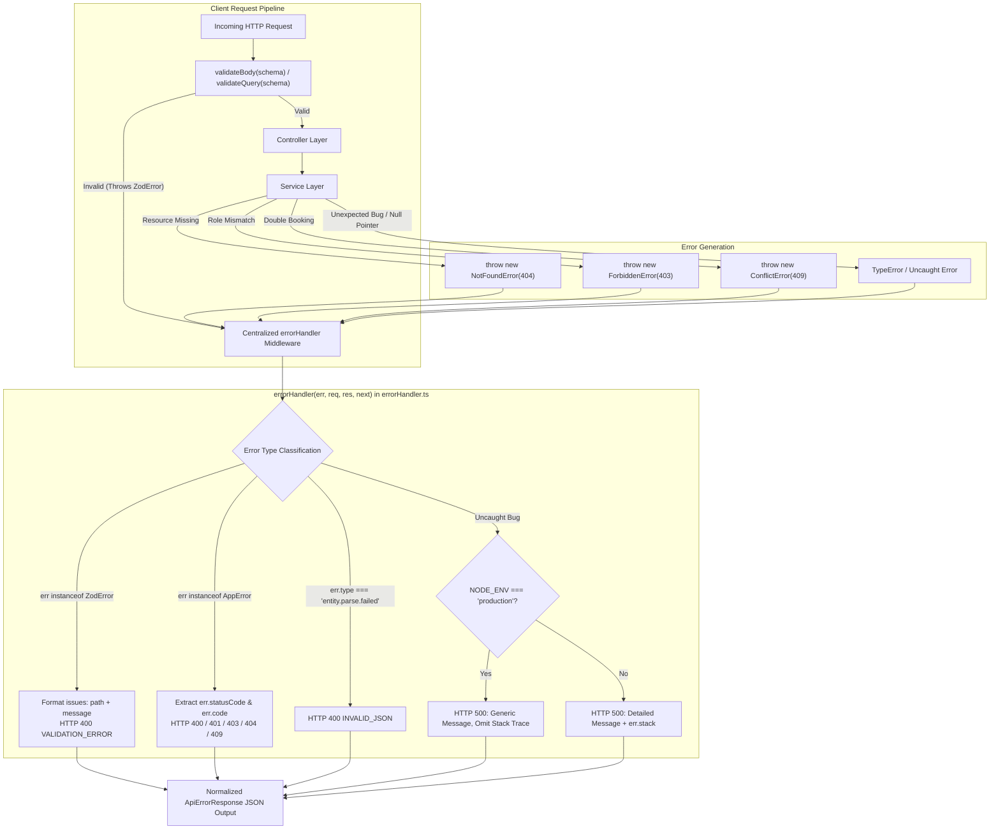
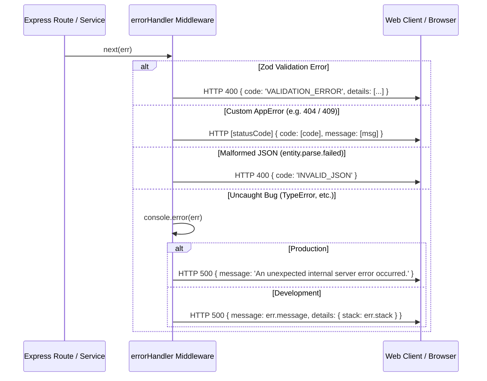

# Module 10: Error Handling & Request Validation Pipeline

This module explores the centralized error-handling system and runtime validation architecture of StayLocal. It covers the object-oriented `AppError` class hierarchy, operational vs. programmer error classification, Zod schema validation middleware, production stack trace suppression, and standard error contract formatting.

---

## Architecture Diagram: Error Dispatch & Validation Pipeline



---

## Concept 1: The Object-Oriented `AppError` Hierarchy and Operational Errors

### 1. Concept Name
The Object-Oriented Custom Error Hierarchy (`AppError`) and Operational vs. Programmer Error Classification.

### 2. Simple Definition
An **Object-Oriented Error Hierarchy** is an inheritance tree of custom error classes extending JavaScript's built-in `Error`. It attaches structured metadata—such as HTTP status codes, machine-readable error codes, and operational flags—so that backend services can throw domain-specific errors without manually managing HTTP response codes in business logic.

### 3. Real-World Analogy
Imagine a hospital triage system. When a patient arrives, nurses don't just say "Something is wrong". They assign a specific code: "Code Blue" (Cardiac Arrest, Priority 1), "Code Red" (Fire), or "Code Yellow" (Missing Patient). Every department knows exactly how to respond based on the formal code, rather than guessing from vague verbal descriptions.

### 4. Why Developers Need It
1. **Decouples Business Logic from HTTP**: Services (`BookingService`, `HostListingService`) should not import Express `Response` objects or call `res.status(404).json(...)`. Services should simply throw domain errors: `throw new NotFoundError('Stay not found')`.
2. **Operational vs. Programmer Errors**:
   - **Operational Errors**: Known, expected failure modes that occur during normal system operation (e.g., user supplies wrong password, homestay is sold out, file size exceeds limit). These should be caught, formatted, and returned to the client cleanly.
   - **Programmer Errors**: Unexpected bugs in the software itself (e.g. `TypeError: Cannot read properties of undefined`, database connection syntax error). These represent critical defects that must be logged with full stack traces for developers to fix.
3. **Stack Trace Preservation**: Using `Error.captureStackTrace(this, this.constructor)` ensures stack traces pinpoint the exact line in service code where the error occurred, omitting internal boilerplate.

### 5. How StayLocal Uses It
StayLocal defines a clean inheritance tree in [server/src/utils/errors.ts](file:///c:/Users/HP/Downloads/Major%20Project/server/src/utils/errors.ts):
- `AppError`: Base class containing `statusCode`, `code`, `isOperational: true`, and `details`.
- Subclasses:
  - `NotFoundError` (HTTP 404, `'NOT_FOUND'`)
  - `BadRequestError` (HTTP 400, `'BAD_REQUEST'`)
  - `UnauthorizedError` (HTTP 401, `'UNAUTHORIZED'`)
  - `ForbiddenError` (HTTP 403, `'FORBIDDEN'`)
  - `ConflictError` (HTTP 409, `'CONFLICT'`)
  - `ConfigurationError` (HTTP 500, `'CONFIGURATION_ERROR'`)
  - `DatabaseError` (HTTP 503, `'DATABASE_UNAVAILABLE'`)

### 6. Actual File Location
- File: [server/src/utils/errors.ts](file:///c:/Users/HP/Downloads/Major%20Project/server/src/utils/errors.ts)
- Classes: `AppError`, `NotFoundError`, `BadRequestError`, `UnauthorizedError`, `ForbiddenError`, `ConflictError`, `ConfigurationError`, `DatabaseError`

### 7. Code Explanation
Here is the core hierarchy from [server/src/utils/errors.ts](file:///c:/Users/HP/Downloads/Major%20Project/server/src/utils/errors.ts#L1-L63):

```typescript
export class AppError extends Error {
  public readonly statusCode: number;
  public readonly code: string;
  public readonly isOperational: boolean;
  public readonly details?: unknown;

  constructor(
    message: string,
    statusCode = 500,
    code = 'INTERNAL_SERVER_ERROR',
    details?: unknown
  ) {
    super(message);
    this.name = this.constructor.name;
    this.statusCode = statusCode;
    this.code = code;
    this.isOperational = true;
    this.details = details;
    Error.captureStackTrace(this, this.constructor);
  }
}

export class NotFoundError extends AppError {
  constructor(message = 'Resource not found', details?: unknown) {
    super(message, 404, 'NOT_FOUND', details);
  }
}

export class ConflictError extends AppError {
  constructor(message = 'Resource conflict or overlapping reservation', details?: unknown) {
    super(message, 409, 'CONFLICT', details);
  }
}
```

- **Line 1 (`extends Error`)**: Inherits standard JavaScript error properties (`message`, `stack`).
- **Line 4 (`isOperational: true`)**: Distinguishes planned operational errors from uncaught runtime crashes.
- **Line 14 (`this.name = this.constructor.name`)**: Ensures `err.name` reflects the concrete subclass name (e.g. `'NotFoundError'`) rather than generic `'Error'`.
- **Line 19 (`Error.captureStackTrace`)**: Node.js V8 optimization that creates the `.stack` property while omitting the constructor call itself, keeping stack traces concise and actionable.
- **Lines 23–27 (`NotFoundError`)**: Encapsulates HTTP status 404 and the standardized string code `'NOT_FOUND'`. Callers can instantiate it cleanly with `throw new NotFoundError('Stay not found')`.

### 8. Execution Flow
1. Tourist attempts to book homestay `'stay-invalid-99'`.
2. Inside `BookingService.createBooking()`, the lookup executes:
   `const stay = await StayModel.findOne({ id: stayId });`
3. Lookup returns `null`.
4. Service throws:
   `throw new NotFoundError("Homestay not found with ID 'stay-invalid-99'");`
5. The exception bubbles out of the service and controller.
6. The controller's catch block forwards it to Express: `next(err)`.
7. Centralized `errorHandler` catches `err`, identifies `err instanceof AppError`, and responds with HTTP 404.

### 9. Common Mistakes
- **Throwing raw strings or generic errors**: Writing `throw "User not found"` or `throw new Error("User not found")`. Raw errors lack status codes, forcing the error handler to treat them as 500 Internal Server Errors.
- **Missing `Error.captureStackTrace`**: Without this, the top lines of the stack trace point to the `AppError` constructor file rather than the controller or service line where the error actually originated.

### 10. Interview Questions & Answers
**Q1: What is the architectural difference between an "operational error" and a "programmer error" in Node.js backend systems?**
*Answer:* 
- **Operational errors** represent predictable, anticipated failure conditions encountered during normal execution—such as invalid user input (400), expired JWT tokens (401), missing database records (404), or concurrency locks (409). They do not indicate software bugs; the system should handle them gracefully by returning standard HTTP responses.
- **Programmer errors** represent actual bugs in the codebase—such as trying to read a property of `undefined`, passing the wrong type to a function, or failing to handle an unhandled promise rejection. These require immediate logging, developer alerts, and in severe cases, process restarts to prevent corrupted state.

**Q2: Why should service classes never import `Response` from Express to send error responses directly?**
*Answer:* Coupling service classes to Express's `Response` object violates the **Separation of Concerns** and **Single Responsibility Principle**. Services should contain pure business logic that can be reused anywhere—in HTTP controllers, background cron jobs, CLI scripts, or automated unit tests. If a service directly calls `res.status(404).json()`, it becomes impossible to test without mocking the entire HTTP response object and cannot be called from background workers.

### 11. Practical Exercise
Inspect [server/src/utils/errors.ts](file:///c:/Users/HP/Downloads/Major%20Project/server/src/utils/errors.ts). Look at lines 59–63 for `DatabaseError`. Notice how it automatically maps to HTTP 503 (`DATABASE_UNAVAILABLE`).

---

## Concept 2: Zod Schema Validation and Preprocessing Middleware

### 1. Concept Name
Runtime Schema Validation, Type Coercion, and Preprocessing Middleware (`Zod`).

### 2. Simple Definition
**Runtime validation** is the process of inspecting incoming HTTP request data (`req.body`, `req.query`, `req.params`) at runtime to ensure it adheres to exact data types, constraints, and business formats before reaching controller logic. **Zod** is a TypeScript-first schema declaration and validation library that infers static TypeScript types directly from runtime validation rules.

### 3. Real-World Analogy
Think of an automated airport baggage sizing template at the boarding gate. Before passengers can step onto the jet bridge, their carry-on bag must slide into the metal frame. If the bag is too wide, heavy, or contains prohibited items, the gate agent halts the passenger before they ever reach the airplane aisle.

### 4. Why Developers Need It
1. **TypeScript Types Vanish at Runtime**: TypeScript types exist only during compilation. When a client sends a JSON payload `{ "guestCount": -5 }`, TypeScript cannot protect you at runtime.
2. **Preventing SQL/NoSQL Injection**: Validating that an ID matches an expected slug or UUID prevents malicious query injection payloads (e.g. `{ "$gt": "" }`).
3. **Handling Empty Query Strings**: In HTTP GET requests, frontend forms often send empty strings for unselected filters (e.g., `?district=&division=`). Without preprocessing, `z.enum(['Kumaon', 'Garhwal']).optional()` fails because `""` is not a valid enum value.

### 5. How StayLocal Uses It
StayLocal creates modular validation schemas in [server/src/validators/](file:///c:/Users/HP/Downloads/Major%20Project/server/src/validators/):
- Helper preprocessors: `optionalString` and `optionalEnum` convert empty strings `""` to `undefined`.
- Middleware factories: `validateBody(schema)` and `validateQuery(schema)` automatically parse incoming requests and forward any `ZodError` to the error handler.

### 6. Actual File Location
- File: [server/src/validators/index.ts](file:///c:/Users/HP/Downloads/Major%20Project/server/src/validators/index.ts)
- Functions: `validateBody()`, `validateQuery()`
- Schemas: `staysQuerySchema`, `destinationsQuerySchema`, `experiencesQuerySchema`

### 7. Code Explanation
Here is the validation engine from [server/src/validators/index.ts](file:///c:/Users/HP/Downloads/Major%20Project/server/src/validators/index.ts#L5-L79):

```typescript
// Helper to preprocess empty query strings to undefined
const optionalString = z.preprocess(
  (val) => (typeof val === 'string' && val.trim() === '' ? undefined : val),
  z.string().optional()
);

const optionalEnum = <T extends [string, ...string[]]>(values: T) =>
  z.preprocess(
    (val) => (typeof val === 'string' && val.trim() === '' ? undefined : val),
    z.enum(values).optional()
  );

export const staysQuerySchema = z.object({
  destination: optionalString,
  district: optionalString,
  category: optionalEnum([
    'village_homestay',
    'heritage_farmstay',
    'eco_lodge',
    'mountain_cottage',
    'bed_and_breakfast',
  ]),
  minGuests: z
    .preprocess(
      (val) => (typeof val === 'string' && val.trim() === '' ? undefined : val),
      z.string().optional()
    )
    .transform((val) => (val !== undefined ? parseInt(val, 10) : undefined))
    .refine((val) => val === undefined || (!isNaN(val) && val >= 0), {
      message: 'minGuests must be a non-negative number',
    }),
});

export function validateBody(schema: z.ZodTypeAny) {
  return (req: Request, _res: Response, next: NextFunction): void => {
    try {
      req.body = schema.parse(req.body); // Validates and strips unrecognized fields
      next();
    } catch (err) {
      next(err); // Forwards ZodError to errorHandler
    }
  };
}
```

- **Lines 5–8 (`optionalString`)**: Uses `z.preprocess()`. If the client submits `?district=`, the preprocessor checks `val.trim() === ''` and converts it to `undefined`. Zod then treats it as omitted rather than an invalid value.
- **Lines 38–46 (`minGuests` Transformation)**:
  - Takes a raw query string parameter (e.g. `"4"`).
  - Uses `.transform()` to convert it to an integer `4`.
  - Uses `.refine()` to enforce domain constraints (`val >= 0`).
- **Line 74 (`req.body = schema.parse(req.body)`)**: Validates the payload. If valid, replaces `req.body` with the parsed and sanitized output. Any extra, unapproved fields sent by an attacker are automatically stripped!
- **Line 76 (`catch (err) { next(err); }`)**: Passes any validation error down the Express middleware chain to the centralized `errorHandler`.

### 8. Execution Flow
1. Client sends `POST /api/bookings` with `{ "checkIn": "2026-05-10", "guestCount": 0 }`.
2. Request hits route with `validateBody(createBookingSchema)`.
3. `schema.parse()` runs:
   - Evaluates `guestCount`: constraint is `min(1)`.
   - Validation fails; Zod constructs a `ZodError` containing:
     `[{ path: ['guestCount'], message: 'Guest count must be at least 1' }]`.
4. Middleware catches `ZodError` and calls `next(err)`.
5. `errorHandler` intercepts `err instanceof ZodError` and returns HTTP 400 with formatted issue details.
6. The controller function is never invoked, protecting database resources.

### 9. Common Mistakes
- **Validating inside every controller**: Duplicating `if (!req.body.name) return res.status(400)...` in every controller method creates massive code duplication and inconsistent error responses.
- **Forgetting that query parameters are always strings**: In Express, `req.query.minGuests` is the string `"4"`, not number `4`. If you write `z.number()` without `.preprocess()` or `.transform()`, validation will always fail on query strings.

### 10. Interview Questions & Answers
**Q1: What is the security advantage of replacing `req.body` with the return value of `schema.parse(req.body)`?**
*Answer:* This practice protects against **Mass Assignment vulnerabilities** (CWE-915). By default, Zod schemas strip unlisted keys during `.parse()`. If an attacker attempts to inject privileged fields into a user profile update request (e.g. `{ "name": "Aarav", "role": "admin", "isVerified": true }`), `schema.parse()` strips `role` and `isVerified` because they are not declared in the profile update schema. Reassigning `req.body` guarantees that downstream controllers only receive validated, explicitly permitted properties.

**Q2: How does `z.preprocess()` differ from `z.transform()` in Zod?**
*Answer:* 
- `z.preprocess(fn, schema)` executes the transformation function **before** schema validation occurs. It is ideal for sanitizing raw inputs—such as converting empty strings `""` to `undefined` or trimming whitespace—so that the subsequent schema validators see clean data.
- `z.transform(fn)` executes **after** the initial schema validation has succeeded. It is used to cast or convert validated data types—such as converting a validated numeric string into a JavaScript `Number` or converting an ISO date string into a `Date` instance.

### 11. Practical Exercise
Examine [server/src/validators/booking.validator.ts](file:///c:/Users/HP/Downloads/Major%20Project/server/src/validators/booking.validator.ts). Review `createBookingSchema`. Verify how dates and guest counts are validated before any booking logic executes.

---

## Concept 3: Centralized Error Handler and Response Formatting

### 1. Concept Name
The Centralized 4-Parameter Error Middleware and Unified API Error Responses.

### 2. Simple Definition
A **centralized error handler** is a dedicated Express middleware with an exact 4-argument signature `(err, req, res, next)`. It serves as the single funnel through which every error across the entire application passes. It intercepts different error types, formats them into a unified, predictable JSON contract, and sends the final HTTP response.

### 3. Real-World Analogy
Think of the claims processing department of an insurance company. Regardless of whether an issue was caused by a car accident, a storm, or a lost piece of luggage, all claim forms are routed to the central processing center. The department translates varied police and medical reports into a standard, official claim settlement letter with a standardized case number.

### 4. Why Developers Need It
1. **Consistency**: Frontend developers shouldn't have to handle 10 different error formats. Every error response must follow a single schema: `{ success: false, error: { code, message, details } }`.
2. **Crash Prevention**: Unhandled asynchronous errors crash Node.js processes. Passing errors through `next(err)` to a central handler prevents unhandled exceptions from terminating the server.
3. **HTTP 400 for Malformed JSON**: If a client sends a body with a missing curly brace (`{ "name": `), Express's body parser throws a syntax error. A central handler catches `entity.parse.failed` and returns clean HTTP 400 instead of a crash or 500 error.

### 5. How StayLocal Uses It
StayLocal registers `errorHandler` in [server/src/middleware/errorHandler.ts](file:///c:/Users/HP/Downloads/Major%20Project/server/src/middleware/errorHandler.ts) as the very last middleware in `createApp()` ([server/src/app.ts](file:///c:/Users/HP/Downloads/Major%20Project/server/src/app.ts#L86)). It provides a 4-tier dispatch pipeline handling Zod validation errors, custom `AppError` operational errors, malformed JSON body errors, and unexpected server crashes.

### 6. Actual File Location
- File: [server/src/middleware/errorHandler.ts](file:///c:/Users/HP/Downloads/Major%20Project/server/src/middleware/errorHandler.ts)
- Function: `errorHandler(err: Error, _req: Request, res: Response<ApiErrorResponse>, _next: NextFunction)`

### 7. Code Explanation
Here is the error dispatcher from [server/src/middleware/errorHandler.ts](file:///c:/Users/HP/Downloads/Major%20Project/server/src/middleware/errorHandler.ts#L7-L72):

```typescript
export function errorHandler(
  err: Error,
  _req: Request,
  res: Response<ApiErrorResponse>,
  _next: NextFunction
): void {
  // 1. Zod Validation Errors
  if (err instanceof ZodError) {
    const formattedErrors = err.issues.map((issue) => ({
      path: issue.path.join('.'),
      message: issue.message,
    }));

    const detailSummary = formattedErrors.map((e) => e.message).join('. ');

    res.status(400).json({
      success: false,
      error: {
        code: 'VALIDATION_ERROR',
        message: detailSummary || 'Invalid request payload or query parameters.',
        details: formattedErrors,
      },
    });
    return;
  }

  // 2. Custom App Operational Errors
  if (err instanceof AppError) {
    res.status(err.statusCode).json({
      success: false,
      error: {
        code: err.code,
        message: err.message,
        details: err.details,
      },
    });
    return;
  }

  // 3. Express JSON parse syntax error
  if ('type' in err && (err as { type: string }).type === 'entity.parse.failed') {
    res.status(400).json({
      success: false,
      error: {
        code: 'INVALID_JSON',
        message: 'Malformed JSON payload in request body.',
      },
    });
    return;
  }

  // 4. Uncaught Internal Server Errors
  console.error('[ServerError] Unhandled exception:', err);

  const isProduction = env.NODE_ENV === 'production';
  res.status(500).json({
    success: false,
    error: {
      code: 'INTERNAL_SERVER_ERROR',
      message: isProduction
        ? 'An unexpected internal server error occurred.'
        : err.message || 'Internal server error',
      details: isProduction ? undefined : { stack: err.stack },
    },
  });
}
```

- **Lines 7–12**: Express identifies error middleware strictly by the arity of its parameters (it **must** have 4 arguments: `err, req, res, next`). If you omit `_next`, Express treats it as a normal route middleware!
- **Lines 14–31 (Tier 1 - Zod)**: Flattens nested validation issues into a clean `{ path: 'guestDetails.adults', message: '...' }` array.
- **Lines 34–44 (Tier 2 - AppError)**: Reads `err.statusCode` and `err.code` from our OOP error classes.
- **Lines 47–56 (Tier 3 - JSON Syntax)**: Gracefully handles malformed JSON bodies without crashing.
- **Lines 59–71 (Tier 4 - Uncaught 500)**: Logs the raw error via `console.error()`. Checks `isProduction`: in production, internal messages and stack traces are hidden from the user.

### 8. Execution Flow


### 9. Common Mistakes
- **Registering the error handler before routes**: In Express, middleware executes in the exact order registered. If `app.use(errorHandler)` is placed before `app.use('/api', routes)`, errors occurring in routes will bypass the handler entirely and default to Express's HTML error page.
- **Removing the unused `next` parameter**: Writing `function errorHandler(err, req, res)` has only 3 arguments. Express inspects `fn.length`; if `length !== 4`, it is treated as normal middleware and will not be invoked when an error is thrown.

### 10. Interview Questions & Answers
**Q1: How does Express recognize that a middleware function is an error-handling middleware?**
*Answer:* Express uses JavaScript's function arity property (`Function.prototype.length`). Standard route middleware functions declare 2 or 3 parameters: `(req, res)` or `(req, res, next)`. Error-handling middleware functions declare exactly 4 parameters: `(err, req, res, next)`. When a route or middleware calls `next(err)` with an argument, Express skips all standard 2- and 3-parameter middleware in the router stack and jumps directly to the next middleware whose `.length === 4`.

**Q2: Why must the centralized error handler be the very last middleware registered in `app.ts`?**
*Answer:* Express processes requests sequentially through its internal middleware and route stack. If an error occurs in an API controller registered on line 50, Express searches downstream in the stack for an error handler. If the error handler was registered on line 20 (before the route), Express will not see it and will fall back to its default built-in HTML error handler. Therefore, `app.use(errorHandler)` must always be registered after all routers and 404 fallback handlers.

### 11. Practical Exercise
Check [server/src/app.ts](file:///c:/Users/HP/Downloads/Major%20Project/server/src/app.ts#L80-L87). Verify the exact ordering:
1. `app.use('/api', apiRouter)`
2. `app.use(notFoundHandler)`
3. `app.use(errorHandler)`

---

## Concept 4: Production Information Leakage and Stack Trace Suppression

### 1. Concept Name
Production Information Disclosure Prevention and Environment-Aware Stack Trace Suppression.

### 2. Simple Definition
**Stack trace suppression** is the security practice of stripping internal code paths, line numbers, variable contents, and database driver error messages from HTTP error responses when the application is running in a production environment (`NODE_ENV === 'production'`).

### 3. Real-World Analogy
Imagine an ATM screen encountering a software crash while dispensing cash.
- **In Development Mode**: The ATM displays a debug terminal showing: "Line 402 in cash_dispenser.c: Buffer underrun at memory address 0x7FFF...".
- **In Production Mode**: The ATM safely displays: "An unexpected error occurred. Please contact customer service at 1800-XXX-XXXX." Revealing the memory address and internal code would allow a criminal to reverse-engineer and exploit the cash machine.

### 4. Why Developers Need It
1. **OWASP Top 10 Security Compliance**: CWE-209 (Generation of Error Message Containing Sensitive Information) is a major attack vector. Stack traces reveal exact file paths (`C:\Users\HP\...`), server operating system details, third-party library versions, and database table schemas.
2. **Preventing Credential Leakage**: Database driver exceptions (e.g. MongoServerError) often embed partial connection strings, IP addresses, or database collection names in the error message.
3. **Developer Ergonomics in Local Dev**: In local development (`NODE_ENV !== 'production'`), developers need full stack traces in their API client (e.g. Postman or browser console) to debug issues without constantly switching to terminal logs.

### 5. How StayLocal Uses It
In [server/src/middleware/errorHandler.ts](file:///c:/Users/HP/Downloads/Major%20Project/server/src/middleware/errorHandler.ts#L61-L71), StayLocal evaluates `env.NODE_ENV === 'production'`. If true, it returns a generic user-friendly message (`"An unexpected internal server error occurred."`) and sets `details: undefined`, completely omitting `err.stack`.

### 6. Actual File Location
- File: [server/src/middleware/errorHandler.ts](file:///c:/Users/HP/Downloads/Major%20Project/server/src/middleware/errorHandler.ts)
- Lines: 61–71

### 7. Code Explanation
Here is the environment-aware suppression from [server/src/middleware/errorHandler.ts](file:///c:/Users/HP/Downloads/Major%20Project/server/src/middleware/errorHandler.ts#L59-L71):

```typescript
// 4. Uncaught Internal Server Errors
console.error('[ServerError] Unhandled exception:', err);

const isProduction = env.NODE_ENV === 'production';
res.status(500).json({
  success: false,
  error: {
    code: 'INTERNAL_SERVER_ERROR',
    message: isProduction
      ? 'An unexpected internal server error occurred.'
      : err.message || 'Internal server error',
    details: isProduction ? undefined : { stack: err.stack },
  },
});
```

- **Line 59 (`console.error('[ServerError] Unhandled exception:', err)`)**: Unconditionally logs the full error and stack trace to server standard error (`stderr`). Platform operators and monitoring tools (like Render logs or Datadog) can inspect the full bug details securely behind authenticated server logs.
- **Line 61 (`const isProduction = env.NODE_ENV === 'production'`)**: Checks the strongly-typed environment configuration.
- **Lines 66–68 (`message: isProduction ? ...`)**: In production, replaces potentially sensitive error messages with a generic sentence.
- **Line 69 (`details: isProduction ? undefined : { stack: err.stack }`)**: If production, `details` is omitted from the JSON payload completely. In development, the full V8 stack trace is included to accelerate debugging.

### 8. Execution Flow
1. A developer accidentally introduces a null pointer bug: `stay.hostAuthorization.documents.map(...)` when `hostAuthorization` is undefined.
2. Request crashes with `TypeError: Cannot read properties of undefined`.
3. Error reaches `errorHandler`.
4. Full stack trace is printed to server terminal logs:
   `[ServerError] Unhandled exception: TypeError: Cannot read properties... at HostListingService.submitForVerification (C:\...\host-listing.service.ts:384)`
5. If `env.NODE_ENV === 'production'`:
   - Response sent to user:
     ```json
     {
       "success": false,
       "error": {
         "code": "INTERNAL_SERVER_ERROR",
         "message": "An unexpected internal server error occurred."
       }
     }
     ```
   - Zero internal server paths or stack frames are leaked over the internet.

### 9. Common Mistakes
- **Relying on Express's default error page in production**: If no custom error handler is installed, Express renders an HTML page that displays `TypeError: ...` and the full stack trace directly in the browser!
- **Not logging the error to `stderr`**: Suppressing the error for the client is crucial, but failing to log it on the server (`console.error`) means production bugs become invisible "black boxes" that developers cannot diagnose.

### 10. Interview Questions & Answers
**Q1: What is the risk of exposing database query errors (e.g., Mongoose or PostgreSQL driver errors) directly in API responses?**
*Answer:* Database driver error messages frequently expose internal database topology, collection/table names, SQL/BSON syntax structures, and sometimes even the raw data or parameter values involved in the failed query. Malicious actors use this information to conduct database reconnaissance, map out the schema for SQL/NoSQL injection attacks, or identify unindexed queries to execute denial-of-service attacks.

**Q2: How do APM (Application Performance Monitoring) tools like Sentry or Datadog integrate with a centralized error handler?**
*Answer:* In production, an APM tool's SDK (e.g. `@sentry/node`) is initialized during bootstrap. Inside the centralized `errorHandler` middleware (specifically in Tier 4 before returning HTTP 500), developers call `Sentry.captureException(err)`. The APM tool captures the full stack trace, request headers, authenticated user ID, and environment metadata, transmitting it asynchronously to a secure developer dashboard while the client receives only a safe, sanitized generic error message.

### 11. Practical Exercise
Review lines 59–71 in [server/src/middleware/errorHandler.ts](file:///c:/Users/HP/Downloads/Major%20Project/server/src/middleware/errorHandler.ts). Verify how the ternary operator guarantees that `details` evaluates to `undefined` whenever `NODE_ENV === 'production'`.

---

## Summary of Error Handling & Validation Contracts

| Error Category | HTTP Code | Internal Code | Example Source | Client Payload Content |
| :--- | :--- | :--- | :--- | :--- |
| **Validation** | 400 | `VALIDATION_ERROR` | `ZodError` in `validateBody()` | Array of `{ path, message }` issues |
| **Malformed JSON** | 400 | `INVALID_JSON` | Body parser syntax error | `"Malformed JSON payload in request body."` |
| **Authentication** | 401 | `UNAUTHORIZED` | Missing or invalid JWT cookie | `"Authentication required"` |
| **Authorization** | 403 | `FORBIDDEN` | Role mismatch / Host non-owner | `"Access forbidden for your role"` |
| **Resource Missing** | 404 | `NOT_FOUND` | Missing Stay or Booking ID | `"Resource not found"` |
| **Concurrency Conflict** | 409 | `CONFLICT` | Concurrent booking / lock contention | `"Resource conflict or overlapping reservation"` |
| **Database Unavailable**| 503 | `DATABASE_UNAVAILABLE` | MongoDB Atlas disconnect | `"Database service is currently unavailable"` |
| **Uncaught Exception** | 500 | `INTERNAL_SERVER_ERROR` | Runtime crash / TypeError | Sanitized generic text (Prod) or stack trace (Dev) |