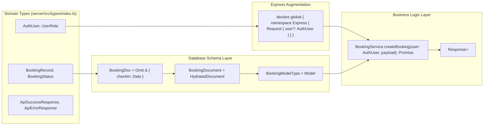

# Module 11: TypeScript in Backend Architecture

This module details how TypeScript is employed across the StayLocal backend to build an end-to-end type-safe, resilient server architecture. It explores ambient declaration merging to augment Express requests, Mongoose document type hydration, discriminated union state machines, generic API contracts, and strict compiler configurations.

---

## Architecture Diagram: TypeScript Type Flow Across Backend Layers



---

## Concept 1: Ambient Declaration Merging and Express Request Augmentation

### 1. Concept Name
Ambient Declaration Merging and Augmenting `Express.Request`.

### 2. Simple Definition
**Declaration merging** is a TypeScript language feature where the compiler combines multiple separate declarations with the exact same name into a single unified type definition. **Ambient declaration merging** allows backend developers to inject custom properties (such as an authenticated `user` object) directly into external third-party library types (like Express's `Request`) without modifying the third-party source code.

### 3. Real-World Analogy
Imagine receiving a standard printed government passport application form (`Express.Request`). The form has standard fields: Name, Address, Date of Birth. For high-security international summit delegates, the security division attaches an official stamped addendum sheet to the packet titled "Summit Clearance Badge" (`user?: AuthUser`). Every security officer at every checkpoint now expects the badge to be attached to the passport packet.

### 4. Why Developers Need It
In Express, middleware executes before route handlers. When the `authenticate` middleware runs, it decodes a JWT token and attaches the authenticated user's profile to `req.user`.
- Without declaration merging: TypeScript flags an immediate compile error on every controller: `Property 'user' does not exist on type 'Request'`.
- Developers are tempted to use `(req as any).user`, which disables type checking, causes typos (`req.usr`), and loses auto-completion.
- Declaration merging provides compile-time auto-completion: typing `req.user.` in any controller immediately suggests `.id`, `.email`, `.role`, and `.fullName`.

### 5. How StayLocal Uses It
In [server/src/middleware/auth.ts](file:///c:/Users/HP/Downloads/Major%20Project/server/src/middleware/auth.ts#L8-L15), StayLocal executes ambient declaration merging on `Express.Request` to include `user?: AuthUser`.

### 6. Actual File Location
- File: [server/src/middleware/auth.ts](file:///c:/Users/HP/Downloads/Major%20Project/server/src/middleware/auth.ts)
- Lines: 8–15

### 7. Code Explanation
Here is the declaration merging block from [server/src/middleware/auth.ts](file:///c:/Users/HP/Downloads/Major%20Project/server/src/middleware/auth.ts#L8-L15):

```typescript
import { Request, Response, NextFunction } from 'express';
import { AuthUser, UserRole } from '../types';

// Extend Express Request interface to include authenticated user
declare global {
  // eslint-disable-next-line @typescript-eslint/no-namespace
  namespace Express {
    interface Request {
      user?: AuthUser;
    }
  }
}
```

- **Line 8 (`declare global`)**: Escapes the current ES module scope to modify ambient global types accessible across the entire TypeScript project.
- **Line 10 (`namespace Express`)**: Targets Express's internal global namespace.
- **Lines 11–13 (`interface Request { user?: AuthUser }`)**: Declares an interface with the exact same name as Express's built-in `Request`. TypeScript automatically merges this new property into the existing Express interface.
- **`user?: AuthUser`**: Typed as optional (`?`) because unauthenticated public routes (e.g., `GET /api/stays` or `POST /api/auth/login`) will have `req.user === undefined`.

### 8. Execution Flow
1. Developer writes a controller: `const hostId = req.user?.id;`.
2. TypeScript compiler reads `server/src/middleware/auth.ts`.
3. The compiler locates the merged `Express.Request` definition.
4. Auto-completion prompts: `req.user` has properties `id: string`, `email: string`, `role: UserRole`, `fullName: string`.
5. If the developer types `req.user.nonExistentField`, TypeScript halts compilation with a strict type error.

### 9. Common Mistakes
- **Omitting `declare global` in a module file**: If a file contains `import` or `export` statements, it is an ES module. Writing `namespace Express { ... }` without `declare global` creates a local module-scoped namespace that Express never sees.
- **Marking `user` as non-optional (`user: AuthUser`)**: If typed without `?`, TypeScript will assume `req.user` is always present, leading to runtime null-pointer crashes on public unauthenticated endpoints.

### 10. Interview Questions & Answers
**Q1: How does TypeScript declaration merging work under the hood?**
*Answer:* In TypeScript, interfaces and namespaces are "open-ended", meaning multiple declarations with the same identifier in the same scope are merged into a single type. When the compiler encounters an interface declaration that matches an existing interface (such as `Express.Request`), it combines the members of both declarations. Properties in later declarations must either introduce new property names or have identical types to previously declared properties.

**Q2: What is the difference between an ambient declaration (`.d.ts`) file and inlining `declare global` inside a `.ts` source file?**
*Answer:* A standalone declaration file (e.g. `express.d.ts`) provides ambient types project-wide without containing any runtime JavaScript code. Inlining `declare global` inside a `.ts` module file (like `server/src/middleware/auth.ts`) ties the type augmentation directly to the module that actually populates that property at runtime (`authenticate`). Both approaches merge declarations correctly; however, an inlined declaration ensures that whenever the middleware is imported, the accompanying type definition is guaranteed to be loaded by the compiler.

### 11. Practical Exercise
Open [server/src/controllers/host-listing.controller.ts](file:///c:/Users/HP/Downloads/Major%20Project/server/src/controllers/host-listing.controller.ts#L125). Look at line 125: `if (!req.user) throw new UnauthorizedError();`. Notice how TypeScript uses this type guard to narrow `req.user` from `AuthUser | undefined` to strictly `AuthUser` on line 129!

---

## Concept 2: Mongoose Document Interfaces and Type Hydration

### 1. Concept Name
Mongoose Document Interfaces, Hydration Types, and Reconciling Dates.

### 2. Simple Definition
Mongoose documents have two lives:
1. **At rest in MongoDB**: Stored as BSON, with dates stored as native BSON `Date` objects.
2. **In transit over JSON APIs**: Dates are serialized to ISO 8601 strings (`"2026-05-10T12:00:00.000Z"`).
**Type reconciliation** uses TypeScript type utilities (`Omit`, `HydratedDocument`, `Model`) to ensure the Mongoose database model expects true JavaScript `Date` instances, while the public API contract expects ISO strings.

### 3. Real-World Analogy
Think of an international traveler's currency.
- While inside Japan, you spend physical Yen banknotes (`Date` objects in MongoDB).
- When looking at your international credit card statement online, all purchases are converted into your home currency of US Dollars (ISO strings in JSON responses).
A good accountant keeps the Japanese receipts separate from the US Dollar credit card statement, maintaining clear records in both currencies.

### 4. Why Developers Need It
Without rigorous document typing:
1. Developers pass string dates (`"2026-05-10"`) directly to Mongoose queries expecting `Date` objects, breaking `$gte` and `$lt` date range comparisons.
2. TypeScript complains if you assign a Mongoose `Document` to a frontend interface because Mongoose documents contain dozens of internal methods (`$isNew`, `$set`, `save`).
3. Using `HydratedDocument<T>` provides full typing for both schema fields and Mongoose document methods on query results.

### 5. How StayLocal Uses It
In [server/src/models/booking.model.ts](file:///c:/Users/HP/Downloads/Major%20Project/server/src/models/booking.model.ts#L4-L25), StayLocal derives `BookingDoc` from the public `BookingRecord` interface using TypeScript's `Omit` utility, replacing ISO date strings with native JavaScript `Date` types.

### 6. Actual File Location
- File: [server/src/models/booking.model.ts](file:///c:/Users/HP/Downloads/Major%20Project/server/src/models/booking.model.ts)
- Types: `BookingDoc`, `BookingDocument`, `BookingModelType`

### 7. Code Explanation
Here is the type reconciliation from [server/src/models/booking.model.ts](file:///c:/Users/HP/Downloads/Major%20Project/server/src/models/booking.model.ts#L4-L25):

```typescript
import { Schema, model, Model, HydratedDocument } from 'mongoose';
import { BookingRecord, BookingStatus } from '../types';

export interface BookingDoc extends Omit<
  BookingRecord,
  'createdAt' | 'updatedAt' | 'checkIn' | 'checkOut' | 'confirmedAt' | 'cancelledAt' | 'rejectedAt' | 'expiresAt'
> {
  checkIn: Date;
  checkOut: Date;
  bedsRequired?: number;
  guestDetails?: {
    adults: number;
    children: number;
    maleGuests?: number;
    femaleGuests?: number;
  };
  cleaningBufferMinutes?: number;
  expiresAt?: Date;
  confirmedAt?: Date;
  cancelledAt?: Date;
  rejectedAt?: Date;
  createdAt?: Date;
  updatedAt?: Date;
}

export type BookingDocument = HydratedDocument<BookingDoc>;
export type BookingModelType = Model<BookingDoc, Record<string, never>>;
```

- **Lines 4–7 (`Omit<BookingRecord, ...>`)**: Takes the public API interface `BookingRecord` (where dates are typed as `string`) and strips out all date fields.
- **Lines 8–20**: Re-declares all date fields as native JavaScript `Date` objects. This guarantees that inside backend services, `booking.checkIn.getTime()` is 100% type-safe.
- **Line 23 (`HydratedDocument<BookingDoc>`)**: Mongoose utility type representing a fully instantiated Mongoose document. Combines `BookingDoc` schema properties with Mongoose methods (`.save()`, `.isModified()`, `.id`).
- **Line 24 (`Model<BookingDoc>`)**: Represents the static Mongoose model type, providing type checking for `BookingModel.find()`, `BookingModel.create()`, and `BookingModel.findOneAndUpdate()`.

### 8. Execution Flow
1. Developer writes `await BookingModel.findOne({ id })`.
2. TypeScript types the result as `BookingDocument | null`.
3. Calling `booking.checkIn` returns `Date`, allowing `booking.checkIn.toISOString()` or `.getTime()`.
4. When calling `booking.save()`, TypeScript recognizes `.save()` as a valid method on `BookingDocument`.
5. When calling `booking.toJSON()`, the schema transform runs, converting `Date` objects back into ISO strings matching `BookingRecord`.

### 9. Common Mistakes
- **Using a single interface for both API JSON and Mongoose**: If you type `checkIn: string` on the Mongoose document interface, Mongoose internally casts it to a `Date`, creating a discrepancy between TypeScript's compile-time expectation (`string`) and runtime reality (`Date`).
- **Using `any` for Mongoose models**: Writing `const BookingModel: any = model(...)` disables type checking on all database queries across the entire application.

### 10. Interview Questions & Answers
**Q1: What is the purpose of Mongoose's `HydratedDocument<T>` type utility in TypeScript?**
*Answer:* `HydratedDocument<T>` represents an active document instance returned from queries or created via `new Model()`. It intersects the raw schema data properties defined in interface `T` with Mongoose's internal document prototype—including instance methods (`.save()`, `.validate()`), virtuals, getters, and change tracking flags (`.isModified()`). This eliminates the need to manually extend `mongoose.Document` in custom interfaces.

**Q2: Why should dates be represented as `Date` in Mongoose models but `string` in public API response interfaces?**
*Answer:* In MongoDB's BSON wire protocol, dates are stored as 64-bit UTC integers (`BSON Date`), allowing range indexing (`$gte`, `$lte`) and date aggregation pipelines. However, the JSON specification has no native date data type; all dates serialized over HTTP must be ISO 8601 strings (`"2026-11-24T12:00:00.000Z"`). Having separate types for the database layer (`BookingDoc`) and the API boundary (`BookingRecord`) accurately reflects runtime data structures at both layers.

### 11. Practical Exercise
Examine [server/src/models/booking.model.ts](file:///c:/Users/HP/Downloads/Major%20Project/server/src/models/booking.model.ts#L175-L203). Trace `toJSON.transform`. Notice how it converts `record.checkIn` and `record.checkOut` from `Date` objects into ISO strings before sending them to the client.

---

## Concept 3: Discriminated Unions and String Literal Types for State Machines

### 1. Concept Name
String Literal Types and Discriminated Unions for Lifecycle State Machines.

### 2. Simple Definition
A **string literal type** is a TypeScript type that permits only specific, predefined string values (e.g. `'pending' | 'confirmed' | 'cancelled'`), rather than arbitrary strings. A **discriminated union** is a union of object types that share a common literal discriminator property (like `status`), enabling TypeScript to automatically narrow down available fields based on that property.

### 3. Real-World Analogy
Think of a traffic light. A traffic light cannot display "purple", "neon blue", or "banana". The hardware physical lens permits only three distinct states: `'RED'`, `'YELLOW'`, or `'GREEN'`. When the sensor detects `'RED'`, the system knows with 100% certainty that the walk signal is active, without needing to check any other conditions.

### 4. Why Developers Need It
1. **Eliminates Magic Strings**: Typos in status updates (e.g. `status = 'confrimed'`) are caught instantly by the TypeScript compiler before code ever runs.
2. **Exhaustive Switch Checking**: When writing status transition handlers or UI badges, TypeScript warns developers if they forgot to handle a new state (e.g. `'rejected'`).
3. **Domain Integrity**: Prevents invalid state mutations across homestay verifications, host assignments, and tourist bookings.

### 5. How StayLocal Uses It
StayLocal models all entity lifecycles as strict string literal unions in [server/src/types/index.ts](file:///c:/Users/HP/Downloads/Major%20Project/server/src/types/index.ts):
- `UserRole = 'tourist' | 'host' | 'admin' | 'guide'`
- `BookingStatus = 'pending' | 'confirmed' | 'rejected' | 'cancelled' | 'completed'`
- `VerificationStatus = 'unverified_lead' | 'verification_pending' | 'verified' | 'rejected_or_inactive'`
- `AssignmentStatus = 'unassigned' | 'assigned'`
- `PublicationStatus = 'draft' | 'published' | 'archived'`

### 6. Actual File Location
- File: [server/src/types/index.ts](file:///c:/Users/HP/Downloads/Major%20Project/server/src/types/index.ts)
- Types: `UserRole`, `BookingStatus`, `VerificationStatus`, `AssignmentStatus`, `PublicationStatus`

### 7. Code Explanation
Here are the state definitions from [server/src/types/index.ts](file:///c:/Users/HP/Downloads/Major%20Project/server/src/types/index.ts#L5-L39):

```typescript
export type VerificationStatus =
  | 'unverified_lead'
  | 'verification_pending'
  | 'verified'
  | 'rejected_or_inactive';

export type PublicationStatus = 'draft' | 'published' | 'archived';

export type AccommodationCategory =
  | 'village_homestay'
  | 'heritage_farmstay'
  | 'eco_lodge'
  | 'mountain_cottage'
  | 'bed_and_breakfast';

export type AssignmentStatus = 'unassigned' | 'assigned';
```

And how it is enforced in service logic ([server/src/services/booking.service.ts](file:///c:/Users/HP/Downloads/Major%20Project/server/src/services/booking.service.ts#L323-L334)):

```typescript
// Status transition validation
if (booking.status === 'confirmed') {
  throw new BadRequestError('This booking reservation has already been confirmed.');
}
if (booking.status === 'cancelled') {
  throw new BadRequestError('Cannot confirm a booking that has been cancelled.');
}
if (booking.status !== 'pending') {
  throw new BadRequestError(`Cannot confirm booking in '${booking.status}' status.`);
}
```

- If a developer tries to compare `booking.status === 'approved'`, TypeScript immediately underlines `'approved'` with an error:
  `This comparison appears to be unintentional because the types 'BookingStatus' and '"approved"' have no overlap.`
- This catches logical errors before unit tests or production builds are executed.

### 8. Execution Flow
1. Developer writes booking cancellation logic.
2. In the switch statement or if-conditions, TypeScript checks `booking.status`.
3. If the developer types `booking.status = 'archived'`, TypeScript flags an error: `'archived' is not assignable to type 'BookingStatus'`.
4. The developer corrects the code to use `'cancelled'`.

### 9. Common Mistakes
- **Using TypeScript `enum` instead of string literal unions**: Traditional TypeScript enums (`enum Status { Pending, Confirmed }`) compile into complex runtime IIFE JavaScript functions that pollute bundles and require importing the enum object in every file. String literal unions compile away to zero runtime JavaScript while offering superior type safety and JSON compatibility.
- **Using loose `string` in service parameters**: Writing `updateStatus(id: string, status: string)` allows any arbitrary string to be passed into the database.

### 10. Interview Questions & Answers
**Q1: Why are TypeScript string literal union types (`type Role = 'admin' | 'host'`) generally preferred over TypeScript `enum` in modern Node.js backends?**
*Answer:* String literal unions have three major advantages over traditional enums:
1. **Zero Runtime Overhead**: String literal unions exist purely at compile-time and compile to zero bytes of JavaScript code, whereas enums generate runtime objects and IIFEs.
2. **Seamless JSON Serialization**: A string literal matches standard JSON strings directly (`"admin"`). Enums (especially numeric enums) often cause serialization and deserialization bugs when communicating across network boundaries.
3. **Simpler Imports**: Calling `requireRole('admin')` requires zero imports of an enum symbol; the string is self-documenting and type-checked directly.

**Q2: What is "Exhaustiveness Checking" using the `never` type in TypeScript?**
*Answer:* Exhaustiveness checking is a compiler verification technique used in `switch` statements to guarantee that every possible member of a union has been handled. By assigning the unhandled default case to a variable of type `never` (`const _exhaustiveCheck: never = status;`), the TypeScript compiler will throw a compile error if a developer adds a new state to the union (e.g. adding `'disputed'` to `BookingStatus`) without updating the switch statement to handle it.

### 11. Practical Exercise
Check [server/src/types/index.ts](file:///c:/Users/HP/Downloads/Major%20Project/server/src/types/index.ts#L47). Notice how `action` in `AssignmentHistoryItem` is strictly typed as `'assigned' | 'reassigned' | 'unassigned'`.

---

## Concept 4: Strict Compiler Configuration (`tsconfig.json`)

### 1. Concept Name
Enterprise-Grade Strict Compiler Options in `tsconfig.json`.

### 2. Simple Definition
The **`tsconfig.json`** file controls how the TypeScript compiler (`tsc`) analyzes, type-checks, and transpiles TypeScript code into JavaScript. Enabling **strict compiler flags** activates the most rigorous type-checking rules, eliminating common JavaScript runtime errors at compile time.

### 3. Real-World Analogy
Think of building a suspension bridge across a Himalayan gorge. You can build it using relaxed safety inspections where loose bolts are ignored until the bridge opens, or you can enforce rigorous aerospace-grade inspections where every single weld, bolt, and cable tension is measured with laser precision before anyone is allowed to step onto the bridge.

### 4. Why Developers Need It
JavaScript is notorious for runtime exceptions like:
- `TypeError: Cannot read properties of undefined`
- Functions silently returning `undefined` when developers forgot a `return` statement.
- Unused variables cluttering memory.
Strict compiler options convert these runtime landmines into blocking compile-time errors.

### 5. How StayLocal Uses It
StayLocal defines an exceptionally strict configuration in [server/tsconfig.json](file:///c:/Users/HP/Downloads/Major%20Project/server/tsconfig.json).

### 6. Actual File Location
- File: [server/tsconfig.json](file:///c:/Users/HP/Downloads/Major%20Project/server/tsconfig.json)

### 7. Code Explanation
Here is the configuration from [server/tsconfig.json](file:///c:/Users/HP/Downloads/Major%20Project/server/tsconfig.json#L2-L24):

```json
{
  "compilerOptions": {
    "target": "ES2022",
    "module": "CommonJS",
    "lib": ["ES2022"],
    "outDir": "./dist",
    "rootDir": "./src",
    "strict": true,
    "noImplicitAny": true,
    "strictNullChecks": true,
    "strictFunctionTypes": true,
    "strictBindCallApply": true,
    "strictPropertyInitialization": true,
    "noImplicitThis": true,
    "alwaysStrict": true,
    "noUnusedLocals": true,
    "noUnusedParameters": true,
    "noImplicitReturns": true,
    "noFallthroughCasesInSwitch": true,
    "noUncheckedIndexedAccess": true,
    "esModuleInterop": true,
    "skipLibCheck": true,
    "forceConsistentCasingInFileNames": true
  }
}
```

- **`strict: true`**: Master switch activating a broad suite of strict checks.
- **`strictNullChecks: true`**: Guarantees that `null` and `undefined` are not assignable to standard types unless explicitly specified (e.g. `string | undefined`).
- **`noImplicitAny: true`**: Prohibits variables or function arguments from defaulting to `any`.
- **`noUncheckedIndexedAccess: true`**: Essential enterprise flag. When accessing array indices (`arr[0]`) or dictionary keys (`obj[key]`), TypeScript forces the type to include `| undefined`, compelling developers to handle missing array elements or dictionary keys safely.
- **`noImplicitReturns: true`**: Ensures all code branches in a function return a value.
- **`noUnusedLocals: true` & `noUnusedParameters: true`**: Prevents dead code and orphaned parameters from polluting the production build.

### 8. Execution Flow
1. Developer attempts to access `req.params.id`.
2. Because `noUncheckedIndexedAccess: true` is enabled, TypeScript types `req.params.id` as `string | undefined`.
3. If the developer tries to call `req.params.id.toLowerCase()` without a guard, TypeScript refuses to compile: `Object is possibly 'undefined'`.
4. Developer adds a guard: `if (!stayId) { ... }` or casts safely after validation.
5. Runtime null pointer crashes are completely prevented in production.

### 9. Common Mistakes
- **Disabling `strictNullChecks` to avoid fixing type errors**: Disabling this flag invites `Cannot read properties of undefined` back into your production server.
- **Using `// @ts-ignore` instead of fixing type guards**: `@ts-ignore` silences the compiler, blinding the development team to actual potential bugs.

### 10. Interview Questions & Answers
**Q1: What is the impact of enabling `"noUncheckedIndexedAccess": true` in `tsconfig.json`?**
*Answer:* By default, TypeScript assumes that accessing any array element (`const item = array[5]`) or dictionary key (`const val = dict[key]`) returns the base element type (e.g. `string`), even though the element might not exist at runtime. Enabling `"noUncheckedIndexedAccess": true` forces TypeScript to automatically append `| undefined` to all indexed lookup operations. This compels developers to perform null checks before accessing properties on indexed lookups, eliminating an entire category of index out-of-bounds runtime crashes.

**Q2: Why does StayLocal compile with `"target": "ES2022"` and `"module": "CommonJS"`?**
*Answer:* Node.js 18+ and 20+ have native runtime support for modern ECMAScript 2022 features (such as `Array.prototype.at`, `Object.hasOwn`, and top-level await), allowing `tsc` to emit clean, unbloated modern JavaScript syntax without polyfills. Emitting `CommonJS` modules (`module: "CommonJS"`) guarantees seamless compatibility with standard Node.js runtime loaders, production process managers, and CJS database drivers like Mongoose and Bcrypt without ESM loader interoperability hurdles.

### 11. Practical Exercise
Review [server/tsconfig.json](file:///c:/Users/HP/Downloads/Major%20Project/server/tsconfig.json#L20). Locate `"noUncheckedIndexedAccess": true`. Note how this single line elevates the code quality of the entire backend.

---

## Summary of TypeScript Architectural Standards

| Principle | StayLocal Pattern | Implementation File | Benefit |
| :--- | :--- | :--- | :--- |
| **Request Augmentation** | Ambient Declaration Merging | `middleware/auth.ts` | Type-safe `req.user` in all authenticated controllers |
| **Document Typing** | `HydratedDocument` & `Omit` | `models/booking.model.ts` | Reconciles native `Date` in DB with ISO strings in JSON |
| **State Validation** | String Literal Unions | `types/index.ts` | Eliminates typos and magic strings at compile time |
| **Compiler Rigor** | Enterprise Strict Flags | `tsconfig.json` | Compile-time prevention of undefined property exceptions |