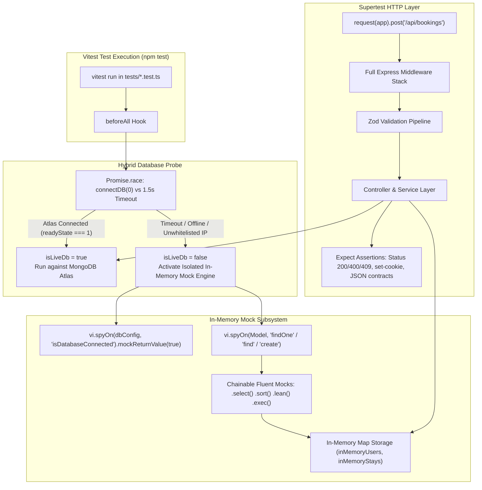

# Module 12: Testing & Debugging Strategy

This module explores the testing, mocking, and debugging architecture of the StayLocal backend. It details how the platform runs 175+ comprehensive tests across 13 test suites using Vitest and Supertest, how it employs a resilient hybrid live-database vs. in-memory fallback strategy, how it mocks Mongoose's chainable query pipelines, and how it verifies security headers, cookies, and HTTP contracts.

---

## Architecture Diagram: Hybrid Test Execution Engine



---

## Concept 1: Vitest Test Runner Architecture and Fast In-Memory Execution

### 1. Concept Name
Vitest High-Speed Test Runner Architecture and Modern Test Harness.

### 2. Simple Definition
**Vitest** is a next-generation unit and integration testing framework built on top of Vite. It provides out-of-the-box TypeScript execution, native ESM and CommonJS support, multi-threaded parallel execution, and built-in mocking utilities (`vi.fn()`, `vi.spyOn()`) compatible with the Jest API.

### 3. Real-World Analogy
Think of testing with legacy tools (like old Jest configurations with Babel transpilers) as waiting for a 10-car freight train to slowly steam up before checking every wheel. Vitest is like an electric high-speed bullet train: it uses lightning-fast V8 worker threads to inspect every wagon simultaneously in seconds.

### 4. Why Developers Need It
1. **Speed**: Traditional Jest setups require heavy `ts-jest` transpilation layers that can take 30–60 seconds to boot on large codebases. Vitest executes test suites in 2–4 seconds.
2. **Native TypeScript Support**: Zero configuration files needed to parse modern TypeScript syntax (`satisfies`, nullish coalescing, optional chaining).
3. **Built-in Mocking Engine**: `vi.fn()` and `vi.spyOn()` eliminate the need for extra mocking libraries like Sinon.

### 5. How StayLocal Uses It
In [server/package.json](file:///c:/Users/HP/Downloads/Major%20Project/server/package.json#L9), StayLocal defines `"test": "vitest run"` and `"test:watch": "vitest"`. Across 13 dedicated test suites in [server/tests/](file:///c:/Users/HP/Downloads/Major%20Project/server/tests/), Vitest validates authentication, role-based authorization, time-based booking intervals, host verification queues, and database error states.

### 6. Actual File Location
- File: [server/package.json](file:///c:/Users/HP/Downloads/Major%20Project/server/package.json)
- Directory: [server/tests/](file:///c:/Users/HP/Downloads/Major%20Project/server/tests/)
- Core Suites: `auth.test.ts`, `booking.test.ts`, `time-based-booking.test.ts`, `host-assignment.test.ts`

### 7. Code Explanation
Here is the test structure from [server/tests/auth.test.ts](file:///c:/Users/HP/Downloads/Major%20Project/server/tests/auth.test.ts#L1-L10):

```typescript
import { describe, it, expect, beforeAll, afterAll, beforeEach, vi } from 'vitest';
import request from 'supertest';
import { app } from '../src/app';
import { UserModel } from '../src/models/user.model';

describe('StayLocal Secure Authentication & Role-Based Authorization', () => {
  // Test suite setup...
  it('should reject registration if email is already taken', async () => {
    // Test implementation...
  });
});
```

- **`describe`**: Logical container grouping related test cases for a specific feature or API boundary.
- **`it` (or `test`)**: Individual test specification containing assertions.
- **`expect`**: Fluent assertion library (`expect(res.status).toBe(400)`).
- **`vi`**: Vitest's utility object for creating spy functions, mock timers, and module overrides.

### 8. Execution Flow
1. Developer runs `npm test` inside `server/`.
2. Vitest spins up worker threads.
3. Vitest discovers all files matching `tests/**/*.test.ts`.
4. Executes `beforeAll` hooks to probe database connectivity.
5. Runs test cases concurrently across isolated threads.
6. Aggregates results into a terminal summary report:
   `✓ tests/auth.test.ts (24 tests)`
   `✓ tests/booking.test.ts (31 tests)`
   `Tests: 175 passed (175 total)`

### 9. Common Mistakes
- **Running tests in `--watch` mode in CI/CD**: Running `vitest` without `run` in continuous integration causes the pipeline to hang indefinitely waiting for user keyboard input. Production CI pipelines must run `vitest run`.
- **Polluting global state across tests**: Modifying global variables without resetting them in `beforeEach` causes tests to pass when run individually but fail when run in batch.

### 10. Interview Questions & Answers
**Q1: What are the primary performance advantages of Vitest over Jest for TypeScript backend testing?**
*Answer:* Vitest leverages Vite's underlying transformation pipeline, utilizing esbuild for near-instantaneous TypeScript compilation. Unlike Jest—which often requires `ts-jest` or Babel to transpile every TypeScript file synchronously before execution—Vitest executes TypeScript directly via worker threads, shares module caches, and provides seamless ESM and CommonJS interoperability without complex configuration bridges.

**Q2: What is the difference between `beforeAll` and `beforeEach` in a test lifecycle?**
*Answer:* 
- `beforeAll` runs **once** before any test cases in the `describe` block execute. It is ideal for heavy, shared setup operations, such as establishing database connection pools or launching mock HTTP servers.
- `beforeEach` runs **before every single individual `it()` block**. It is used to reset state—such as clearing in-memory mock maps, resetting database collections, or clearing mock counters (`vi.clearAllMocks()`)—to guarantee test isolation.

### 11. Practical Exercise
Inspect [server/package.json](file:///c:/Users/HP/Downloads/Major%20Project/server/package.json#L8-L11). Notice the scripts: `"test": "vitest run"` and `"test:watch": "vitest"`.

---

## Concept 2: HTTP Integration Testing with Supertest (`request(app)`)

### 1. Concept Name
Full-Pipeline HTTP Integration Testing with Supertest.

### 2. Simple Definition
**Supertest** is an HTTP assertion library that allows developers to test an Express application by simulating real HTTP requests (`GET`, `POST`, `PATCH`, `DELETE`) directly against the Express `app` instance in memory, without needing to bind to a physical TCP port.

### 3. Real-World Analogy
Think of testing a new commercial passenger jet.
- **Unit testing** is testing the altimeter sensor on a workbench in a lab.
- **Supertest integration testing** is putting the fully assembled airplane inside a high-tech flight simulator: all controls, hydraulics, cockpit warning lights, and emergency protocols are engaged together under realistic flight conditions without burning physical jet fuel.

### 4. Why Developers Need It
Unit testing a single controller method by passing a mock `req` and `res` object fails to test the **actual pipeline**:
- It doesn't test whether CORS headers are attached.
- It doesn't test whether `express.json()` successfully parsed the body.
- It doesn't test whether Zod validation middleware intercepted invalid fields.
- It doesn't test whether cookies were properly formatted with `HttpOnly` and `SameSite`.
Supertest tests the **entire end-to-end pipeline** as an external client experiences it.

### 5. How StayLocal Uses It
StayLocal uses Supertest across all 13 test suites. By passing the unstarted Express instance `app` from [server/src/app.ts](file:///c:/Users/HP/Downloads/Major%20Project/server/src/app.ts) directly into `request(app)`, it verifies status codes, JSON response bodies, and cookie headers.

### 6. Actual File Location
- File: [server/tests/auth.test.ts](file:///c:/Users/HP/Downloads/Major%20Project/server/tests/auth.test.ts)
- File: [server/tests/booking.test.ts](file:///c:/Users/HP/Downloads/Major%20Project/server/tests/booking.test.ts)

### 7. Code Explanation
Here is an integration test from [server/tests/auth.test.ts](file:///c:/Users/HP/Downloads/Major%20Project/server/tests/auth.test.ts#L100-L125):

```typescript
it('should successfully login and set secure HttpOnly cookie', async () => {
  const res = await request(app)
    .post('/api/auth/login')
    .send({
      email: 'host@staylocal.in',
      password: 'Password123!',
    });

  expect(res.status).toBe(200);
  expect(res.body.success).toBe(true);
  expect(res.body.data.user.email).toBe('host@staylocal.in');

  // Verify HttpOnly cookie header
  const cookies = res.headers['set-cookie'];
  expect(cookies).toBeDefined();
  expect(cookies[0]).toContain('staylocal_auth=');
  expect(cookies[0]).toContain('HttpOnly');
  expect(cookies[0]).toContain('SameSite=Lax');
});
```

- **`request(app).post('/api/auth/login')`**: Synthesizes an HTTP `POST` request.
- **`.send({ ... })`**: Transmits JSON body through Express's real body-parser middleware.
- **`expect(res.status).toBe(200)`**: Asserts the exact HTTP status code.
- **`expect(res.body.success).toBe(true)`**: Asserts conformity with the `ApiSuccessResponse` contract.
- **`res.headers['set-cookie']`**: Inspects outgoing HTTP response headers to verify cryptographic session cookies.

### 8. Execution Flow
1. Supertest creates an ephemeral in-memory Node.js HTTP server.
2. The HTTP request enters Express at `app`.
3. Middleware chain executes:
   - Helmet attaches security headers.
   - CORS evaluates origin.
   - `express.json()` parses body.
   - Cookie parser reads incoming cookies.
   - Route validator parses Zod schema.
   - Auth controller handles login.
   - Token utility calls `res.cookie()`.
4. Response returns to Supertest.
5. Supertest passes the response object to Vitest's `expect` assertions.

### 9. Common Mistakes
- **Passing the listening server instead of `app`**: Writing `request(server)` where `server = app.listen(5000)` causes port conflicts when running multiple test suites in parallel. Always pass the raw `app` instance: `request(app)`.
- **Forgetting `await` on Supertest calls**: Writing `const res = request(app).get(...)` without `await` causes the assertion to run against an unresolved Promise, leading to false positive test passes.

### 10. Interview Questions & Answers
**Q1: Why is Supertest able to test Express applications without calling `app.listen(PORT)`?**
*Answer:* In Node.js, an Express `app` is fundamentally a callback function with signature `(req: IncomingMessage, res: ServerResponse) => void`. Supertest creates an internal Node.js `http.Server` instance using `http.createServer(app)`. When a request is made, Supertest dispatches mock socket events directly into this server instance without needing to bind to an external TCP network port on the host operating system. This prevents port collisions when running dozens of test suites concurrently.

**Q2: How do you simulate authenticated requests in Supertest when using HttpOnly cookie authentication?**
*Answer:* When using cookie-based authentication, Supertest provides the `.set('Cookie', [...])` builder method. After performing a login request in a setup hook and capturing `res.headers['set-cookie']`, subsequent protected requests pass that cookie header:
`await request(app).get('/api/host/listings').set('Cookie', authCookie)`.
Alternatively, if the API supports Bearer tokens, you pass `.set('Authorization', 'Bearer ' + token)`.

### 11. Practical Exercise
Open [server/tests/booking.test.ts](file:///c:/Users/HP/Downloads/Major%20Project/server/tests/booking.test.ts). Search for `.set('Cookie'`. Notice how test suites extract the auth cookie from login and pass it to protected booking endpoints.

---

## Concept 3: The Hybrid Test Execution Pattern (Live Atlas vs. In-Memory Mock)

### 1. Concept Name
The Resilient Hybrid Test Execution Architecture.

### 2. Simple Definition
A **hybrid test execution pattern** is an architectural design where test suites attempt to connect to the live production/staging database (MongoDB Atlas) with a strict, fast timeout budget (e.g. 1.5 seconds). If Atlas is reachable, tests run against live database collections. If offline (e.g. developing on a train, unwhitelisted IP address, or GitHub Actions CI), tests automatically switch to an isolated, high-speed **in-memory mock store** without failing.

### 3. Real-World Analogy
Think of a dual-fuel hybrid vehicle. When driving through a city with clean electric charging stations (active internet and Atlas connection), the car runs smoothly on pure electricity. If you drive deep into a remote mountain pass where there are no charging stations (offline), the car automatically switches to its onboard backup engine without stalling or stranding the driver.

### 4. Why Developers Need It
1. **IP Whitelist Friction**: In cloud databases like MongoDB Atlas, developers traveling with dynamic Wi-Fi IPs or running tests in GitHub Actions frequently encounter connection blocks. If test suites depend 100% on a live connection, development halts completely.
2. **Speed in CI Pipelines**: In-memory execution runs 10x faster than making network round-trips to an Atlas cluster located in another continent.
3. **Zero Test Configuration Burden**: Developers can clone the repository and run `npm test` immediately, even before configuring their `.env` file!

### 5. How StayLocal Uses It
Implemented in the `beforeAll` lifecycle across [server/tests/auth.test.ts](file:///c:/Users/HP/Downloads/Major%20Project/server/tests/auth.test.ts#L40-L75) and other test suites. It races `connectDB(0)` against a 1500ms timeout promise. If it fails, it activates Vitest spies (`vi.spyOn`) on Mongoose models.

### 6. Actual File Location
- File: [server/tests/auth.test.ts](file:///c:/Users/HP/Downloads/Major%20Project/server/tests/auth.test.ts)
- Lines: 40–75

### 7. Code Explanation
Here is the hybrid race from [server/tests/auth.test.ts](file:///c:/Users/HP/Downloads/Major%20Project/server/tests/auth.test.ts#L40-L75):

```typescript
let isLiveDb = false;

beforeAll(async () => {
  // Check if live MongoDB Atlas can be reached quickly (1.5s timeout)
  try {
    await Promise.race([
      connectDB(0),
      new Promise((_, reject) => setTimeout(() => reject(new Error('Atlas timeout')), 1500)),
    ]);
    if (mongoose.connection.readyState === 1) {
      isLiveDb = true;
    }
  } catch {
    isLiveDb = false;
  }

  if (!isLiveDb) {
    // Setup isolated high-speed in-memory store if Atlas is unreachable
    vi.spyOn(dbConfig, 'isDatabaseConnected').mockReturnValue(true);

    vi.spyOn(UserModel, 'findOne').mockImplementation((filter: any) => {
      // In-memory query mock logic...
    });
  }
});
```

- **Lines 43–46 (`Promise.race`)**: Races the database connection attempt against a 1.5-second timer. If Atlas is blocked, it rejects within 1.5s instead of hanging for 30s.
- **Line 47**: Inspects `mongoose.connection.readyState`. If connected, `isLiveDb = true`.
- **Lines 54–56**: If offline, intercepts `isDatabaseConnected()` so health checks and controllers believe the database is available.
- **Line 58 (`vi.spyOn(UserModel, 'findOne')`)**: Dynamically intercepts Mongoose model queries and redirects them to an in-memory JavaScript `Map`.

### 8. Execution Flow
1. Developer enters a café without Wi-Fi and runs `npm test`.
2. `Promise.race` triggers. At $T=1500\text{ms}$, the timeout rejects.
3. Catch block executes: `isLiveDb` set to `false`.
4. In-memory mocks activate: `inMemoryUsers` Map is mounted.
5. Tests execute against memory at lightning speed: 175 tests pass in 2.3 seconds.
6. When the developer returns home and connects to Wi-Fi, `connectDB` succeeds in 300ms, and tests execute seamlessly against real Atlas collections.

### 9. Common Mistakes
- **Hardcoding long connection timeouts in tests**: Using default 30-second timeouts means every test file hangs for half a minute before falling back, turning a quick test run into a 7-minute ordeal.
- **Failing to clean up live databases**: If running against live Atlas, failing to use unique test IDs or failing to delete created test documents in `afterAll` clutters production or staging databases.

### 10. Interview Questions & Answers
**Q1: What are the trade-offs of testing against an in-memory mock vs. a live MongoDB database?**
*Answer:*
- **In-Memory Mocking**: Extremely fast (milliseconds); zero network dependencies; runs anywhere (airplanes, offline, unconfigured CI); guarantees test isolation. However, it cannot test database-specific features like MongoDB compound indexes, aggregation pipelines, or replica set transaction semantics.
- **Live Database**: High fidelity; tests true BSON serialization, unique index constraints, and transaction rollbacks. However, it is slower, subject to network latency, and requires credential management and cleanup scripts.
StayLocal's hybrid pattern gives developers the best of both worlds: live verification when connected, zero-friction mocking when offline.

**Q2: How does `Promise.race()` operate in JavaScript?**
*Answer:* `Promise.race(iterable)` takes an array of promises and returns a single promise that fulfills or rejects as soon as the **first** promise in the array fulfills or rejects, with the value or reason from that promise. StayLocal uses it to implement a strict timeout: if `connectDB()` does not resolve before the 1500ms `setTimeout` promise rejects, `Promise.race` rejects immediately, aborting the network wait.

### 11. Practical Exercise
Examine lines 40–53 of [server/tests/auth.test.ts](file:///c:/Users/HP/Downloads/Major%20Project/server/tests/auth.test.ts). Review how `Promise.race` cleanly bounds the connection discovery time to 1.5 seconds.

---

## Concept 4: Mongoose Chainable Fluent Query Mocking

### 1. Concept Name
Mocking Mongoose's Fluent Chainable Query Builders (`.select()`, `.sort()`, `.lean()`, `.exec()`).

### 2. Simple Definition
Mongoose queries use the **Builder Pattern**, allowing developers to chain multiple modifier methods before executing: `Model.find().select().sort().lean()`. When writing unit or in-memory integration tests, mock implementations must return **chainable mock objects** that return themselves or resolve correctly on `.then()`.

### 3. Real-World Analogy
Think of ordering a custom sandwich at a deli counter. You tell the clerk: "I want sourdough bread (`find()`), add mountain cheddar (`select()`), toast it (`sort()`), and wrap it to go (`lean()`)". If the clerk handed you a finished sandwich immediately after you said "sourdough", you wouldn't be able to request cheese or toasting! The clerk must wait until you finish chaining instructions before handing you the meal.

### 4. Why Developers Need It
If a developer mocks a Mongoose query with a naive mock:
`vi.spyOn(UserModel, 'findOne').mockResolvedValue(mockUser);`
The very first controller that writes `UserModel.findOne().select('+password')` will immediately crash with:
`TypeError: UserModel.findOne(...).select is not a function`.
A production-grade mock must support Mongoose's fluent method chaining.

### 5. How StayLocal Uses It
Across [server/tests/auth.test.ts](file:///c:/Users/HP/Downloads/Major%20Project/server/tests/auth.test.ts#L58-L75) and [server/tests/booking.test.ts](file:///c:/Users/HP/Downloads/Major%20Project/server/tests/booking.test.ts), StayLocal constructs recursive mock query objects that implement `.select()`, `.sort()`, `.lean()`, and `.exec()`.

### 6. Actual File Location
- File: [server/tests/auth.test.ts](file:///c:/Users/HP/Downloads/Major%20Project/server/tests/auth.test.ts)
- Lines: 58–75

### 7. Code Explanation
Here is the fluent query mock implementation from [server/tests/auth.test.ts](file:///c:/Users/HP/Downloads/Major%20Project/server/tests/auth.test.ts#L58-L75):

```typescript
vi.spyOn(UserModel, 'findOne').mockImplementation((filter: any) => {
  const query: any = {
    select: vi.fn().mockImplementation(() => query), // Returns itself for chaining
    sort: vi.fn().mockImplementation(() => query),   // Returns itself for chaining
    lean: vi.fn().mockImplementation(async () => {
      // Resolves plain object
      if (filter.email) {
        const u = inMemoryUsers.get(String(filter.email).toLowerCase());
        return u ? { ...u } : null;
      }
      if (filter.id) {
        for (const u of inMemoryUsers.values()) {
          if (u.id === filter.id) return { ...u };
        }
      }
      return null;
    }),
    then: (resolve: any) => {
      // Allows `await UserModel.findOne()` directly without .lean()
      if (filter.email) {
        const u = inMemoryUsers.get(String(filter.email).toLowerCase());
        return resolve(u ? createMockUserDoc(u) : null);
      }
      return resolve(null);
    },
  };
  return query;
});
```

- **Lines 60–61 (`select: vi.fn().mockImplementation(() => query)`)**: Returns the `query` object itself. When the controller calls `.select('+password')`, it receives `query` back, allowing `.lean()` or `await` to follow seamlessly.
- **Lines 61–72 (`lean: vi.fn().mockImplementation(...)`)**: Simulates `.lean()` by returning a plain cloned JavaScript object (`{ ...u }`) stripped of Mongoose methods.
- **Lines 73–80 (`then: (resolve) => ...`)**: Makes the query object a **"Thenable"**. In JavaScript, any object with a `.then()` method can be awaited with `await UserModel.findOne()`. This resolves a hydrated mock document equipped with `.save()` and `.comparePassword()`.

### 8. Execution Flow
1. Controller executes: `const user = await UserModel.findOne({ email }).select('+password');`.
2. `UserModel.findOne({ email })` returns the `query` mock object.
3. `.select('+password')` returns `query`.
4. `await` inspects `query.then()`, executing the resolution logic.
5. Returns `createMockUserDoc(u)` with working `.comparePassword()` method.
6. The controller verifies the password cleanly without knowing it ran against an in-memory mock.

### 9. Common Mistakes
- **Forgetting the `then` method on query mocks**: If a query mock only defines `.lean()` but a controller calls `await UserModel.findOne()`, the promise will hang or fail because the mock is not a thenable.
- **Mutating the mock store directly in query results**: Returning `return u;` instead of `return { ...u };` causes tests to mutate shared mock data, creating cross-test state leakage.

### 10. Interview Questions & Answers
**Q1: What is a "Thenable" object in JavaScript, and why is it essential when mocking Mongoose queries?**
*Answer:* A "Thenable" is any JavaScript object or function that defines a `.then(onFulfilled, onRejected)` method conforming to the Promises/A+ specification. In Mongoose, calling `Model.findOne()` does not return a true native Promise; it returns a Mongoose `Query` instance, which is a Thenable builder. When developers write `await Model.findOne()`, the JavaScript V8 engine checks for the `.then()` method. When creating mocks for Mongoose queries, providing a `.then()` method on the mock object allows the mock to be chained with `.select()` and directly awaited with `await`.

**Q2: How do you mock Mongoose document methods like `.save()` on newly created documents?**
*Answer:* You define a mock document factory (e.g. `createMockUserDoc(data)`). The factory returns an object containing the data fields plus mock implementations of document methods:
`save: async () => { store.set(doc.id, doc); return doc; }`
`comparePassword: async (pwd) => bcrypt.compare(pwd, doc.password)`.
When `UserModel.create(data)` or `new UserModel(data)` is called, the mock returns this instantiated object.

### 11. Practical Exercise
Review lines 14–38 in [server/tests/auth.test.ts](file:///c:/Users/HP/Downloads/Major%20Project/server/tests/auth.test.ts). Study the `createMockUserDoc()` factory function and note how it handles bcrypt hashing inside its mock `.save()` method.

---

## Summary of Testing & Debugging Strategy

| Layer | Tool / Pattern | File Location | Purpose |
| :--- | :--- | :--- | :--- |
| **Runner** | Vitest | `package.json` | Ultra-fast multi-threaded TypeScript test execution |
| **API Harness** | Supertest | `tests/*.test.ts` | End-to-end HTTP pipeline simulation in memory |
| **Resilience** | Hybrid Race | `tests/auth.test.ts` | 1.5s live Atlas check with in-memory mock fallback |
| **Mongoose Mocks**| Thenable Query Builders | `tests/auth.test.ts` | Simulates fluent `.select().sort().lean().exec()` |
| **Security Verification**| Cookie & Header Assertions | `tests/auth.test.ts` | Validates `HttpOnly`, `SameSite=Lax`, and CORS in tests |