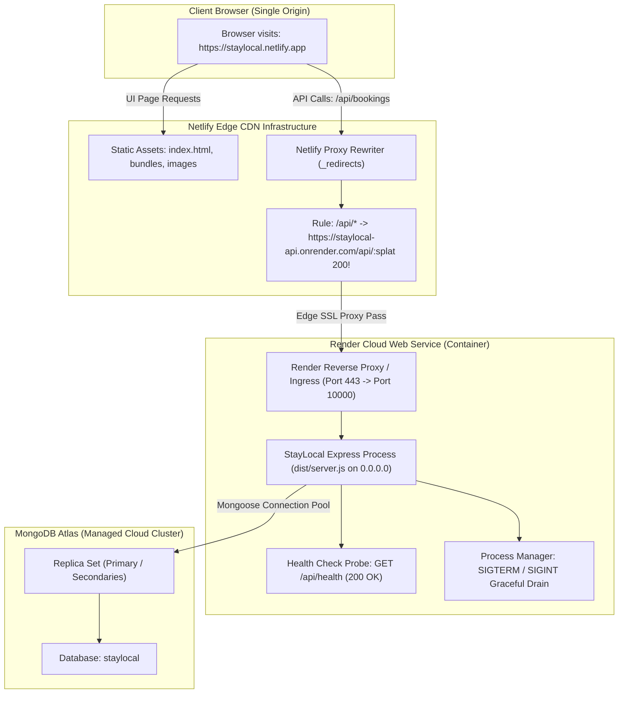
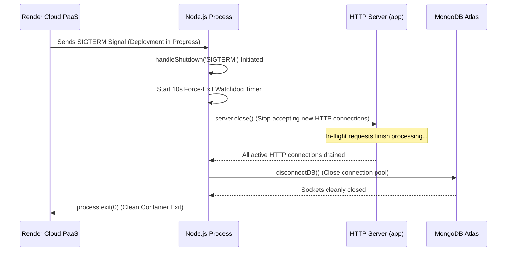

# Module 13: Deployment, Production Operations & Observability

This module provides an exhaustive operational guide to deploying, hosting, and monitoring the StayLocal backend in production. It explores the split-architecture deployment across Render and Netlify, edge proxy rewriting rules, container binding (`0.0.0.0`), graceful process termination, health probes, and production build pipelines.

---

## Architecture Diagram: Production Deployment & Proxy Topology



---

## Concept 1: The Two-Tier Split Cloud Deployment Architecture (Render + Netlify)

### 1. Concept Name
Two-Tier Split Deployment Architecture (Render PaaS + Netlify CDN Edge).

### 2. Simple Definition
A **split cloud deployment** separates static frontend assets from dynamic backend compute. The React single-page application is compiled into static HTML/JS/CSS and deployed to a global Content Delivery Network (Netlify), while the Express backend runs in a persistent, containerized server environment (Render) connected to a managed cloud database (MongoDB Atlas).

### 3. Real-World Analogy
Think of a mountain resort.
- **The Netlify CDN** is like brochures, postcards, and route maps placed in information kiosks at tourist hubs across the region (fast, replicated everywhere, instant access).
- **The Render Backend** is the central reservation desk situated at the main lodge (where phone calls are answered, credit card machines run, and the master ledger book is locked in the safe).

### 4. Why Developers Need It
1. **Edge Performance**: Static frontend files are cached within milliseconds of users worldwide across Netlify's global edge network.
2. **Cost Optimization**: Serving static files through an Express server wastes Node.js CPU and memory. Offloading static assets to Netlify frees Node.js to focus 100% of its resources on executing API queries and booking transactions.
3. **Independent Scalability**: You can redeploy the frontend 20 times a day for UI tweaks without restarting the backend Node.js process or dropping active database connections.

### 5. How StayLocal Uses It
- **Frontend**: Hosted on Netlify, building from `client/` using Vite.
- **Backend**: Hosted on Render as a Web Service running Node.js 20+, building via `npm run build` and running `node dist/server.js`.
- **Database**: Hosted on MongoDB Atlas (`staylocal` database cluster).

### 6. Actual File Location
- File: [client/public/_redirects](file:///c:/Users/HP/Downloads/Major%20Project/client/public/_redirects)
- File: [server/src/server.ts](file:///c:/Users/HP/Downloads/Major%20Project/server/src/server.ts)
- File: [server/src/config/env.ts](file:///c:/Users/HP/Downloads/Major%20Project/server/src/config/env.ts)

### 7. Code Explanation
Here is the production configuration in [client/public/_redirects](file:///c:/Users/HP/Downloads/Major%20Project/client/public/_redirects#L1-L2):

```text
/api/*  https://staylocal-api.onrender.com/api/:splat  200!
/*      /index.html                                    200
```

- **Line 1 (`/api/* ... 200!`)**: Netlify HTTP proxy rule.
  - `/api/*`: Matches any request originating from the React client starting with `/api/`.
  - `https://staylocal-api.onrender.com/api/:splat`: Rewrites the target URL to the Render backend, passing the matched subpath via `:splat`.
  - `200!`: Returns an HTTP 200 rewrite (reverse proxy) rather than an HTTP 301/302 redirect. The browser remains on the Netlify domain, and the proxying happens transparently at the edge.
- **Line 2 (`/* /index.html 200`)**: Single-Page Application (SPA) fallback. Ensures client-side routing (React Router) works when users refresh deep pages like `/stays/stay-mun-01`.

### 8. Execution Flow
1. Tourist loads `https://staylocal.netlify.app/stays/stay-mun-01`. Netlify edge serves cached HTML/JS.
2. React component calls `fetch('/api/stays/stay-mun-01/availability')`.
3. The request hits Netlify Edge CDN.
4. Netlify's reverse proxy intercepts `/api/*` and opens a secure backend connection to Render (`https://staylocal-api.onrender.com/api/stays/stay-mun-01/availability`).
5. Render receives the request, queries MongoDB Atlas, and returns JSON.
6. Netlify pipes the JSON back to the tourist's browser.

### 9. Common Mistakes
- **Using 301/302 redirects instead of 200 rewrites**: A 301 redirect forces the browser to make a visible cross-origin redirect to Render, breaking `HttpOnly` cookies and triggering CORS preflight delays. Netlify's `200!` rewrite keeps everything under the same origin.
- **Placing the SPA fallback rule first**: Putting `/* /index.html 200` before the API rewrite rule causes all API calls to return the React HTML homepage instead of JSON!

### 10. Interview Questions & Answers
**Q1: What are the primary architectural benefits of using an Edge Proxy rewrite rule (`200!`) on Netlify for API communication?**
*Answer:* 
1. **Eliminates CORS Complexity**: Because the browser sends requests to `staylocal.netlify.app/api/...`, the request is same-origin from the browser's perspective. No CORS preflight (`OPTIONS`) requests are required, saving 100–300ms on every API call.
2. **First-Party Cookie Security**: Modern browsers (Safari ITP, Brave, Chrome Privacy Sandbox) heavily restrict third-party cross-site cookies. Same-origin proxying ensures authentication cookies are treated as first-party cookies, guaranteeing rock-solid session persistence.
3. **DDoS & Latency Shielding**: Netlify's global DDoS mitigation infrastructure protects the origin Render server from direct public exposure.

**Q2: What is the purpose of `:splat` in Netlify redirects?**
*Answer:* In Netlify's redirect syntax, an asterisk wildcard (`*`) matches any remaining path segments. The `:splat` parameter in the destination URL represents the exact text captured by that wildcard. For example, if a client requests `/api/v1/stays/123?date=today`, `:splat` resolves to `v1/stays/123?date=today`, preserving the full subpath and query parameters across the proxy bridge.

### 11. Practical Exercise
Inspect [client/public/_redirects](file:///c:/Users/HP/Downloads/Major%20Project/client/public/_redirects). Confirm that the `/api/*` proxy rewrite rule appears on line 1, strictly above the `/* /index.html 200` SPA catch-all rule.

---

## Concept 2: Host Interface Binding (`0.0.0.0`) in Cloud Containers

### 1. Concept Name
Container Ingress and Host Binding (`0.0.0.0` vs. `localhost`).

### 2. Simple Definition
When an HTTP server starts, it binds to a network IP address. Binding to **`127.0.0.1` (`localhost`)** restricts connections strictly to programs running inside that same local container. Binding to **`0.0.0.0` (all IPv4 interfaces)** instructs the operating system to accept incoming network connections from any interface, allowing cloud container routers, reverse proxies, and external users to reach the Express application.

### 3. Real-World Analogy
Think of an apartment intercom system.
- Binding to `localhost` is like plugging a phone into an intercom that only reaches other rooms inside your own private apartment. No one outside the front door can buzz you.
- Binding to `0.0.0.0` is connecting your handset to the building's exterior lobby gate, allowing visitors and delivery drivers at the front entrance to ring your bell.

### 4. Why Developers Need It
A classic error when deploying Node.js apps to containerized platforms (Render, Docker, AWS ECS, Google Cloud Run) is writing `app.listen(PORT)`. In some environments, this defaults to `localhost` (`127.0.0.1`). When Render's routing proxy tries to forward incoming traffic from port 443 into the container, the connection is refused, causing deployments to hang and fail with:
`Port 10000 was not bound within 15 minutes. Build failed.`

### 5. How StayLocal Uses It
In [server/src/server.ts](file:///c:/Users/HP/Downloads/Major%20Project/server/src/server.ts#L14), StayLocal explicitly passes `'0.0.0.0'` as the host parameter:
`app.listen(env.PORT, '0.0.0.0', () => { ... })`.

### 6. Actual File Location
- File: [server/src/server.ts](file:///c:/Users/HP/Downloads/Major%20Project/server/src/server.ts)
- Line: 14

### 7. Code Explanation
Here is the server listener from [server/src/server.ts](file:///c:/Users/HP/Downloads/Major%20Project/server/src/server.ts#L14-L21):

```typescript
const server = app.listen(env.PORT, '0.0.0.0', () => {
  console.log('==================================================');
  console.log(`🌲 StayLocal Backend API running in [${env.NODE_ENV}] mode`);
  console.log(`📡 URL: http://localhost:${env.PORT}`);
  console.log(`🩺 Health: http://localhost:${env.PORT}/api/health`);
  console.log(`🌍 CORS Origin: ${env.CORS_ORIGIN}`);
  console.log('==================================================');
});
```

- **`env.PORT`**: Read dynamically from environment variables. In Render, Render automatically assigns an arbitrary internal port (often `10000`).
- **`'0.0.0.0'`**: Explicitly binds to all network interfaces. Render's load balancer can now forward ingress HTTP traffic directly to the Node.js process.

### 8. Execution Flow
1. Render container boots up.
2. Render injects `PORT=10000`.
3. `server.ts` executes `app.listen(10000, '0.0.0.0')`.
4. The Linux kernel opens a TCP listening socket on `0.0.0.0:10000`.
5. Render's port detection probe detects the listening socket immediately.
6. Render marks the deployment successful: `Service is live at https://staylocal-api.onrender.com`.

### 9. Common Mistakes
- **Hardcoding `PORT = 5000`**: Cloud platforms assign dynamic ports. If you hardcode 5000 and ignore `process.env.PORT`, the cloud proxy listening on port 10000 will never reach your app.
- **Binding to `'localhost'` in Docker**: Inside a container, `localhost` means *only inside that container*. Port forwarding from the host (`-p 5000:5000`) will fail unless the process inside binds to `0.0.0.0`.

### 10. Interview Questions & Answers
**Q1: What is the precise technical difference between listening on `127.0.0.1` and `0.0.0.0`?**
*Answer:* `127.0.0.1` is the loopback network interface. Sockets bound to `127.0.0.1` only accept TCP packets originating from within the local operating system kernel itself. `0.0.0.0` is a non-routable meta-address that designates "any IPv4 address". Binding to `0.0.0.0` instructs the network stack to listen for incoming connections on every available physical and virtual network interface (including Ethernet, Wi-Fi, Docker bridge networks, and container veth pairs).

**Q2: Why does Render or Docker require explicit `0.0.0.0` binding?**
*Answer:* In containerized architectures, the application runs inside an isolated network namespace. Traffic from the internet enters via a virtual network interface (e.g. `eth0`) created by Docker or the container orchestrator. If the Node.js process binds only to `127.0.0.1`, it ignores packets arriving on `eth0`, causing external health checks and user traffic to be rejected with `Connection Refused`.

### 11. Practical Exercise
Check line 14 in [server/src/server.ts](file:///c:/Users/HP/Downloads/Major%20Project/server/src/server.ts). Verify that `'0.0.0.0'` is explicitly passed as the second argument to `app.listen()`.

---

## Concept 3: Graceful Process Shutdown (`SIGTERM` / `SIGINT`)

### 1. Concept Name
Graceful Process Termination and Signal Trapping (`SIGTERM` / `SIGINT`).

### 2. Simple Definition
**Graceful shutdown** is the practice of intercepting operating system termination signals (`SIGTERM`, `SIGINT`), stopping the server from accepting new HTTP requests, allowing all in-flight requests and database writes to finish cleanly, closing database connection pools, and then exiting the process without data corruption.

### 3. Real-World Analogy
Imagine a busy restaurant closing for the evening.
- **Ungraceful shutdown** is flipping off the main circuit breaker at 10:00 PM sharp. Diners are plunged into pitch darkness mid-meal, cooks abandon half-fried food on hot stoves, and credit card transactions fail halfway through processing.
- **Graceful shutdown** is locking the front entrance to new guests at 10:00 PM, allowing seated diners to finish their meals and pay their bills, turning off the ovens safely, balancing the cash register, and only then locking up the building.

### 4. Why Developers Need It
When deploying new code on Render, Kubernetes, or Docker:
1. The platform spins up the new container and sends a `SIGTERM` signal to the old container.
2. If the old container terminates abruptly:
   - A tourist's booking confirmation request is severed mid-write, resulting in orphaned database records.
   - MongoDB connections are dropped without a proper TCP disconnect handshake, keeping socket allocations open on Atlas until server-side timeouts expire.
3. Graceful shutdown guarantees zero downtime deployments and protects data integrity.

### 5. How StayLocal Uses It
In [server/src/server.ts](file:///c:/Users/HP/Downloads/Major%20Project/server/src/server.ts#L23-L40), StayLocal attaches signal listeners for `SIGTERM` (sent by Render during deploys or restarts) and `SIGINT` (Ctrl+C in local terminals). It closes the HTTP server, disconnects Mongoose, and includes a 10-second timeout watchdog.

### 6. Actual File Location
- File: [server/src/server.ts](file:///c:/Users/HP/Downloads/Major%20Project/server/src/server.ts)
- Lines: 23–40

### 7. Code Explanation
Here is the shutdown sequence from [server/src/server.ts](file:///c:/Users/HP/Downloads/Major%20Project/server/src/server.ts#L23-L40):

```typescript
// Graceful Shutdown
const handleShutdown = async (signal: string) => {
  console.log(`\n[Shutdown] Received ${signal}. Closing StayLocal server gracefully...`);
  server.close(async () => {
    console.log('[Shutdown] HTTP server closed.');
    await disconnectDB();
    process.exit(0);
  });

  // Force exit after 10s timeout
  setTimeout(() => {
    console.error('[Shutdown] Forced termination after timeout.');
    process.exit(1);
  }, 10000);
};

process.on('SIGTERM', () => handleShutdown('SIGTERM'));
process.on('SIGINT', () => handleShutdown('SIGINT'));
```

- **Line 24 (`handleShutdown`)**: Master cleanup closure receiving the trigger signal name.
- **Line 26 (`server.close(...)`)**: Instructs Express to reject new incoming connections while allowing active in-flight HTTP requests to complete normally. Once the last client disconnects, the callback fires.
- **Line 28 (`await disconnectDB()`)**: Invokes `mongoose.disconnect()`, cleanly flushing any pending write buffers and releasing replica set sockets on MongoDB Atlas.
- **Line 29 (`process.exit(0)`)**: Exits with return code 0, signaling a clean, successful shutdown to the operating system.
- **Lines 32–36 (`setTimeout(..., 10000)`)**: Critical watchdog timer. If an in-flight request or long-running database query hangs indefinitely, this timer forces `process.exit(1)` after 10 seconds, preventing zombie containers from blocking cloud redeployments.

### 8. Execution Flow


### 9. Common Mistakes
- **Exiting immediately on signal**: Writing `process.on('SIGTERM', () => process.exit(0))` kills in-flight requests instantly, corrupting database transactions.
- **Omitting the watchdog timeout**: If an active SSE stream or hanging query keeps a socket open forever, `server.close()` will never fire its callback, causing the container to hang until the cloud host kills it with `SIGKILL`.

### 10. Interview Questions & Answers
**Q1: What is the difference between `SIGTERM` and `SIGKILL` in Unix operating systems?**
*Answer:* `SIGTERM` (Signal 15) is the standard termination signal sent by process managers to request a process to stop. Because it can be caught, handled, or ignored by application code, it gives the application a chance to perform cleanup tasks (closing file handles, finishing database queries). `SIGKILL` (Signal 9) cannot be caught or handled; the operating system kernel immediately halts the process and reclaims its memory, giving the application zero opportunity to execute cleanup logic.

**Q2: Why must `disconnectDB()` be executed after `server.close()` rather than before?**
*Answer:* `server.close()` allows in-flight requests that are already inside the Express pipeline to finish executing. Those in-flight requests frequently need to read or write data to MongoDB to complete their operations (e.g. saving a final booking record). If you disconnect the database first, all currently running in-flight requests will immediately crash with database connection errors.

### 11. Practical Exercise
Review lines 23–40 of [server/src/server.ts](file:///c:/Users/HP/Downloads/Major%20Project/server/src/server.ts). Trace the sequence: Identify why `await disconnectDB()` is placed inside the `server.close()` callback rather than before it.

---

## Concept 4: Health Probes and Database Status Inspection (`/api/health`)

### 1. Concept Name
Production Health Probes, Readiness vs. Liveness, and Dynamic Database Verification.

### 2. Simple Definition
A **health probe** is an automated HTTP endpoint (typically `/api/health`) that monitoring services and load balancers poll periodically to determine whether an application container is healthy and ready to receive real user traffic.

### 3. Real-World Analogy
Think of a pilot's pre-flight checklist. Before taking off, the pilot checks engine oil pressure, hydraulic fluid, and radio communication. If the radio works but both engines have zero oil pressure, the pilot reports "Not Ready for Departure", and the control tower holds the flight at the gate rather than sending passengers down the runway.

### 4. Why Developers Need It
1. **Preventing Routing to Dead Containers**: During deployment, a container might boot its Node.js process in 1 second, but take 4 seconds to connect to MongoDB Atlas. If a load balancer starts routing user traffic before the database is connected, tourists will see HTTP 500 errors.
2. **Automated Recovery**: If MongoDB Atlas undergoes an automated cluster failover and the backend cannot reconnect, the health probe reports failure, prompting the cloud platform to reboot the container.
3. **Database Name Verification**: Ensures the production backend is connected to the intended database (`staylocal`) rather than an accidental test database.

### 5. How StayLocal Uses It
StayLocal exposes `GET /api/health` in [server/src/app.ts](file:///c:/Users/HP/Downloads/Major%20Project/server/src/app.ts#L67-L77). It evaluates `getDatabaseStatus()` and `getConnectedDatabaseName()` from [server/src/config/db.ts](file:///c:/Users/HP/Downloads/Major%20Project/server/src/config/db.ts), returning uptime, database status, and environment mode.

### 6. Actual File Location
- File: [server/src/app.ts](file:///c:/Users/HP/Downloads/Major%20Project/server/src/app.ts) (Lines 67–77)
- File: [server/src/config/db.ts](file:///c:/Users/HP/Downloads/Major%20Project/server/src/config/db.ts) (Lines 15–24, 31–45)

### 7. Code Explanation
Here is the health check endpoint from [server/src/app.ts](file:///c:/Users/HP/Downloads/Major%20Project/server/src/app.ts#L67-L77):

```typescript
app.get('/api/health', (_req: Request, res: Response) => {
  const dbStatus = getDatabaseStatus();
  const dbName = getConnectedDatabaseName();

  res.status(200).json({
    status: 'healthy',
    timestamp: new Date().toISOString(),
    uptime: process.uptime(),
    environment: env.NODE_ENV,
    database: {
      status: dbStatus,
      name: dbName || null,
    },
  });
});
```

And the database state helpers from [server/src/config/db.ts](file:///c:/Users/HP/Downloads/Major%20Project/server/src/config/db.ts#L15-L24):

```typescript
export function isDatabaseConnected(): boolean {
  return mongoose.connection.readyState === 1;
}

export function getConnectedDatabaseName(): string | undefined {
  if (mongoose.connection.readyState === 1) {
    return mongoose.connection.name; // Returns "staylocal"
  }
  return undefined;
}
```

- **`process.uptime()`**: Returns the number of seconds the Node.js process has been continuously running.
- **`mongoose.connection.readyState === 1`**: Evaluates whether the connection pool is active and ready.
- **`mongoose.connection.name`**: Returns the exact database name resolved by Mongoose (`staylocal`), verifying that the backend is connected to the right database cluster.

### 8. Execution Flow
1. Render's health monitoring agent sends `GET /api/health` every 30 seconds.
2. Express calls `getDatabaseStatus()`.
3. `mongoose.connection.readyState` evaluates to `1`.
4. Endpoint responds with HTTP 200:
   ```json
   {
     "status": "healthy",
     "timestamp": "2026-11-24T12:00:00.000Z",
     "uptime": 14205.82,
     "environment": "production",
     "database": {
       "status": "connected",
       "name": "staylocal"
     }
   }
   ```
5. Render marks container status as green in the cloud dashboard.

### 9. Common Mistakes
- **Putting expensive queries in health checks**: Writing `await StayModel.find()` inside `/api/health`. If health checks run every 5 seconds across 10 containers, running heavy database queries wastes database IOPS and CPU. Checking `mongoose.connection.readyState` is an in-memory integer check that takes 0.001 milliseconds.
- **Returning HTTP 200 when the database is down in production**: If the database is disconnected, returning 200 tricks load balancers into continuing to send traffic to a crippled container.

### 10. Interview Questions & Answers
**Q1: What is the architectural difference between a Liveness Probe and a Readiness Probe in container orchestration?**
*Answer:* 
- **Liveness Probe**: Asks "Is the process alive and running?". If it fails (e.g. process is deadlocked or in an infinite loop), the orchestrator immediately restarts the container.
- **Readiness Probe**: Asks "Is the application ready to handle incoming user requests?". If it fails (e.g. database connection is warming up or temporarily lost), the orchestrator stops routing user traffic to this container without killing it, resuming traffic once the probe succeeds.

**Q2: Why should health endpoints never require authentication headers?**
*Answer:* Health probes are queried automatically by external cloud infrastructure—such as Render health checkers, AWS Application Load Balancers, or Kubernetes kubelet daemons. These infrastructure agents do not have user credentials or JWT auth cookies. Requiring authentication on `/api/health` causes probes to fail with HTTP 401 Unauthorized, leading cloud orchestrators to mistakenly mark healthy containers as dead.

### 11. Practical Exercise
Examine lines 67–77 of [server/src/app.ts](file:///c:/Users/HP/Downloads/Major%20Project/server/src/app.ts). Notice how the health check safely exposes operational status (`uptime`, `environment`, `database.status`, `database.name`) without revealing sensitive secrets, connection URIs, or internal filesystem paths.

---

## Summary of Production Operations

| Operational Domain | Mechanism | Primary File | Key Production Benefit |
| :--- | :--- | :--- | :--- |
| **Split Architecture** | Netlify Edge Proxy (`200!`) | `_redirects` | Same-origin requests; zero CORS preflight overhead |
| **Container Binding** | Ingress on `0.0.0.0` | `server.ts` | Allows Render routing proxy to reach Node.js process |
| **Graceful Shutdown** | `SIGTERM` / `SIGINT` trapping | `server.ts` | Zero-downtime deploys; drains active HTTP requests |
| **Connection Safety** | 10s watchdog timeout | `server.ts` | Prevents hanging sockets from creating zombie processes |
| **Health Monitoring** | In-memory `readyState` probe | `app.ts` | Sub-millisecond container health verification |
| **Atlas Verification** | `mongoose.connection.name` | `config/db.ts` | Guarantees connection to correct database (`staylocal`) |