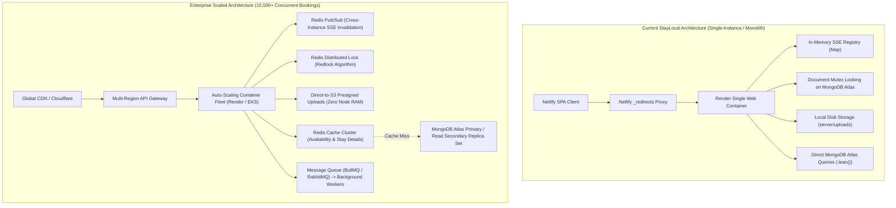
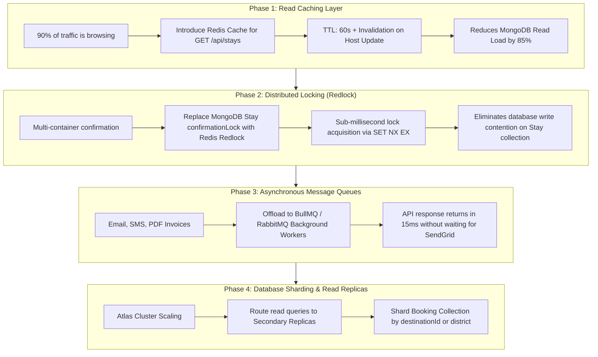

# Module 14: Advanced Backend Concepts & Scalability Architecture

This module bridges the current implementation of StayLocal with enterprise-grade distributed systems design. It explores how SOLID principles are realized in the codebase, catalogs implemented vs. partially implemented vs. absent architectural patterns, and provides an actionable blueprint for scaling the Himalayan eco-tourism platform from 10 to 10,000 concurrent reservations.

---

## Architecture Diagram: Current Architecture vs. Enterprise Scaled Horizon



---

## Concept 1: SOLID Principles Applied to Modern Node.js & TypeScript

### 1. Concept Name
SOLID Object-Oriented and Modular Architectural Principles in StayLocal.

### 2. Simple Definition
**SOLID** is an acronym for five foundational software engineering design principles that make software architectures more understandable, flexible, and maintainable as codebases grow in complexity:
- **S**: Single Responsibility Principle (SRP)
- **O**: Open/Closed Principle (OCP)
- **L**: Liskov Substitution Principle (LSP)
- **I**: Interface Segregation Principle (ISP)
- **D**: Dependency Inversion Principle (DIP)

### 3. Real-World Analogy
Think of a professional mountain expedition team ascending Nanda Devi.
- You don't have one person who carries the tent, cooks the food, fixes the climbing ropes, and performs altitude medical surgery (violates Single Responsibility).
- You have a certified Lead Mountaineer, a Dedicated High-Altitude Medic, and an Expedition Logistics Coordinator. Each expert has a distinct role and standard equipment interfaces, allowing the team to operate efficiently in extreme environments.

### 4. Why Developers Need It
Without architectural principles, Node.js applications degrade into "Spaghetti Code":
1. Routes contain 500 lines mixing database queries, payment math, validation checks, and HTML formatting.
2. Modifying a booking calculation breaks user authentication.
3. Adding a new user role requires editing 15 different files.
4. Testing individual components becomes impossible without mocking the entire universe.

### 5. How StayLocal Uses It
StayLocal applies all five SOLID principles across its layers:
- **SRP (Single Responsibility)**: Controllers handle HTTP transport; Services handle pure business logic; Models define data schemas; Validators handle data sanitization.
- **OCP (Open/Closed)**: Custom error handling via `AppError` is open for extension (subclasses like `NotFoundError`, `ConflictError`) but closed for modification (the core `errorHandler` middleware requires no changes when new error types are added).
- **LSP (Liskov Substitution)**: Any subclass of `AppError` can be passed to `next(err)` and handled identically by the error dispatcher without breaking type contracts.
- **ISP (Interface Segregation)**: Rather than one massive `User` interface, StayLocal defines granular contracts: `AuthUser` (for sessions), `UserDoc` (for Mongoose), and `UserProfileResponse` (for client consumption).
- **DIP (Dependency Inversion)**: The Express application factory `createApp()` decouples router setup from physical environment variables, allowing test harnesses to inject mock databases and configurations.

### 6. Actual File Location
- File: [server/src/utils/errors.ts](file:///c:/Users/HP/Downloads/Major%20Project/server/src/utils/errors.ts) (OCP & LSP)
- File: [server/src/services/admin-assignment.service.ts](file:///c:/Users/HP/Downloads/Major%20Project/server/src/services/admin-assignment.service.ts) (SRP)
- File: [server/src/types/index.ts](file:///c:/Users/HP/Downloads/Major%20Project/server/src/types/index.ts) (ISP)
- File: [server/src/app.ts](file:///c:/Users/HP/Downloads/Major%20Project/server/src/app.ts) (DIP)

### 7. Code Explanation
Here is the Liskov Substitution and Open/Closed implementation from [server/src/utils/errors.ts](file:///c:/Users/HP/Downloads/Major%20Project/server/src/utils/errors.ts#L1-L33):

```typescript
// Open for extension: Base AppError encapsulates operational error contracts
export class AppError extends Error {
  public readonly statusCode: number;
  public readonly code: string;
  public readonly isOperational: boolean;
  public readonly details?: unknown;

  constructor(message: string, statusCode = 500, code = 'INTERNAL_SERVER_ERROR', details?: unknown) {
    super(message);
    this.name = this.constructor.name;
    this.statusCode = statusCode;
    this.code = code;
    this.isOperational = true;
    this.details = details;
    Error.captureStackTrace(this, this.constructor);
  }
}

// Subclasses extend behavior without altering AppError
export class NotFoundError extends AppError {
  constructor(message = 'Resource not found', details?: unknown) {
    super(message, 404, 'NOT_FOUND', details);
  }
}

export class ConflictError extends AppError {
  constructor(message = 'Resource conflict or overlapping reservation', details?: unknown) {
    super(message, 409, 'CONFLICT', details);
  }
}
```

- **Open/Closed Principle (OCP)**: When developers created `ConflictError` for booking race conditions, they did not have to alter a single line of `AppError` or rewrite the `errorHandler` middleware. They simply extended `AppError`.
- **Liskov Substitution Principle (LSP)**: In `errorHandler.ts`:
  ```typescript
  if (err instanceof AppError) {
    res.status(err.statusCode).json({ success: false, error: { code: err.code, message: err.message } });
  }
  ```
  Whether `err` is a `NotFoundError`, `ConflictError`, or `DatabaseError`, it can be substituted wherever `AppError` is expected without causing type errors or logic breaks.

### 8. Execution Flow
1. Developer adds a new feature (e.g. Guide Booking system).
2. Developer needs a specialized domain error: creates `export class SlotUnavailableError extends AppError { ... }`.
3. Guide service throws `new SlotUnavailableError()`.
4. Downstream error handler automatically extracts status code and error code without modifying core middleware.
5. SOLID compliance preserves system stability.

### 9. Common Mistakes
- **Violating SRP in Controllers**: Writing database queries, password hashing, and PDF generation directly inside route handlers.
- **Fat Interfaces**: Creating a single 80-property `IHomestay` interface that includes administrative audit logs, private host phone numbers, public amenities, and pricing history, forcing every public endpoint to handle private properties.

### 10. Interview Questions & Answers
**Q1: How does the Separation of Concerns between Controllers and Services satisfy the Single Responsibility Principle?**
*Answer:* In StayLocal, an Express **Controller** has one responsibility: HTTP protocol orchestration. It parses incoming request parameters, triggers validation, invokes business services, and formats HTTP response codes. A **Service** has one responsibility: business domain logic (calculating nightly rates, checking bed inventory, executing mutex locks). If StayLocal transitions from an Express REST API to a tRPC or GraphQL API tomorrow, the service layer remains 100% untouched because it contains zero references to Express `Request` or `Response` objects.

**Q2: Give an example of how the Interface Segregation Principle (ISP) is enforced in StayLocal's type system.**
*Answer:* Rather than defining a single monolithic `User` interface, StayLocal splits user contracts by operational context:
- `AuthUser`: Contains only identity tokens needed for request authorization (`id`, `email`, `role`, `fullName`).
- `UserDoc`: The internal Mongoose document containing the cryptographic `password` hash and Mongoose change-tracking flags.
- `UserProfileResponse`: The client-facing payload where passwords and database ObjectIds are strictly omitted.
Clients and middleware only depend on the specific slice of user data they require.

### 11. Practical Exercise
Inspect [server/src/app.ts](file:///c:/Users/HP/Downloads/Major%20Project/server/src/app.ts). Notice how `createApp()` is a factory function that constructs and configures the Express application independently of `server.ts`, allowing unit tests to instantiate isolated app instances without binding to network ports.

---

## Concept 2: Architectural Gap Analysis: Implemented vs. Partially Implemented vs. Absent Patterns

### 1. Concept Name
Architectural Maturity Analysis: Production Inventory and Gap Identification.

### 2. Simple Definition
A professional software engineering evaluation that classifies backend patterns into three distinct categories:
1. **Fully Implemented**: Battle-tested patterns fully realized in production code.
2. **Partially Implemented**: Patterns that work effectively for current traffic volumes but have architectural constraints under extreme horizontal scaling.
3. **Absent Patterns**: Enterprise patterns intentionally omitted or deferred to avoid premature over-engineering.

### 3. Real-World Analogy
Think of a rugged mountain vehicle.
- **Implemented**: Four-wheel drive, high-clearance suspension, and disc brakes (essential for rough terrain).
- **Partially Implemented**: An auxiliary 20-liter fuel canister strapped to the roof (great for a weekend trip, but insufficient for a 3,000-mile cross-continental expedition).
- **Absent**: A dual-rotor helicopter winch (not installed because you're driving on mountain roads, not flying over glaciers).

### 4. Why Developers Need It
Senior engineers must be brutally honest about system capabilities:
- Claiming a system is "infinitely scalable" when it uses an in-memory client map is a critical architectural blind spot.
- Knowing what is *absent* prevents teams from solving problems they don't yet have (avoiding premature microservices or Kafka clusters when standard MongoDB queries are under 5ms).

### 5. How StayLocal Uses It
The table below documents the exact state of architectural patterns in the StayLocal codebase:

| Architectural Pattern | Status | Implementation Details in StayLocal | Scalability Limitation / Next Step |
| :--- | :--- | :--- | :--- |
| **Server-Sent Events (SSE)** | **Fully Implemented** | Native HTTP streaming in `realtime.service.ts` | Complete for client push; no WebSockets needed |
| **Document Mutex Locking** | **Fully Implemented** | Atomic `findOneAndUpdate` with 5s TTL lease | Perfect for single/multi-container Atlas setups |
| **Cryptographic Hashing** | **Fully Implemented** | Bcrypt with 10 salt rounds in pre-save hooks | Air-tight security; zero plain text passwords |
| **Zod Schema Validation** | **Fully Implemented** | Preprocessing, coercion, and middleware | Strips unapproved mass-assignment properties |
| **In-Memory Pub/Sub Map** | **Partially Implemented** | `Map<stayId, Set<ClientConnection>>` in RAM | Works on 1 server; requires Redis Pub/Sub for clusters |
| **Local Disk File Storage** | **Partially Implemented** | Saves to `server/uploads/` via Node Buffer | Local disk is ephemeral on container hosts (Render) |
| **Distributed Redis Cache** | **Absent** | Not implemented (queries hit Atlas with `.lean()`) | Add Redis for heavy read traffic (catalog browsing) |
| **Message Queue / Workers** | **Absent** | Not implemented (synchronous API execution) | Add BullMQ / RabbitMQ for async email & reports |
| **Microservices Architecture**| **Absent** | Deliberately Monolithic Express application | Modular monolith is optimal for current scale |

### 6. Actual File Location
- File: [server/src/services/realtime.service.ts](file:///c:/Users/HP/Downloads/Major%20Project/server/src/services/realtime.service.ts) (Partially Implemented Pub/Sub)
- File: [server/src/services/host-listing.service.ts](file:///c:/Users/HP/Downloads/Major%20Project/server/src/services/host-listing.service.ts) (Partially Implemented Storage)

### 7. Code Explanation
Here is the in-memory Pub/Sub registry in [server/src/services/realtime.service.ts](file:///c:/Users/HP/Downloads/Major%20Project/server/src/services/realtime.service.ts#L9-L11):

```typescript
class RealtimeService {
  private clients: Map<string, Set<ClientConnection>> = new Map();
  // ...
}
```

- **Why it is Partially Implemented**: This `Map` resides exclusively within the local V8 heap of a single Node.js process.
- **The Scaling Wall**: If StayLocal scales to 3 Render containers behind a round-robin load balancer:
  - Tourist A connects to Container 1.
  - Host confirms a booking on Container 2.
  - Container 2 broadcasts to its local `Map`, which is empty! Tourist A never receives the real-time SSE update.
- **The Solution**: Replace the local JavaScript `Map` broadcast with a **Redis Pub/Sub** channel (`redisClient.publish('stay-updates', stayId)`). Every container subscribes to Redis and pushes updates to its locally connected SSE sockets.

### 8. Execution Flow
1. Architect reviews platform roadmap.
2. Identifies that Render web containers have ephemeral filesystems (files saved to `server/uploads` disappear whenever the container redeploys or restarts).
3. Classifies local disk uploads as **Partially Implemented**.
4. Formulates migration plan to move from `fs.writeFileSync()` to Amazon S3 or Google Cloud Storage presigned URLs.

### 9. Common Mistakes
- **Confusing local disk with persistent cloud storage**: Assuming files saved with `fs.writeFileSync('uploads/...')` on Render or Heroku will persist permanently. Containers have ephemeral filesystems; all uploaded files are wiped on every code deployment!
- **Premature Microservice Decomposition**: Splitting a 15-file Express monolith into 6 separate microservices before achieving product-market fit, introducing distributed transaction overhead and network latency.

### 10. Interview Questions & Answers
**Q1: Why is storing uploaded files on the local container filesystem considered a "Partially Implemented" pattern in modern cloud hosting?**
*Answer:* Modern cloud hosting platforms (like Render, Heroku, AWS Fargate, and Kubernetes pods) utilize **ephemeral filesystems**. Whenever a new deployment occurs, an autoscaling event triggers, or a container restarts, the old container is destroyed and replaced with a fresh Docker image. Any files written to `server/uploads/` on the local disk are permanently lost. In production, binary assets must be stored in durable object storage services (like AWS S3, Google Cloud Storage, or Cloudflare R2).

**Q2: How does a Redis Pub/Sub layer resolve horizontal scaling limitations for Server-Sent Events?**
*Answer:* In a multi-server cluster, clients are distributed across different backend instances. When an event occurs on Server A, Server A publishes a message to a shared Redis channel: `redis.publish('stay:availability', JSON.stringify({ stayId }))`. Because all backend servers (Server A, Server B, Server C) subscribe to that Redis channel, every server receives the message and pushes the event down to its own locally connected SSE clients. This decouples the real-time push mechanism from server instance boundaries.

### 11. Practical Exercise
Examine [server/src/services/host-listing.service.ts](file:///c:/Users/HP/Downloads/Major%20Project/server/src/services/host-listing.service.ts#L345-L352). Notice how `uploadDir` writes to the local machine directory. Consider how replacing lines 367–369 with an S3 `PutObjectCommand` would make the storage tier completely stateless.

---

## Concept 3: The Roadmap from 10 to 10,000 Concurrent Himalayan Reservations

### 1. Concept Name
High-Throughput Scaling Roadmap: Caching, Distributed Locks, and Sharding.

### 2. Simple Definition
A strategic engineering blueprint that outlines the specific infrastructural and architectural transformations required to scale a reservation platform by orders of magnitude without database degradation or race conditions.

### 3. Real-World Analogy
Think of a single Himalayan trail bridge made of wooden planks.
- At 10 hikers a day, the wooden footbridge works flawlessly.
- At 10,000 travelers an hour (pilgrims and tourists during peak festival season), the wooden bridge would collapse. You must construct a multi-lane steel cable suspension bridge with dedicated pedestrian lanes, vehicle bypass tunnels, and toll gates.

### 4. Why Developers Need It
Scaling is not about "buying a bigger server" (Vertical Scaling). Vertical scaling reaches hardware limits and becomes exponentially expensive. Sustainable scaling requires **Horizontal Scaling** (adding more stateless containers) coupled with **Caching** and **Distributed Synchronization**.

### 5. How StayLocal Can Evolve
To scale StayLocal to 10,000 concurrent reservations, the platform follows a 4-phase evolutionary roadmap:



### 6. Architectural Details

#### Phase 1: Redis Caching for Read Queries
- **Problem**: 10,000 tourists searching for stays in "Munsiyari" or "Almora" execute 10,000 identical MongoDB `$or` queries.
- **Solution**: Cache the serialized homestay catalog in Redis under key `catalog:destination:munsiyari`.
- **Cache Aside Pattern**:
  ```typescript
  const cached = await redis.get(cacheKey);
  if (cached) return JSON.parse(cached);
  const stays = await StayModel.find(query).lean();
  await redis.set(cacheKey, JSON.stringify(stays), 'EX', 120);
  return stays;
  ```

#### Phase 2: Distributed Locking with Redlock
- **Problem**: MongoDB document mutex locking (`StayModel.findOneAndUpdate`) requires disk I/O and locks the BSON document in WiredTiger memory. Under thousands of concurrent requests, lock contention degrades database throughput.
- **Solution**: Use Redis distributed locks via `SET lock:stay:stay-mun-01 <uuid> NX PX 5000`. Redis executes in-memory with sub-millisecond latency, handling 100,000 lock checks per second.

#### Phase 3: Direct-to-Storage Presigned Uploads
- **Problem**: Large Base64 payloads (15MB) sent through Express consume significant Node.js heap memory, triggering Garbage Collection pauses.
- **Solution**: The client requests a Presigned S3 Upload URL:
  1. Client calls `POST /api/uploads/presigned-url` with `{ fileName, fileType }`.
  2. Server generates an authenticated, temporary S3 PUT URL using AWS SDK.
  3. Client uploads the raw binary file directly to Amazon S3 via `fetch(presignedUrl, { method: 'PUT', body: file })`.
  4. Node.js handles zero file bytes, reducing server RAM usage to near zero.

#### Phase 4: Database Sharding Strategy
- **Problem**: A single MongoDB primary replica set cannot handle writes for millions of global tourist bookings.
- **Solution**: Shard the `bookings` collection using a compound shard key: `{ stayDistrict: 1, stayId: 1 }`. Queries targeting a specific Himalayan district (e.g., Pithoragarh, Chamoli, Nainital) are routed directly to the specific shard hosting that geographical data.

---

## Summary of Enterprise Architectural Concepts

| Architectural Vector | Current StayLocal Implementation | Enterprise Scaled Implementation | Benefit |
| :--- | :--- | :--- | :--- |
| **Real-time Push** | Local In-Memory SSE `Map` | Redis Pub/Sub + SSE Cluster | Instant notifications across auto-scaled fleets |
| **Concurrency Lock**| MongoDB Atlas Document TTL Lock | Redis Redlock (`SET NX PX`) | Sub-millisecond locks; zero database write latching |
| **File Storage** | Ephemeral Server Disk (`Buffer.from`) | Amazon S3 / R2 Presigned URLs | Durable cloud storage; zero server RAM usage |
| **Catalog Queries** | Direct MongoDB `.lean()` | Redis Cache-Aside Layer | Sub-5ms catalog browsing; 90% DB load reduction |
| **Background Tasks**| Synchronous in API thread | BullMQ / Redis Background Workers | Decouples third-party email/SMS latency from API |
| **Database Topology**| Single Atlas Replica Set | Sharded Cluster by District/Region | Horizontally scales writes across independent shards |